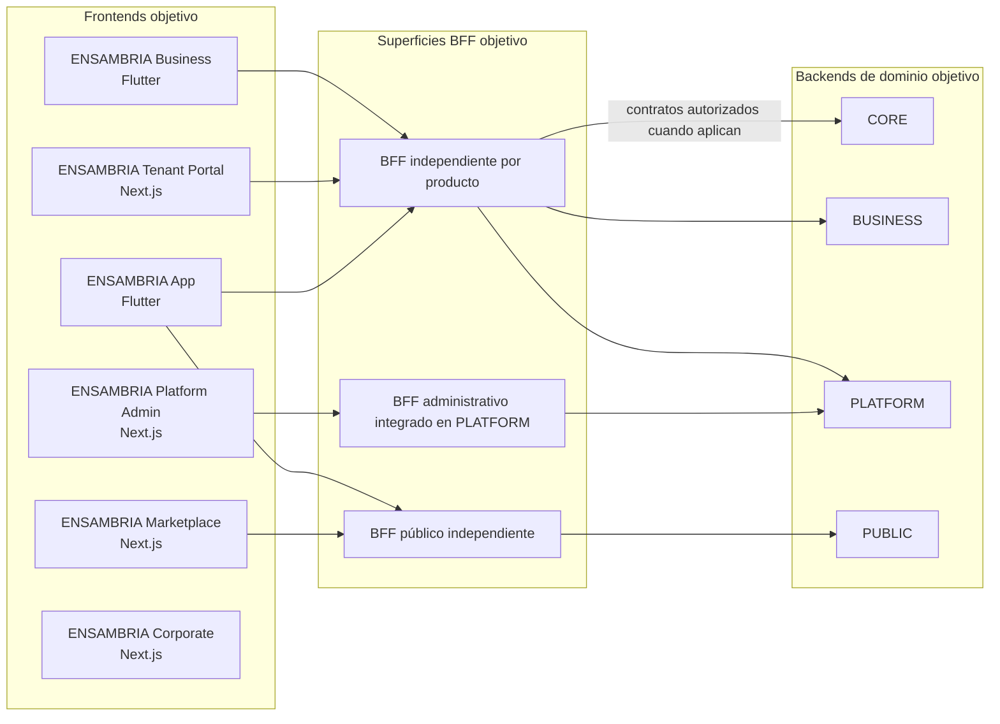

# ENSAMBRIA

ENSAMBRIA es una plataforma tecnológica compartida para productos SaaS comerciales independientes. Beauty & Wellness es el producto funcional inicial; los productos futuros siguen siendo horizonte de diseño. **El repositorio contiene actualmente documentación de producto y arquitectura; no acredita backends, frontends ni servicios funcionales.**


[Requisitos](docs/requerimiento.md) · [Roadmap](ROADMAP.md) · [Contrato de arquitectura](ARCHITECTURE_RULES.md) · [Modelo de dominios](docs/arquitectura-dominios.md) · [Instrucciones para agentes](AGENTS.md)

## Propósito y alcance

La plataforma permite diseñar productos que reúnan operaciones de establecimientos independientes y cadenas: reservas, gestión del negocio, clientes, personal, inventario, pagos, comercio y descubrimiento. El producto funcional inicial se orienta a belleza, estética y bienestar. El alcance y la secuencia son los definidos en el requerimiento; se consideran objetivos de producto, no capacidades disponibles.

Beauty & Wellness agrupa inicialmente barberías, peluquerías, salones de belleza, centros de uñas y estética, spas, bienestar y otros negocios afines; cada subtipo no genera por sí mismo un producto o backend distinto. Otras industrias son horizonte y requieren decisión y planificación propias. La arquitectura también prepara capacidades multi-tenant, multi-sucursal, internacionalización, reglas por dominio, eventos, auditoría, APIs, webhooks y extensiones. Su alcance y secuencia están en la [matriz de capacidades transversales](docs/requerimiento.md#capacidades-tecnológicas-transversales-definición-desde-fase-0) y el [modelo de dominios](docs/arquitectura-dominios.md).

## Características previstas

Las siguientes son capacidades descritas en el alcance del producto; **no indican que ya estén implementadas**:

| Capacidad | Alcance previsto |
|---|---|
| Verticales | Barberías, peluquerías, salones de belleza, uñas, estética, spas, bienestar, maquillaje y tratamientos capilares. |
| Reservas y recursos | Agenda y coordinación de disponibilidad, reservas y recursos del establecimiento. |
| Operación del negocio | Servicios, catálogo, horarios, workforce, sucursales e inventario. |
| Clientes, marketing y fidelización | CRM, membresías comerciales, campañas y capacidades de relación con clientes. |
| Comercio y pagos | Commerce, pedidos y flujos financieros con ownership separado por dominio. |
| Descubrimiento | Directorio y Marketplace con proyecciones públicas autorizadas y atribución. |
| Gestión de plataforma | Catálogo de productos, tenants comerciales, planes y suscripciones SaaS. |
| Capacidades transversales | Aislamiento tenant/sucursal, soporte regional y multiidioma, reglas de dominio, eventos durables, auditoría, API pública, webhooks y extensiones controladas. |

El diseño debe servir a negocios independientes y a cadenas, sin transferir reglas entre backends ni presentar integraciones futuras como disponibles. ENSAMBRIA define cuatro backends de dominio y experiencias frontend por producto; el catálogo comercial pertenece a PLATFORM, la asociación técnica tenant–producto a CORE, las reglas operativas a BUSINESS y las proyecciones públicas a PUBLIC. El alcance, ownership y secuencia por fases están en [docs/requerimiento.md](docs/requerimiento.md), [ARCHITECTURE_RULES.md](ARCHITECTURE_RULES.md) y el [modelo de dominios](docs/arquitectura-dominios.md).

## Estado actual

- **Documentación y arquitectura:** presentes en el repositorio.
- **Aplicación funcional:** no se encontraron implementaciones de los backends ni frontends descritos.
- **Ejecución y pruebas de la aplicación:** no hay comandos verificables porque aún no hay targets ejecutables.
- **Integración continua:** el workflow `.github/workflows/repository-quality.yml` disponible en esta rama ejecuta la validación estructural de Skills, perfiles y controles estáticos de gobierno. Un resultado `repository-quality` satisfactorio no comprueba que VS Code/Copilot haya cargado o ejecutado agentes/Skills, ni valida semánticamente ADR, ownership, matrices, aceptación de Fase 0 o requisitos legales. Los resultados remotos corresponden al SHA exacto de cada ejecución; no se presentan como validación de producto.
- **Repositorio:** GitHub informa que el repositorio es público. El contenido sigue siendo propietario; la visibilidad pública no concede derechos de uso.

La presencia de requisitos, contratos o diseños no significa que la funcionalidad esté implementada, probada o desplegada.

## Arquitectura objetivo

El diseño define cuatro backends como monolitos modulares con ownership de dominio y despliegues independientes, y seis proyectos de interfaz. ENSAMBRIA Business y Tenant Portal son clientes distintos de las mismas operaciones empresariales; no duplican reglas ni permisos. El siguiente diagrama representa la topología objetivo, no servicios existentes:



Los BFF adaptan contratos; no son propietarios de reglas de negocio. CORE no se expone directamente a los frontends. La comunicación entre backends se realiza mediante contratos autorizados y solo cuando un caso de uso lo requiere. Los límites y responsabilidades completos están en [ARCHITECTURE_RULES.md](ARCHITECTURE_RULES.md).
Corporate puede publicar contenido estático; cualquier contenido dinámico requiere una superficie pública autorizada y no implica acceso directo a PLATFORM.

| Backend objetivo | Responsabilidad principal |
|---|---|
| CORE | Identidad, contexto de seguridad y tenancy–producto, reservas y operaciones financieras centrales. |
| BUSINESS | Operación de establecimientos, workforce, catálogo, clientes, inventario y Commerce. |
| PLATFORM | Catálogo de productos, administración global y relación comercial SaaS con tenants. |
| PUBLIC | Directorio, Discovery/Marketplace y proyecciones expresamente autorizadas. |

| Aplicación objetivo | Tecnología y uso previsto |
|---|---|
| ENSAMBRIA Business | Flutter + Dart para operación empresarial en Android/iOS/tablets y Windows/Linux/macOS. |
| ENSAMBRIA Tenant Portal | React + TypeScript + Next.js para administrar desde navegador los mismos tenants/capacidades que Business. |
| ENSAMBRIA App | Flutter + Dart para clientes finales en Android/iOS/tablets; no es una aplicación administrativa. |
| ENSAMBRIA Marketplace | React + TypeScript + Next.js para descubrimiento público autorizado. |
| ENSAMBRIA Platform Admin | React + TypeScript + Next.js para administración global privada. |
| ENSAMBRIA Corporate | React + TypeScript + Next.js para contenido institucional público. |

## Tecnologías

Las tecnologías de los badges ya están **definidas para la arquitectura**; los badges no afirman que estén instaladas o en operación. La [sección 14 del requerimiento](docs/requerimiento.md#14-arquitectura-y-tecnologías) establece:

- **Backend:** Rust como lenguaje principal. Tokio, Axum, SQLx, Serde, Tonic, OpenTelemetry y Tracing son dependencias candidatas sujetas a evaluación.
- **Persistencia y mensajería:** PostgreSQL como base principal; Redis exclusivamente como caché con TTL; NATS Core para fan-out realtime efímero y NATS JetStream con Outbox para eventos durables.
- **Web:** Next.js, TypeScript estricto y Tailwind CSS.
- **Aplicaciones Flutter:** Flutter + Dart para Business y App; Business incluye destinos de escritorio Windows/Linux/macOS.
- **Aplicaciones web:** React + TypeScript + Next.js para Tenant Portal, Marketplace, Platform Admin y Corporate.
- **iOS nativo:** Swift solo para capacidades específicas cuando corresponda.

El [manifiesto Cargo](Cargo.toml) confirma Rust Edition 2024 para el paquete `ENSAMBRIA`, versión `0.1.0`, pero no lista dependencias. Por eso se distingue entre tecnologías definidas en la arquitectura y herramientas integradas: todavía no hay paquetes, binarios ni aplicaciones ejecutables que acrediten su implementación.

## Estructura del repositorio

La estructura disponible se concentra en:

- `docs/`: requerimientos y reglas del proyecto.
- `.github/agents/` y `.github/skills/`: perfiles y procedimientos de ingeniería.
- `scripts/validate_engineering_skills.py`: validador del registro de Skills y perfiles.
- `ARCHITECTURE_RULES.md` y `AGENTS.md`: contrato arquitectónico e instrucciones del repositorio.

No hay instrucciones de instalación, configuración de runtime o despliegue mientras no existan los componentes ejecutables y sus dependencias verificadas.

## Validación disponible

La validación de Skills y perfiles requiere Python 3 y se ejecuta desde la raíz:

```bash
python3 scripts/validate_engineering_skills.py
```

Este comando valida estructura estática de Skills, perfiles Copilot, algunos enlaces/textos de gobierno, y presencia de archivos de workflow, CODEOWNERS y plantilla PR. **No acredita la carga o ejecución del harness, aplicación de Skills, coherencia arquitectónica semántica, aceptación de una fase, aprobación legal ni ejecución remota del check; tampoco compila o prueba una aplicación.** No se documentan comandos de build, lint o test de producto porque todavía no hay targets de aplicación.

## Seguridad, infraestructura y observabilidad

Las políticas de seguridad, privacidad, ciclo de vida de datos y acceso geográfico están en las [reglas especializadas](docs/rules/). No se incluyen credenciales, configuraciones de entorno ni datos de infraestructura.

El repositorio no presenta configuración de despliegue o runtime de infraestructura verificable. Las decisiones y obligaciones de observabilidad están documentadas en [ENSAMBRIA Observability Monitoring Alerting SLO](docs/rules/ENSAMBRIA_Observability_Monitoring_Alerting_SLO.md); su documentación no acredita que exista instrumentación desplegada. No se ha identificado en el repositorio un canal autorizado de reporte de vulnerabilidades.

## Documentación

- [Requerimientos y alcance funcional del producto](docs/requerimiento.md)
- [Roadmap de fases y subfases](ROADMAP.md)
- [Reglas arquitectónicas y responsabilidades](ARCHITECTURE_RULES.md)
- [Modelo de dominios, productos y estructura objetivo](docs/arquitectura-dominios.md)
- [Registro de Fase 0](docs/registro-fase-0-descubrimiento-arquitectura.md)
- [ADR-0004: plataforma multiproducto](docs/adr/ADR-0004-plataforma-multiproducto.md)
- [ADR-0006: arquitectura multiplataforma y seis aplicaciones](docs/adr/ADR-0006-arquitectura-multiplataforma-aplicaciones.md)
- [Gobierno arquitectónico y documental](docs/rules/ENSAMBRIA_architecture_doc_engineering_governance_standard.md)
- [Gobierno del repositorio y contribuciones](docs/rules/ENSAMBRIA_github_repository_governance_and_engineering_rules.md)
- [Estándar de README y documentación](docs/rules/ENSAMBRIA_README_Documentation_Quality_Security_Standard.md)
- [Reglas de arquitectura Rust modular](docs/rules/ENSAMBRIA_reglas-estrictas-de-arquitectura-monolito-modular.md)
- [Reglas de privacidad y cumplimiento](docs/rules/ENSAMBRIA_Privacy_Legal_Compliance.md)
- [Gestión del ciclo de vida de datos](docs/rules/ENSAMBRIA_Privacy_Data_Lifecycle_Management.md)
- [Outbox e Inbox transaccionales](docs/rules/ENSAMBRIA_Transactional_Outbox_Inbox.md)
- [Pooling de PostgreSQL](docs/rules/ENSAMBRIA_Connection_Pooling_PostgreSQL.md)
- [Calidad web, SEO, rendimiento y accesibilidad](docs/rules/ENSAMBRIA_Website_Launch_SEO_Performance_Accessibility.md)
- [Open Graph y metadatos SEO](docs/rules/ENSAMBRIA_Open_Graph_SEO_Metadata.md)
- [Pruebas de rendimiento con k6](docs/rules/ENSAMBRIA_k6_performance_load_stress_and_capacity_testing_rules.md)

## Contribución y uso

Antes de proponer cambios, consulta [AGENTS.md](AGENTS.md), el [contrato arquitectónico](ARCHITECTURE_RULES.md) y el [estándar de gobierno del repositorio](docs/rules/ENSAMBRIA_github_repository_governance_and_engineering_rules.md). Los cambios se presentan mediante Pull Request y los checks aplicables deben verificarse en el commit exacto. El check `repository-quality` valida configuración estática; no sustituye pruebas de producto ni aceptación de fase.

### Creador y contacto del proyecto

La cuenta propietaria visible del repositorio en GitHub es [programadorkevinsvega-sys](https://github.com/programadorkevinsvega-sys). Este dato identifica al propietario visible del repositorio; no confirma por sí solo la autoría individual ni una dirección de contacto. No se encontró un correo oficial designado para el proyecto.

### Licencia

ENSAMBRIA es software propietario. © 2026 ENSAMBRIA. Todos los derechos reservados (*All Rights Reserved*). El repositorio es actualmente público, pero su contenido no es open source. Consulta [LICENSE](LICENSE) para el aviso de derechos de autor y las condiciones de uso. No se concede permiso para usar, copiar, modificar o distribuir el contenido salvo autorización previa y expresa por escrito del titular.
# ENSAMBRIA
