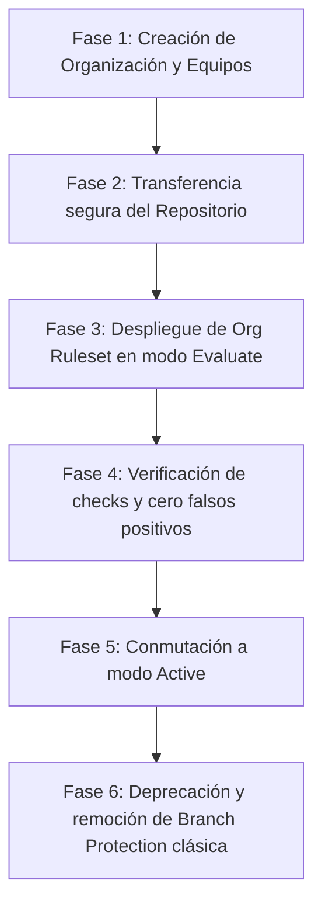

# ADR-0011: Estrategia de migración a Organización GitHub, adopción de Rulesets organizacionales y plan de deprecación de Branch Protection clásica

**Estado:** propuesta de gobierno aceptada documentalmente en el corte anterior; situación y aplicabilidad actuales **NO VERIFICADAS**
**Fecha:** 2026-11-16  
**Autores:** Equipo de ingeniería ENSAMBRIA  
**Revisores:** `@programadorkevinsvega-sys`  
**Reglas aplicables:** §4, §8.1, §11, §12, §14, §21 de `ENSAMBRIA_github_repository_governance_and_engineering_rules.md`

> Este ADR conserva una hoja de ruta de migración basada en el repositorio y la configuración GitHub de un corte previo. No afirma que la organización, equipos, Branch Protection o Rulesets descritos estén vigentes, ni autoriza ejecutar los comandos propuestos. Verificar el propietario y la configuración remota actuales antes de adoptar o ejecutar el plan.

---

## 1. Contexto

En la Fase 0 y el inicio de la Fase 1, el repositorio `ENSAMBRIA` se aloja temporalmente bajo una cuenta de usuario individual (`programadorkevinsvega-sys`, `owner.type: User`). Para salvaguardar la integridad de la rama principal `main` desde el día uno conforme a §4 del estándar de gobierno, se implementaron dos capas de protección concurrentes:

1. **Branch Protection clásica de repositorio:** Bloqueo de push directo, force-push y eliminación de `main`, con verificación obligatoria de CI y requerimiento de Pull Request (§8.1 para mantenedor único).
2. **Ruleset a nivel de repositorio (`protect-main`, id `27409010`):** Complementa la protección clásica incorporando la resolución obligatoria de hilos de revisión (`required_review_thread_resolution: true`) y trazabilidad en el log de auditoría (`repository_ruleset.*`).

A medida que el proyecto avanza hacia la incorporación de múltiples colaboradores, equipos especializados (arquitectura, seguridad, frontend, backend) y potenciales repositorios complementarios (infraestructura Terraform/IaC, contratos públicos, frontends satélite o repositorios de documentación), la cuenta de usuario presenta limitaciones estructurales:

- **Falta de gobernanza jerárquica:** Las reglas clásicas de rama pueden ser modificadas o relajadas por cualquier usuario con permisos de administración en el repositorio individual.
- **Falta de herencia multi-repositorio:** Cada nuevo repositorio requeriría replicar manualmente la configuración de protección de ramas, aumentando el riesgo de desalineación o configuraciones incompletas.
- **Gestión de accesos plana:** No permite segmentar responsabilidades en equipos (`@ensambria/core-maintainers`, `@ensambria/security`, `@ensambria/reviewers`) para asignaciones precisas en `CODEOWNERS` y políticas de bypass auditadas.

---

## 2. Decisión

Se aprueba formalmente la hoja de ruta técnica para migrar el repositorio a una **Organización de GitHub** (`@ensambria` o nombre corporativo registrado), implementar **Organization Rulesets** centralizados y ejecutar la **deprecación controlada de la Branch Protection clásica**.

### 2.1. Evaluación comparativa de mecanismos de protección

| Criterio | Branch Protection Clásica | Repository Rulesets | Organization Rulesets |
|---|---|---|---|
| **Ámbito de aplicación** | Rama exacta en repositorio único | Ramas/Tags por patrón en repositorio único | Toda la organización o subconjunto de repositorios por tags/nombres |
| **Jerarquía de gobernanza** | Administrador de repo puede editar | Administrador de repo puede editar | **Inmutable por admins de repositorio; sólo Owners de la Organización pueden modificar** |
| **Herencia a nuevos repositorios** | No (manual) | No (manual o template) | **Automática e inmediata para cualquier repositorio nuevo** |
| **Modo de evaluación (Dry-run)** | No (sólo activo o inactivo) | Sí (`evaluate`) | **Sí (`evaluate`): audita impactos en PRs sin bloquear antes de activar** |
| **Control de Bypass** | Excepción global para admins (`enforce_admins: false/true`) | Lista de actores específicos | **Roles de organización, equipos concretos o GitHub Apps autorizadas con auditoría total** |
| **Resolución de hilos obligatoria** | No soportada | Soportada | **Soportada (`required_review_thread_resolution: true`)** |
| **Metadatos y nombres de ramas/commits** | No soportada | Regex de nombres de ramas y commits | **Enforzamiento de Conventional Commits (`feat/`, `fix/`, etc.) en toda la organización** |
| **Trazabilidad en Audit Log** | Eventos genéricos | `repository_ruleset.*` | `organization_ruleset.*` centralizado |

**Conclusión de la evaluación:** Los Organization Rulesets superan en seguridad, escalabilidad y consistencia a las Branch Protection Rules clásicas, eliminando el riesgo de que privilegios locales en un repositorio debiliten las defensas del proyecto.

---

## 3. Hoja de ruta de migración y plan de deprecación

Para garantizar una transición sin brechas de seguridad ni interrupción de pipelines de desarrollo, la migración se ejecutará en seis fases estrictamente secuenciales:



### Fase 1: Creación de la Organización y estructura de equipos
1. Creación de la organización GitHub oficial (ej. `ensambria` o `ensambria-sys`).
2. Configuración de 2FA obligatorio para todos los miembros de la organización.
3. Creación de los equipos técnicos requeridos por `CODEOWNERS`:
   - `@ensambria/architecture-governance`
   - `@ensambria/security-and-privacy`
   - `@ensambria/backend-core`
   - `@ensambria/backend-business`
   - `@ensambria/backend-platform`
   - `@ensambria/frontend-engineering`
4. Configuración del correo de facturación, seguridad y políticas de retención de registros de auditoría.

### Fase 2: Transferencia del repositorio
1. Coordinar ventana de mantenimiento mínima (sin PRs en curso de integración inmediata).
2. Transferir `programadorkevinsvega-sys/ENSAMBRIA` a `ensambria/ENSAMBRIA`.
3. GitHub crea automáticamente redirecciones HTTP y SSH para remotos existentes.
4. Actualizar `remote origin` local en entornos de desarrollo y pipelines:
   ```bash
   git remote set-url origin git@github.com:ensambria/ENSAMBRIA.git
   ```
5. Actualizar `.github/CODEOWNERS` sustituyendo `@programadorkevinsvega-sys` por los equipos de la organización.

### Fase 3: Despliegue de Organization Ruleset en modo `evaluate`
Crear un Ruleset a nivel de organización aplicable a `default_branch` de todos los repositorios con criticidad alta:

- **Nombre:** `org-tier1-branch-protection`
- **Enforcement:** `evaluate` (audita sin bloquear para verificar comportamiento).
- **Condiciones:**
  - `repository_name`: todos los repositorios o filtrado por topic `tier-1`.
  - `ref_name`: `refs/heads/main`.
- **Reglas:**
  - `deletion`: bloqueada.
  - `non_fast_forward`: bloqueada (no force-push).
  - `pull_request`:
    - PR obligatorio.
    - `required_approving_review_count`: configurado según el tamaño del equipo (≥1 cuando haya más de un mantenedor, cumpliendo §8.1).
    - `dismiss_stale_reviews_on_push: true`.
    - `required_review_thread_resolution: true`.
    - `require_code_owner_review: true`.
  - `required_status_checks`:
    - `repository-quality`
    - `security-dependencies`
  - `commit_message_pattern`: Conventional Commits (`^(feat|fix|refactor|test|docs|security|infra|perf|build|ci|chore)(\([a-z0-9_-]+\))?: .+`).
  - `branch_name_pattern`: Prefijos estándar (`^(feat|fix|refactor|test|docs|security|infra|perf|build|ci|chore)/.+`).

### Fase 4: Verificación de paridad y resolución de discrepancias
1. Monitorear el log de evaluación de Rulesets en la interfaz de la organización durante 48 horas de trabajo ordinario.
2. Comprobar que los checks `repository-quality` y `security-dependencies` se identifican inequívocamente.
3. Verificar que no se producen falsos bloqueos en workflows automatizados autorizados (ej. PRs de Dependabot).

### Fase 5: Conmutación a modo `active`
Conmutar el estado del Organization Ruleset de `evaluate` a `active`. A partir de este instante, la organización protege la rama de manera inmutable frente a cualquier rol inferior a Organization Owner.

### Fase 6: Deprecación controlada de la Branch Protection clásica
Una vez confirmado que el Organization Ruleset está activo y aplicando los bloqueos:
1. Inspeccionar mediante GitHub API que el Ruleset organizacional cubre la rama:
   ```bash
   gh api repos/ensambria/ENSAMBRIA/rulesets
   ```
2. Eliminar la regla de Branch Protection clásica del repositorio:
   ```bash
   gh api repos/ensambria/ENSAMBRIA/branches/main/protection --method DELETE
   ```
3. Eliminar el Ruleset redundante a nivel de repositorio (`protect-main`, id `27409010`) para evitar duplicidad de comprobaciones en la interfaz de GitHub:
   ```bash
   gh api repos/ensambria/ENSAMBRIA/rulesets/27409010 --method DELETE
   ```
4. Ejecutar prueba de verificación:
   - Intentar push directo a `main` desde cuenta local → Debe ser rechazado por `organization_ruleset`.
   - Crear PR de prueba → Verificar que exige checks y revisión conforme a las reglas.
5. Documentar el fin de la deprecación en el registro de auditoría del repositorio.

---

## 4. Consecuencias y salvaguardas

### Beneficios
- **Cero ventana de vulnerabilidad:** Al solapar las capas durante las fases 3 a 5, `main` nunca queda desprotegida durante el proceso de transferencia y conmutación.
- **Inmutabilidad de la seguridad:** Los desarrolladores y administradores del repositorio no pueden deshabilitar checks de seguridad ni realizar force-pushes sin autorización de los Owners de la organización.
- **Escalabilidad nativa:** Cualquier nuevo crate o servicio que requiera un repositorio satélite heredará automáticamente el estándar de calidad y seguridad sin configuración manual.

### Riesgos y mitigaciones
- **Riesgo:** Bloqueo inadvertido de PRs automáticos de Dependabot.  
  *Mitigación:* Configurar Dependabot como actor autorizado en la lista de bypass del Ruleset exclusivamente para la creación de PRs y actualización de sus ramas, manteniendo la obligatoriedad de que los checks de CI (`repository-quality` y `security-dependencies`) pasen exitosamente antes del merge.
- **Riesgo:** Incompatibilidad temporal de nombres de checks en GitHub Actions.  
  *Mitigación:* La fase de evaluación previa (`evaluate` mode) detecta discrepancias de nombres de contexto antes de que se conviertan en bloqueos operativos.

---

## 5. Referencias

- [ENSAMBRIA_github_repository_governance_and_engineering_rules.md](../rules/ENSAMBRIA_github_repository_governance_and_engineering_rules.md) §4, §8.1, §11, §12, §14, §21
- [ADR-0010: Gestión de dependencias con Dependabot y Rulesets](ADR-0010-dependabot-rulesets-dependency-management.md)
- [GitHub Rulesets Documentation](https://docs.github.com/en/repositories/configuring-branches-and-merges-in-your-repository/managing-rulesets/about-rulesets)
