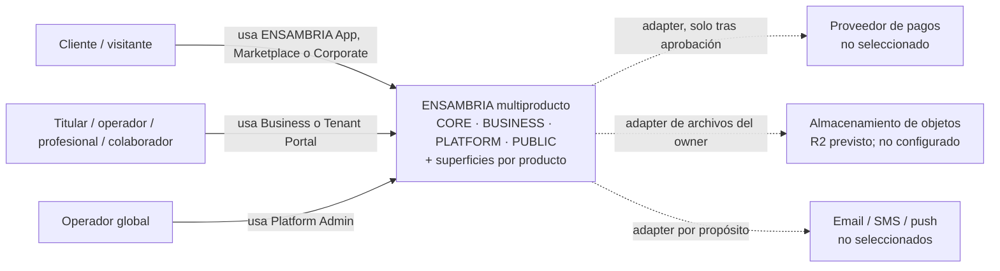
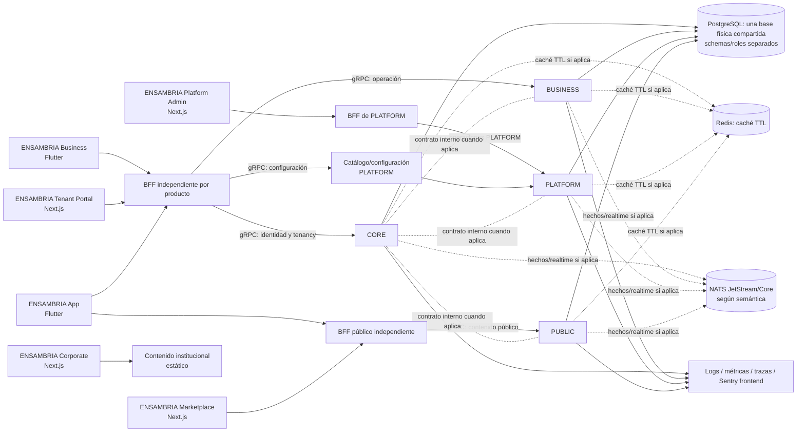

# Registro de Fase 0: descubrimiento y arquitectura

- **Estado:** Cierre documental aprobado por el propietario el 2026-11-11; la integración de este registro y la verificación CI corresponden al PR de cierre.
- **Corte documental:** 11 de noviembre de 2026 (UTC para evidencia remota de GitHub).
- **Alcance:** Evidencia documental y de gobierno previa a la implementación funcional.
- **Regla de fase:** No crear runtime de producto, esquemas activos, migraciones, endpoints, eventos ni integraciones durante Fase 0.

Este registro consolida el estado y la trazabilidad de los entregables de Fase 0 sin sustituir sus fuentes normativas. Los requisitos del producto están en [docs/requerimiento.md](requerimiento.md), la arquitectura y ownership en [ARCHITECTURE_RULES.md](../ARCHITECTURE_RULES.md), y los controles especializados en [docs/rules/](rules/). Un diseño escrito no equivale a aprobación humana, validación legal, implementación ni aceptación de fase.

## 1. Resultado y límites actuales

Fase 0 está **aprobada para cierre documental** por el propietario el 2026-11-11, tras la aceptación expresa de salida 0.5. Este estado se hace efectivo en `main` al integrar el PR de cierre con su check requerido aprobado. El cierre cubre diseño y gobierno; no declara implementación, certificación legal ni habilitación de tratamientos o mercados.

**Aceptación expresa:** el propietario aceptó el 2026-11-11 el diseño de arquitectura, dominios, context map, estructura objetivo, roadmap, ADR-0001 a ADR-0005 y el diseño técnico/documental actual de PDLM. También designó a Kevins Yesid Vega Marmolejo, propietario del proyecto, para la responsabilidad DPO/Legal y declaró ser abogado; esta es una declaración y designación del propietario, no una verificación independiente de credenciales. La aprobación de PDLM se limita a su diseño documental y no certifica cumplimiento, valida obligaciones por tratamiento ni aprueba los borradores legales. Las decisiones funcionales de fases posteriores se resuelven por sus owners antes de habilitar solo el caso dependiente.

No se ejecuta en esta fase:

- Aplicaciones ni servicios de dominio.
- Migraciones, esquemas activos, datos de negocio o infraestructura runtime.
- APIs públicas, webhooks, eventos de negocio ni catálogo ejecutable de extensiones.
- Activación de países, monedas, tratamientos de datos o integraciones de proveedores.

Sí corresponde a esta fase producir arquitectura, decisiones, inventarios, criterios de aceptación y gobierno del repositorio. La automatización de desarrollo permitida por el roadmap no se considera runtime del producto.

## 2. Inventario verificable del repositorio

| Área | Evidencia actual | Estado o brecha |
|---|---|---|
| Producto y arquitectura | [Requisitos y roadmap](requerimiento.md), [contrato arquitectónico](../ARCHITECTURE_RULES.md) y guías en [docs/rules/](rules/) | Documentan propósito, cuatro backends, seis proyectos de interfaz según la actualización ADR-0006, ownership y políticas. La aceptación de Fase 0 corresponde al corte original y no implica implementación de esos proyectos. |
| Backend Rust | [Cargo.toml](../Cargo.toml) declara un paquete `ENSAMBRIA`, versión `0.1.0`, Edition 2024, sin dependencias ni target fuente. | `cargo metadata --no-deps --format-version 1` falla (exit 101: `no targets specified`) y el manifiesto no declara `[workspace]`. No hay crates de backend, binarios ni tests de aplicación. La propuesta de workspace está en [ADR-0003](adr/ADR-0003-cargo-workspace.md); no se crea un target/crate ficticio ni runtime en Fase 0. |
| Frontends y BFF | El diseño vigente describe seis proyectos de interfaz y sus fronteras BFF, según ADR-0006, que actualiza la clasificación previa de cinco experiencias. | No se encontraron aplicaciones frontend o BFF ejecutables. |
| Persistencia e integración | Las guías definen PostgreSQL, Redis, NATS, Outbox/Inbox, gRPC y almacenamiento de objetos como decisiones de arquitectura. | No se encontraron migraciones, contratos Protobuf, configuración de servicios ni dependencias runtime que prueben integración. |
| Decisiones arquitectónicas | Las decisiones y reglas están descritas en `ARCHITECTURE_RULES.md`, documentos especializados y los ADR en [docs/adr/](adr/). | ADR-0001 a ADR-0005 registran el diseño aceptado al cierre de Fase 0; ADR-0006 actualiza posteriormente la arquitectura de interfaces sin reabrir el cierre. Ningún ADR prueba implementación ni aprobación legal. |
| CI y gobierno local | `.github/workflows/repository-quality.yml`, `.github/CODEOWNERS` y `.github/pull_request_template.md` existen en la rama del PR. El workflow invoca `python3 scripts/validate_engineering_skills.py`; el job del snapshot ejecuta validación estructural de Skills/perfiles y controles estáticos de repositorio. | La evidencia remota más reciente consultada antes de estos cambios es PR #1, SHA `61dc0b0f8988b3f274c35cdf0981e11b472bbef7`: `repository-quality` **SUCCESS**, run `42961638831`, job `130329299497`, completado el 2026-11-11 04:48:50 UTC. No verifica ejecución de agentes/Skills en VS Code/Copilot, coherencia semántica de ADR/ownership/matrices, cumplimiento legal ni aceptación de Fase 0. No se hereda a commits posteriores. La configuración actual de la rama y la validación del cambio presente deben comprobarse en el SHA que lo contenga. |
| Controles remotos de GitHub | Repositorio `programadorkevinsvega-sys/ENSAMBRIA`, rama predeterminada `main`; el PR #1 está abierto y apunta al SHA `61dc0b0f8988b3f274c35cdf0981e11b472bbef7` en la consulta del 2026-11-11. El `mergeStateStatus` reportado fue `CLEAN`; no había reviews registradas en esa consulta. | La Branch Protection de `main` fue consultada por API en la verificación previa; esta fila no afirma que la consulta se haya repetido en este corte. `repository-quality` PASS solo acredita su job estructural. Cambios críticos que requieran revisión independiente siguen bloqueados hasta contar con revisor autorizado. |
| Entorno y despliegue | No se encontraron manifiestos de despliegue o entornos de aplicación. | Topología y valores operativos reales pendientes; no hay evidencia de runtime. |

El inventario se limita al contenido accesible del repositorio y a las consultas ejecutadas el día de corte. La ausencia de archivos locales no demuestra por sí sola el estado de sistemas externos.

## 3. Modelo de contexto y ownership

#### C4 nivel 1 — contexto del sistema (conceptual)

ENSAMBRIA es el sistema de software; las personas y servicios externos se representan como actores/adyacencias, no como componentes ya contratados. El diagrama no implica tratamiento o despliegue activo.

#### C4 nivel 2 — contenedores lógicos (no desplegados)

El siguiente mapa resume la topología **definida**, no servicios desplegados:

CORE no se expone directamente a frontends. Los BFF adaptan contratos y no son dueños de reglas de negocio. gRPC es para operaciones síncronas; Outbox/JetStream, para hechos que necesitan entrega durable; NATS Core, para fan-out efímero. No se crean comunicaciones sin necesidad funcional.

El diagrama es una vista de contenedores lógicos C4, no un diagrama de red, despliegue ni grants. PostgreSQL, Redis, NATS, observabilidad, Vault y proveedores no están desplegados/verificados. Los BFF y cada frontend no conectan directamente con PostgreSQL, Redis o NATS; cada backend conserva su proceso, permisos y unidad de despliegue.

ENSAMBRIA Business y Tenant Portal llegan al mismo BFF/API independiente de producto y comparten contratos empresariales; App usa la superficie de producto para operaciones de cliente y puede usar el BFF público para Discovery. Marketplace consume el BFF público independiente; Platform Admin consume el BFF integrado en PLATFORM. Corporate publica contenido institucional estático; cualquier contenido dinámico requiere contrato público autorizado, sin acceso directo al backend. El BFF no posee reglas ni consulta stores. La identidad y el CRM siguen siendo transacciones de sus owners; el contrato idempotente y la recuperación ante fallo parcial son precondición de aceptación del recorrido de cliente. El alta de tenant de operadores es autoservicio por la superficie de producto→CORE; PLATFORM recibe el hecho durable de tenant y producto, sin registro manual de tenants ni clientes.

| Backend dueño | Contextos de dominio definidos por arquitectura |
|---|---|
| CORE (`backend-core`) | Identidad, autenticación, tenancy/contexto de producto y asociación técnica tenant–producto, organizaciones/sucursales centrales, entitlements, reservas y operaciones financieras centrales. |
| BUSINESS (`backend-business`) | Operación de establecimientos, workforce, catálogo, clientes/CRM, membresías comerciales, inventario, Commerce, marketing, facturación tenant, franquicias y comisiones de empleados. |
| PLATFORM (`backend-platform`) | Administración global, catálogo/configuración comercial de productos, relación comercial SaaS, planes, suscripciones, facturación SaaS y políticas comerciales ENSAMBRIA. |
| PUBLIC (`backend-public`) | Directorio, Discovery/Marketplace, páginas y proyecciones públicas autorizadas, reseñas y atribución del canal. |

### Bounded contexts iniciales (diseño)

Son límites propuestos dentro de los cuatro monolitos modulares, no crates, APIs ni deployments existentes. El módulo dueño conserva modelo, reglas, persistencia, migraciones y pruebas propios. La especificación de cada contexto con propósito, problema, owner, datos/agregados, casos de uso, contratos, eventos, dependencias, autorización, integridad, pruebas y fase está en el [modelo de dominios y estructura objetivo](arquitectura-dominios.md). La estructura completa de repositorio, capas y dependencias permitidas también se documenta allí y en [ARCHITECTURE_RULES.md](../ARCHITECTURE_RULES.md).

| Backend | Bounded contexts iniciales | Source of truth / límites |
|---|---|---|
| CORE | Identidad y autenticación; Tenancy, membresía, organización/sucursal, contexto y asociación técnica tenant–producto; Evaluación de entitlements; Reservas; Pagos y ledger; Liquidación/conciliación; privacidad y auditoría de seguridad según fases. | CORE es autoridad de identidad, scope, asociación tenant–producto, estado común de reserva y hechos financieros centrales. No posee catálogo comercial, CRM, catálogo operativo, pedidos, relación comercial SaaS ni proyección pública. |
| BUSINESS | Perfil/configuración del establecimiento; Workforce; Catálogo y servicios operativos; Clientes/CRM; Membresías comerciales; Inventario; Commerce/pedidos; Facturación de establecimiento; Franquicias/regalías; Comisiones de empleados; marketing comercial. | BUSINESS posee reglas y datos de la operación del establecimiento, incluso cuando consulta a CORE o publica a PUBLIC. No escribe estado financiero central o tabla de otro módulo. |
| PLATFORM | Administración global; Catálogo/configuración comercial de productos; Cuenta comercial de tenant; Planes/suscripciones/facturación SaaS; Políticas comerciales ENSAMBRIA; registro de integradores/entitlements según producto. | PLATFORM posee el catálogo de productos, la relación comercial global y políticas comerciales; CORE conserva identidad/contexto y valida/registra el efecto financiero autorizado. |
| PUBLIC | Discovery/directorio; Publicación/proyecciones; Reseñas; Marketplace y atribución del canal. | PUBLIC posee la superficie y atribución del canal; recibe proyección autorizada. No posee catálogo operativo, inventario, pedidos, identidad ni transacción privada. |

### Context map inicial (contratos, no imports)

| Productor → consumidor | Necesidad y semántica | Mecanismo permitido | Límite |
|---|---|---|---|
| Frontend → BFF autorizado | HTTP/REST/OpenAPI/WebSocket de la superficie | HTTPS a su BFF; el BFF traduce a contrato backend | Ningún frontend accede a módulos, stores, gRPC interno o proveedores. |
| BFF → backend propietario | Respuesta de caso de uso requerida | Contrato interno/gRPC según la topología y necesidad | BFF no posee regla de negocio ni accede directamente a PostgreSQL/Redis/NATS. |
| BFF de producto → PLATFORM | Resolver catálogo/configuración y estado de producto de forma autenticada | gRPC para consulta inmediata; Outbox/JetStream solo para cambios persistidos que necesiten distribución durable | Configuración resuelve producto/routing; no autoriza tenant ni sustituye permisos de CORE o del backend dueño. |
| CORE ↔ BUSINESS | Contexto de tenant; reserva y operación comercial; validación/registro de efecto financiero | gRPC para resultado inmediato; Outbox/JetStream para hecho durable que tenga consumidor | Sin imports de implementación ni SQL cruzado; cada backend persiste su parte. |
| CORE ↔ BUSINESS / reserva multimodal | BUSINESS consulta elegibilidad, servicio, cobertura, profesional y versión de disponibilidad; CORE crea/actualiza la reserva central y conserva la ubicación necesaria como snapshot mínimo | gRPC para verificación/respuesta inmediata; Outbox/JetStream y realtime desde el owner solo para cambios persistidos con consumidores/audiencias reales | BUSINESS no modifica estado común de reserva; CORE no posee catálogo, cobertura ni reglas de desplazamiento; direcciones privadas no se publican ni se duplican en eventos. |
| CORE ↔ PLATFORM | Contexto técnico, evaluación/actualización de entitlements, operación financiera de suscripción | Contrato síncrono para comando/consulta inmediata; evento durable para hecho confirmado y recuperación | PLATFORM define política/precio; CORE decide y registra efecto financiero bajo contrato autorizado. |
| BUSINESS → PUBLIC | Publicar, actualizar o retirar contenido autorizado del establecimiento | Outbox/JetStream; proyección minimizada con versión/estado | PUBLIC no consulta tablas BUSINESS; retirar publicación no borra automáticamente el source-of-truth. |
| PUBLIC ↔ CORE/BUSINESS | Revalidar una consulta/acción que requiere disponibilidad, reserva o estado privado | gRPC síncrono cuando el caso lo requiere | Discovery no confirma disponibilidad ni reserva basándose en proyección obsoleta; autorización vive en el owner. |
| Integración externa → módulo propietario | Callback/comando o hecho de proveedor | Adapter del owner; gRPC/HTTP del proveedor y Outbox si el hecho necesita entrega durable | No existe endpoint universal en CORE; firma/esquema se verifican según documentación oficial/sandbox. |

No se genera llamada, evento ni proyección por existir una capacidad transversal. Cada flujo requiere caso de uso, actor, contrato, owner, permiso, errores, cursores/replay si durable y escenarios de prueba. El flujo `core.tenant.created.v1` está ratificado como diseño en ADR-0002; no está implementado.

### Glosario inicial

| Término | Definición operativa |
|---|---|
| Persona / identidad global | Persona natural es sujeto humano; CORE posee su identidad/autenticación global, que por sí sola no concede acceso. Una persona jurídica es entidad legal distinta, cuyos datos solo se recogen cuando el mercado/caso lo requiera. |
| Titularidad / membresía | Relación de CORE con el tenant/organización y permisos explícitos; no equivale a identidad, representación legal verificada ni autorización global. |
| Tenant | Unidad técnica estable de aislamiento/contexto CORE; no representa necesariamente persona jurídica, negocio formal, local, sucursal o modalidad. PLATFORM posee la relación comercial SaaS. |
| Organización operativa | Estructura tenant-scoped CORE que puede representar actividad individual sin afirmar personalidad jurídica; BUSINESS posee su perfil/reglas operativas. |
| Sucursal | Ámbito organizativo/operativo opcional CORE, no sinónimo del establecimiento físico; permisos no se heredan implícitamente. |
| Entitlement | Resultado técnico de autorización/elegibilidad; PLATFORM define la oferta/política comercial y CORE evalúa/propaga efectos según contrato. |
| Establecimiento | Lugar físico de operación/atención opcional cuyo dato operativo pertenece a BUSINESS; su referencia estructural usa CORE cuando corresponda. No es el tenant ni necesariamente una sucursal. |
| Ubicación de atención | Dirección de cliente para una reserva, área de cobertura, lugar temporal acordado o modalidad remota; no crea sucursal/establecimiento. CORE conserva snapshot mínimo necesario de reserva y BUSINESS valida cobertura. |
| Modalidad de servicio | Condición admitida por el servicio: establecimiento, domicilio, ubicación acordada o remoto cuando proceda; no cambia el tipo de tenant. |
| Reserva | Compromiso/estado común y ubicación histórica mínima bajo CORE; catálogo, elegibilidad, disponibilidad operativa y viaje pertenecen a BUSINESS. |
| Operación de pago | Solicitud/resultado financiero idempotente bajo CORE; no es una política de precios. |
| Ledger | Registro financiero autoritativo e inmutable según las reglas aprobadas, propietario de CORE. |
| Commerce / pedido | Venta y reglas del establecimiento, propiedad de BUSINESS; su efecto financiero central se solicita a CORE. |
| Suscripción SaaS | Relación comercial de uso de ENSAMBRIA, propiedad de PLATFORM; diferente a membresía de cliente/establecimiento. |
| Proyección pública | Copia minimizada y autorizada para lectura pública; PUBLIC la posee y no reemplaza datos privados de BUSINESS/CORE. |
| Atribución de canal | Registro de origen/participación de Discovery/Marketplace, propiedad de PUBLIC; no es fuente de verdad del pago. |
| Outbox / Inbox | Registro transaccional de publicación / deduplicación del consumer en el owner productor/consumidor, para entrega al menos una vez. |
| Cursor durable | Posición/versionado para retomar y detectar huecos en una secuencia confirmada, no autoridad sobre permisos. |
| Scope | Límite autorizado de actor/tenant/organización/sucursal/recurso, verificado por backend y no inferido de UUID. |
| BFF | Backend-for-Frontend autorizado que traduce HTTP a contratos internos; no posee reglas ni accede a stores directamente. |
| Señal realtime | Notificación efímera de cambio confirmado; si se pierde, se recupera mediante cursor/snapshot autorizado. |

Los detalles y límites normativos están en [la arquitectura](../ARCHITECTURE_RULES.md) y [la sección de arquitectura del requerimiento](requerimiento.md#14-arquitectura-y-tecnologías). Los bounded contexts, el glosario y el context map necesitan una revisión formal de sus responsables; este resumen no los reemplaza.

## 4. Registro inicial de las diez capacidades transversales

La [matriz de producto de la sección 14](requerimiento.md#14-arquitectura-y-tecnologías) conserva la definición y secuencia funcional. Esta tabla registra actores/datos, fronteras, dependencias, criterios de aceptación y brechas de Fase 0, sin duplicar esa especificación.

| ID / capacidad | Owner y actores/datos | Fronteras, contratos y dependencias | Controles y evidencia de aceptación a preparar | Pendientes de Fase 0 |
|---|---|---|---|---|
| C01 Multi-tenant | CORE: identidad humana, titularidad/membresía explícita, tenant estable, autorización y contexto. BUSINESS: perfil/operación. Un tenant admite persona natural o jurídica, sin local obligatorio ni modalidad inmutable. | Identidad separada de persona jurídica, tenant, organización y CRM; contratos por BFF/owners; RLS y scope en todos los stores/derivados. | Alta natural sin empresa/local/sucursal; cambios de modalidad/crecimiento conservan tenant/IDs; sesión expirada, titularidad falsa, tenant ajeno y permiso insuficiente denegados sin efectos parciales. | Diseño en [§2.2](requerimiento.md#22-modelo-empresarial-multimodal-y-servicios-móviles), [ADR-0005](adr/ADR-0005-tenancy-multimodal-y-servicios-moviles.md) y [§2.6](arquitectura-dominios.md#26-modelo-multimodal-de-tenancy-y-servicios-móviles); autorización por acción/campo y pruebas se concretan por owner/fase. |
| C02 Multi-sucursal | CORE posee relaciones estructurales organización/sucursal; BUSINESS operación por scope. Sucursal no equivale a establecimiento; ambas estructuras son opcionales para la actividad móvil individual. | Propagación de contexto autenticado; no inferir permisos/herencia por ID o árbol. Establecimiento físico y direcciones quedan separados de cobertura y ubicaciones de atención. | Aislamiento entre tenant/sucursal, incorporación posterior de locales, staff y configuración; sin sucursal/local ficticio, acceso lateral ni pérdidas/duplicados. | La precedencia de configuración se decide por campo/dominio antes de usarla; no se presume herencia de permisos ni de configuración. |
| C03 País, moneda y zona horaria | PLATFORM administra mercados habilitados; CORE mantiene contexto regional y operaciones financieras centrales; cada backend conserva sus importes. Colombia figura como mercado inicial de diseño. | Códigos ISO de país/moneda y zonas IANA; contratos transportan contexto explícito. Depende de proveedores, impuestos, pagos y revisión legal/Finanzas. | Casos para país/moneda incompatibles, precisión, conversión no permitida y ausencia de efectos financieros implícitos. | No se encontró aprobación legal del mercado, moneda inicial por flujo, zona horaria por defecto, conversión, impuestos o política comercial. No inferir COP ni habilitar mercados. |
| C04 Idioma y localización | Cada frontend y backend presenta su contenido bajo ownership de producto/contenido; el contexto regional usa locale normalizado. Idiomas iniciales documentados: español, inglés y portugués. | BCP 47; contratos con códigos y datos estables, no texto de UI localizado. Depende de contenido editorial y reglas de locale. | Fallback, locale no soportado, contenido faltante, fechas/números y consistencia de errores, sin cambiar datos financieros. | El propietario asume Producto/contenido; faltan decidir locale inicial/fallback por superficie y asignar fuentes/traducciones. La lista de idiomas no constituye traducciones o lanzamiento. |
| C05 Reglas de dominio | CORE: reglas de reservas/pagos bajo su ownership. BUSINESS: reglas de operación comercial del establecimiento. PLATFORM: planes, entitlements y políticas comerciales ENSAMBRIA. | Reglas tipadas, dentro de su módulo dueño; ninguna política multi-dominio ni ejecución de expresiones/código arbitrario. Depende de cada dominio y su versionado. | Matriz de reglas, invariantes, precedencia, vigencia, concurrencia, transiciones y reproducción de decisiones financieras con versión. | El propietario asume Product y los owners de dominio; faltan decisiones explícitas del catálogo por caso de uso y políticas comerciales; no crear motor runtime en Fase 0. |
| C06 Eventos e integración durable | Cada backend emite solo hechos persistidos que necesiten consumidores. Para cada alta operativa, CORE publica tenant y referencia de producto en `core.tenant.created.v1`; PLATFORM registra ambos de forma idempotente y abre onboarding inicial pendiente. El ADR no añade categorías o exclusiones de tenant. | Mutación tenant/asociación de producto y Outbox atómicos; JetStream durable, Core solo para fan-out efímero y gRPC para RPC. Contrato, Inbox, recuperación y criterios en §6.4 y [ADR-0002](adr/ADR-0002-outbox-alta-tenant-core-platform.md). | Rollback/commit atómico, producto no registrado/inactivo, caída del relay, publicación confirmada, duplicados, orden, reinicio/replay, autorización y redacción con PostgreSQL y JetStream reales; comprobar un único onboarding `onboarding_pending` por tenant/producto. | Decisión del propietario ratificada; el producto se resuelve por contrato confiable y el hecho lleva la referencia canónica, sin inventar taxonomías ni política comercial. Fase 0 no crea eventos, streams, tablas ni runtime. |
| C07 Auditoría | Cada backend audita sus operaciones sensibles; CORE, identidad/seguridad; PLATFORM, administración global. Actores humanos/workloads y recursos con scope. | Historial de dominio append-only separado de logs; correlación cuando esté disponible. Depende de identidad verificada, autorización, privacidad y retención. | Contrato de actor, acción, resultado, instante, recurso/scope; pruebas de atribución, acceso, integridad, minimización y retención. | El propietario asume coordinación de todos los owners; falta ratificar taxonomía/campos, acceso, integridad, almacenamiento y retención; el diseño no prueba auditoría implementada. |
| C08 API pública | CORE, identidad/credenciales/scopes; PLATFORM, relación comercial y entitlements de integradores; cada backend, recursos y operación que posee. Actores: integradores externos. | Superficie externa aprobada tras BFF/gateway; nunca módulos internos, tablas o acceso SQL. Depende de seguridad, versionado, cuotas, acuerdos y sandbox. | Pruebas de scope mínimo, tenant cruzado, abuso/rate limit, idempotencia, compatibilidad y errores seguros. | API externa se planifica para Fase 7; integradores, recursos/scopes, acuerdos, datos y límites concretos pendientes. No habilitar endpoint en Fase 0. |
| C09 Webhooks | Cada owner conserva su suscripción y hechos salientes. Entradas de pago/estado financiero: CORE; facturación y suscripción SaaS: PLATFORM; facturación y operación comercial del establecimiento: BUSINESS; publicación/atribución Marketplace: PUBLIC. | Firma y contrato del proveedor se verifican en el backend propietario del contexto; eventos resultantes se persisten localmente y usan Outbox cuando deban propagarse. No se transfieren credenciales ni se aceptan callbacks en CORE por conveniencia. | Firmas inválidas, replay, duplicados, orden, proveedor indisponible, aislamiento, redacción, egress/SSRF y ausencia de efectos parciales. | Matriz de propiedad definida en §6.5; proveedor, endpoint, esquema de firma, secretos y términos permanecen pendientes hasta selección y verificación oficial en la fase correspondiente. |
| C10 Marketplace de extensiones | PLATFORM administra catálogo, publicación, compatibilidad y entitlements; el backend dueño mantiene APIs, permisos y datos que expone. Actores: publicadores, revisores, tenants e integraciones. | Contratos/scopes aislados; nunca SQL directo ni ejecución de código arbitrario en backends. Depende de API, proveedor, revisión de seguridad y operación. | Revisión de proveedor, permisos mínimos, aislamiento, versiones, revocación, límites y auditoría; pruebas de abuso y compatibilidad en la fase funcional. | Definir elegibilidad, revisión, publicación, revocación y modelo comercial con owners; catálogo ejecutable no se implementa en Fase 0; roadmap lo sitúa en Fase 11. |

Para cada fila, la matriz de aceptación detallada debe conservar la trazabilidad `requisito → caso de uso → decisión/contrato → control → prueba → fase → responsable → ejecución/evidencia`. En Fase 0 los casos se definen documentalmente; las pruebas de comportamiento y de dependencias reales se ejecutan en el corte de implementación que corresponda. Ningún check escrito se considera aprobado por existir en este registro.

### 4.1 Definición transversal y aceptación por capacidad

Los IDs estables C01–C10 se corresponden uno a uno con las diez capacidades de [docs/requerimiento.md, sección 14](requerimiento.md). Las decisiones siguientes convierten esas filas en un diseño comprobable y trazan requisito→owner/contrato→riesgo/control→caso de aceptación/prueba→fase/evidencia esperada; §7.1 relaciona además cada capacidad con las reglas especializadas aplicables. “Owner” identifica al backend dueño del dominio. El propietario del proyecto asume los roles humanos de Producto, Arquitectura, backend y control técnico durante la etapa unipersonal; esto no sustituye la ratificación explícita de decisiones ni una revisión legal profesional. Los comportamientos condicionados por aprobación legal, comercial o de producto permanecen deshabilitados hasta contar con esa aprobación.

| Capacidad | Modelo y contrato de propiedad | Riesgos y controles de diseño | Aceptación y evidencia de la fase propietaria | Secuencia y dependencias |
|---|---|---|---|---|
| C01 Multi-tenant | CORE autentica identidad global, membresía, tenant y scope; cada módulo conserva sus datos bajo su schema en la base compartida. El contexto interno propuesto lleva `actor_id`, `tenant_id`, membresía, scopes concedidos y `correlation_id`; los IDs provienen de identidad verificada y nunca son permisos. | IDOR/BOLA, contexto tenant falsificado, caché/eventos cruzados, RLS residual: autenticar y autorizar en el owner, grants mínimos, contexto SQL transaccional y claves de caché/eventos acotadas por owner/scope. | Sin sesión, sesión expirada, tenant ajeno, rol insuficiente y membresía revocada deniegan sin efectos; tenant falsificado se ignora/rechaza; concurrencia, rollback y reuso de conexión no filtran; probar roles SQL contra schemas ajenos y filas de otro tenant. | Base de identidad/aislamiento en Fase 1 CORE; cada dominio implementa aislamiento al introducir su primer dato. Depende de ADR-0001, IDs, roles, RLS y matriz de autorización ratificados. |
| C02 Multi-sucursal | Modelo estructural CORE: tenant → organización → sucursal. La identidad puede pertenecer a uno o más tenants; las membresías y concesiones de acceso son explícitas. BUSINESS es dueño de la operación por sucursal. Permisos no se heredan automáticamente; las concesiones a varios ámbitos deben enumerar sus scopes. | Acceso lateral a otra sucursal, herencia accidental, sobreescritura de configuración o doble conteo consolidado: contexto de sucursal autorizado, políticas de ámbito explícitas y auditoría de cambios. Configuraciones heredadas y overrides no se habilitan hasta definir por campo su precedencia. | Usuario de sucursal A no accede a B por ID; usuario multiesucursal solo accede a las concedidas; baja/revocación surte efecto; prueba de defaults/override, disponibilidad, inventario/caja y consolidación cuando se implementen. | Relaciones/contexto en Fase 1; verticales/recursos en Fase 2; workforce, inventario y caja en Fase 4; cadenas/consolidación en Fase 10. Pendiente la política de defaults/override por dominio y aprobación de Producto. |
| C03 País, moneda y zona horaria | PLATFORM habilita mercados; CORE valida contexto regional y operaciones financieras; cada backend conserva importes exactos con moneda ISO 4217 y zona IANA explícita. País, moneda y precio son valores explícitos; no se infiere jurisdicción por IP/locale ni se convierte implícitamente. Colombia es mercado inicial de diseño, no aprobación de lanzamiento. | Conversión, impuestos o precios equivocados; jurisdicción asumida; DST: no usar punto flotante, preservar moneda original, no crear cargo cuando el mercado no esté habilitado y versionar reglas de vigencia. | Mercado/moneda no permitidos no producen mutación ni cargo; la operación conserva cantidad y moneda; probar cambio de mercado, límites de zona y DST conforme a política aprobada. | Contexto/tipos Fase 1; internacionalización operativa Fase 10. Finanzas/Producto ratifica mercados/monedas; Legal valida obligaciones por tratamiento antes de habilitar cada país. |
| C04 Multi-idioma | `locale` BCP 47 en presentación/contexto; contratos y datos persistidos mantienen códigos/valores estables y texto de usuario separado del mensaje UI. Español, inglés y portugués son los idiomas iniciales previstos. Resolución propuesta: preferencia explícita de usuario → locale explícito de ruta/producto → primer locale soportado de `Accept-Language` → `es`; contenido sin traducción conserva y declara su idioma de origen. | Fallback incorrecto, pérdida semántica en errores/fechas/precios o filtración por locale en cachés: no traducir datos financieros/autorización; incluir locale en caché solo si cambia la representación; no presentar traducción ausente como disponible. | Probar locale soportado/no soportado, precedencia/fallback, traducción faltante, pluralización, errores, formato regional, accesibilidad y ausencia de impacto en autorización/dato. | Contratos/contexto Fase 1; internacionalización completa Fase 10. La precedencia y fallback `es` son propuesta de Producto, pendiente de ratificación antes de fijarlos en contratos. |
| C05 Motor de reglas | No existe un motor omnisciente. Cada regla es propiedad del dominio CORE (reservas/pagos/seguridad), BUSINESS (operación/workforce/CRM/inventario/ventas), PLATFORM (planes/entitlements/política comercial) o PUBLIC (canal/atribución). Modelo de diseño por regla: owner, alcance, entradas, predicado, resultado/efecto, prioridad, versión, vigencia y actor que la cambió. | Versiones ambiguas, reglas arbitrarias o cambios retroactivos: reglas tipadas por dominio, evaluación determinista, invariantes y transiciones auditadas; ninguna expresión/código de terceros en runtime. | Casos válidos/inválidos, límites, precedencia, concurrencia, estado previo, vigencia, permiso, versión histórica y efecto transaccional; Finanzas/Producto ratifican cada regla comercial antes de efectos. | Fase 0 mantiene catálogo/owners; implementación junto al caso de uso de su dominio y fase. No crear motor genérico ni reglas comerciales ficticias. |
| C06 Eventos | CORE crea el tenant operativo y persiste `core.tenant.created.v1`; PLATFORM consume el hecho para registrar la referencia e iniciar `onboarding_pending`, sin decidir plan, precio, factura, cobro o entitlement. El ADR no agrega clases ni excepciones de tenant. Detalle en §6.4 y ADR-0002. | Pérdida entre commit y publicación, repetición, orden incorrecto, PII en payload, consumer cross-tenant: Outbox local atómico, JetStream confirmado, Inbox por consumidor, scope y envelope minimizado. | Fallos de commit/relay/ACK, reinicio y replay, duplicado, orden/versionado, tenant no autorizado, datos sensibles ausentes y efecto local atómico; evidencia con PostgreSQL y JetStream reales en Fase 1. | Decisión del propietario ratificada. Implementar en el primer corte Fase 1 que cree tenants operativos. El contrato registra autorización e intención operativa sin crear categorías de tenant no definidas por el producto. |
| C07 Auditoría | Cada backend escribe el registro de su dominio; CORE registra identidad, auth, membresía y seguridad; PLATFORM, administración comercial global. Contrato propuesto: `audit_id`, actor/workload, acción, tipo/ID de recurso, tenant/sucursal scope, resultado, instante, `correlation_id`, versión del esquema y motivo permitido. Separado de logs/trazas. | Falsificación/eliminación, sobrecaptura o lectura indebida: escritura por owner, acceso de revisión separado, campos minimizados, sin IP cruda por defecto y retención no fijada hasta revisión Legal. | Atribución actor/scope, acción permitida/denegada, acceso privilegiado, redacción, integridad, autorización de consulta y eliminación/retención según política aprobada; auditoría no concede acceso. | Contrato base Fase 1 y extensión con mutaciones sensibles. Security/Privacy define modelo técnico; Legal debe validar retención, derechos y excepciones antes del tratamiento. |
| C08 API pública | CORE es owner de identidad; PLATFORM de relación comercial/entitlements del integrador; el backend de dominio es owner del recurso. Contrato externo versionado con operación, recurso, tenant/scope, esquema/error y versión; solo REST/OpenAPI por la superficie autorizada, nunca acceso directo a módulos/SQL. El protocolo de credenciales queda como decisión de seguridad previa a Fase 7. | Escalada de scope, abuso, fuga tenant, incompatibilidad/revocación: mínimo privilegio, cuotas, vencimiento/rotación, auditoría, idempotencia y revocación; conocer un ID no concede acceso. | Scope suficiente/insuficiente, expirado/revocado, tenant ajeno, cuota, replay/duplicado, compatibilidad y error seguro; integración real/sandbox y pruebas por proveedor antes de habilitar. | Diseñar Fase 0; contratos base en Fase 1 y API externa Fase 7. Producto y Security ratifican recursos/credenciales; Legal valida acuerdos y datos. No hay endpoint activo. |
| C09 Webhooks | Cada owner conserva su suscripción y hechos salientes. Callbacks entrantes: pagos/cargos/reembolsos→CORE; suscripción/facturación SaaS→PLATFORM; factura/inventario/Commerce del establecimiento→BUSINESS; catálogo/listado/atribución propia de Discovery→PUBLIC. Notificaciones salientes son del owner del hecho, no del receptor. | Firma y contrato se verifican en el backend propietario; persistencia idempotente local y Outbox si el hecho requiere distribución. Aislar endpoint/secreto por proveedor y caso; nunca centralizar callbacks en CORE por conveniencia. | Firma inválida, replay, duplicado, orden, timeout, proveedor no disponible, evento desconocido y estado terminal; ni doble efecto ni mutación parcial; egreso validado para SSRF y redacción de firma/payload sensible. | Ownership documental definido en §6.5; cada endpoint solo se diseña con proveedor real seleccionado y documentación oficial verificada en su fase. Sin callbacks activos en Fase 0. |
| C10 Marketplace de extensiones | PLATFORM es owner del catálogo y política de publicación/entitlements; los datos, permisos y API los conservan sus dominios. Ciclo de vida documental propuesto: submitted → reviewed → approved/available → suspended/revoked; las transiciones y quién puede ejecutarlas se auditan. Integraciones usan contratos/scope, nunca SQL directo ni código arbitrario cargado al backend. | Extensión maliciosa, permisos excesivos, aislamiento o revocación tardía: revisión del publicador/versiones, permisos mínimos, límites, compatibilidad, auditoría, suspensión y revocación por owner. No se define mecanismo criptográfico/ejecución sin modelo aprobado. | Scope no concedido, tenant cruzado, versión no compatible, revisión faltante, suspensión/revocación y acceso posterior denegados; verificar auditoría, propagación de revocación y que ninguna extensión ejecute código dentro del backend. | Fase 0 define confianza/proceso; APIs base Fase 7; catálogo/instalación Fase 11. Estados y modelo comercial propuestos requieren ratificación de Producto/Security antes de habilitar el Marketplace. |

Para todos los casos: el propietario del proyecto asume las funciones de producto, backend, Security/Privacy técnico y QA; no se presenta esa auto-revisión como revisión independiente. Las aprobaciones legales corresponden a asesoría competente aún pendiente. Ninguna fila constituye por sí sola una ratificación de decisión ni aprobación legal o comercial.

### 4.2 Trazabilidad del alcance vertical y de negocio

Las capacidades transversales C01–C10 no agotan el producto. La matriz siguiente cubre las familias funcionales del requerimiento completo (secciones 1–13, 15–21 y roadmap §22); la sección 14 define la arquitectura/tecnologías y su tabla transversal. Las listas detalladas de casos de uso permanecen en [docs/requerimiento.md](requerimiento.md), que es la fuente de alcance y secuencia. Esta matriz enlaza esas familias con el owner, fase y condiciones de aceptación sin duplicar la especificación ni afirmar implementación.

| Dominio / fuente de producto | Owner y frontera | Fase del roadmap | Contrato e integración a preparar | Criterios de aceptación y restricciones |
|---|---|---|---|---|
| Identidad, autenticación, seguridad, tenancy, organización/sucursales, capacidades y reservas comunes (§2.1; roadmap Fase 1) | CORE es owner de identidad, memberships, contexto/entitlements y reservas comunes; mantiene pagos/ledger centrales, sin trasladar reglas financieras a otros owners. | Fase 1: identidad/tenancy, reservas base y Outbox/Inbox del onboarding ratificado; Fase 4: pagos/ledger transaccional; Fase 7: integraciones y conciliación; Fase 9: pagos Marketplace. | REST/OpenAPI por BFF autorizado; contratos internos según uso; PostgreSQL y RLS/grants owner-scoped; Outbox para cambios durables/realtime aplicables. | Autorización por actor/tenant/sucursal y estado; permisos insuficientes, expiración, concurrencia, conflictos, rollback, idempotencia, integridad financiera y datos sensibles sin exposición. |
| Tenancy multimodal y servicios móviles (§2.2; ADR-0005) | CORE: identidad, tenant estable, titularidad/membresía, estructura y reserva común. BUSINESS: perfil, catálogo/modalidades, establecimiento operativo, CRM, workforce, cobertura y desplazamiento. PLATFORM: onboarding comercial. PUBLIC: proyección autorizada. | Diseño F0; tenancy/reserva F1; modalidades F2; CRM F3; cobertura/workforce/operación móvil F4; onboarding/superficies F5; publicación pública F5/F9. | Contratos BFF→owners; CORE↔BUSINESS para factibilidad/reserva; Outbox solo para hechos persistidos que necesiten consumidores; PUBLIC consume solo publicación autorizada. | Persona natural sin persona jurídica/local/sucursal; alta y crecimiento conservan tenant/IDs/historial; modalidades, cobertura, viajes, concurrencia, permisos, ubicación privada, onboarding pendiente y recuperación. Detalle en [requerimiento §2.2](requerimiento.md#22-modelo-empresarial-multimodal-y-servicios-móviles) y [modelo §2.6](arquitectura-dominios.md#26-modelo-multimodal-de-tenancy-y-servicios-móviles). |
| Barberías (§3.1), peluquerías/tratamientos capilares (§3.2), salones/uñas (§3.3), spas/estética/bienestar (§3.4–3.5) | BUSINESS posee catálogos y reglas operativas verticales, profesionales, recursos, servicios y datos de atención; CORE conserva identidad/contexto y las operaciones financieras que le corresponden. | Fase 2; funciones comunes de CRM/reservas/comercio siguen sus fases propietarias. | Casos de uso BUSINESS consumidos por la app de gestión vía BFF; contratos tipados por dominio; configuración por tenant/sucursal y contratos hacia CORE solo para capacidades requeridas. | Casos por vertical, restricciones de recursos/duración y concurrencia; un vertical no debe forzar formularios/reglas idénticos. Fórmulas, fotos, contraindicaciones, planes y otros datos potencialmente sensibles permanecen deshabilitados hasta definir controles y validar aplicabilidad legal. |
| CRM, clientes, reservas relacionadas, preferencias, consentimientos y segmentación (§4.1) | BUSINESS posee CRM y relaciones comerciales del establecimiento; CORE mantiene la reserva común si así lo fija el ownership de la sección 2.1. | Fase 3 | Integración explícita CRM↔reservas, membresías, marketing, pagos y verticales, sin dependencias circulares; PUBLIC solo recibe proyección autorizada. | Separación por tenant/sucursal, preferencias y finalidades, acceso y exportación; duplicados, historial, baja/revocación, ausencia de consentimiento cuando sea requerido y efectos parciales. No reutilizar datos CRM para publicación/marketing sin autorización específica. |
| Membresías, fidelización, puntos, paquetes, bonos y referidos (§4.2 y §19) | BUSINESS posee reglas/beneficios del establecimiento; PLATFORM posee suscripciones/planes SaaS; CORE registra operaciones financieras autorizadas. | CRM/fidelización Fase 3; referidos/sorteos según roadmap y capacidad propietaria. | Contratos de elegibilidad, vigencia, consumo y ledger/operación financiera si aplica; canales/campañas dependen de preferencias y consentimientos. | Límites, caducidad, consumo duplicado/concurrente, cancelación, elegibilidad, saldo y reversión; no asignar beneficios ni activar reglas comerciales sin decisión de owner. |
| Workforce, operaciones del personal, turnos, comisiones y portales (§9, §9.1; funciones transversales de administración del establecimiento §6) | BUSINESS posee workforce, turnos, asignaciones y comisiones de empleados; CORE puede aportar identidad y pagos/ledger solo mediante contratos. | Operación laboral, turnos y comisiones en Fase 4; portal/vistas privadas para empleados en Fase 5. | BFF autorizado para aplicación de gestión/portal; scopes por sucursal y contratos explícitos con reservas, asistencia y finanzas. | Aislamiento por rol/sucursal, solapamientos, cambios concurrentes, permisos, auditoría y no filtración de información privada; liquidaciones y tratamientos laborales/fiscales requieren reglas y revisión aplicables antes de habilitar. |
| Inventario, compras, costos, proveedores y consumos (§4.3; §6; Fase 4) | BUSINESS posee productos, existencias, compras, lotes, consumos, mermas y costos operativos; PUBLIC no posee inventario. | Fase 4 | Contratos con catálogo, servicios/recetas, ventas y Commerce; mutaciones persistidas y eventos owner-scoped donde consumidores lo requieran. | Carrera de stock, límites/cero, ajuste autorizado, concurrencia, lote/vencimiento, devoluciones, doble consumo y ausencia de escritura cruzada; consistencia de costos y movimientos auditables. |
| Marketing, automatización, campañas y notificaciones (§4.4, §12; Fase 6) | BUSINESS para marketing y comunicaciones del establecimiento; CORE para seguridad/identidad; PLATFORM para cuenta SaaS. El owner se determina por propósito. | Fase 6 | Adaptador de proveedor desacoplado y callbacks al owner del propósito; consentimiento/preferencias, supresión y entrega no sustituyen autorización. | Opt-out, revocación, destinatario/canal permitido, duplicados, errores de proveedor, no envío no autorizado y ausencia de contenido sensible en logs. Revisión legal/contractual y proveedor sandbox antes de habilitar. |
| IA, analítica, BI, rentabilidad y calculadora de capacidad (§4.5–4.6; §7; §17) | Cada dominio conserva datos fuente y reglas; la capacidad analítica no obtiene ownership operacional por agregarlos. | BI y métricas de capacidad/rentabilidad en Fase 8; IA en Fase 11. | Proyecciones/definiciones métricas versionadas, minimización y permisos; cargas/consultas no bloquean las operaciones de negocio. | Reconciliar métricas con fuente, validar permisos/scope, calidad y frescura; medir sesgos/errores y explicar límites de predicción. Datos sensibles no se usan como entrada hasta aprobación/control del tratamiento. |
| Marketplace de establecimientos/servicios y atribución (§4.8; §10; Fase 9) | PUBLIC posee directorio, búsqueda, páginas, proyecciones públicas autorizadas, reseñas y atribución; BUSINESS es fuente de contenido/catálogo operativo; CORE posee reservas/pagos. | Fase 9 | Publicación/revocación BUSINESS→PUBLIC por contrato/eventos; transacciones iniciadas en Marketplace con CORE; BFF público consume PUBLIC por gRPC. | Publicación autorizada y retirada propagada, privacidad/noindex de borradores, reseñas moderadas/verificables, precio y disponibilidad revalidados por owner, reserva/pago idempotente y atribución trazable sin alterar ownership. |
| Commerce, e-commerce, catálogo de venta, carrito, pedidos y recomendaciones (§4.9; Fases 4 y 9) | BUSINESS posee Commerce, inventario y reglas de venta; CORE procesa pagos/cargos autorizados; PLATFORM define políticas de monetización ENSAMBRIA sin ejecutar cargos por sí solo. | Caja/ventas operativas en Fase 4; tiendas, carrito, pedidos y Marketplace e-commerce en Fase 9. | Flujo completo frontend→BFF→BUSINESS, con contratos síncronos para validación inmediata y eventos durables para hechos persistidos que necesiten consumidores. | Revalidar precio, compatibilidad y stock al confirmar; una recomendación no incorpora artículos ni cobra sin acción explícita; duplicados, concurrencia, cancelación/reembolso y ausencia de efectos financieros parciales. |
| Franquicias, cadenas, consolidación y expansión (§4.7; Fase 10) | BUSINESS posee franquicias/regalías, comisiones de empleados y operación consolidada; PLATFORM no administra la operación del establecimiento. | Fase 10 | Relaciones explícitas entre tenants/sucursales y scopes; contratos para reportes/transferencias autorizadas sin joins o acceso a tablas ajenas. | Denegar acceso lateral, herencia no aprobada, doble conteo y cambios concurrentes; reglas de regalías, consolidación y permisos regionales requieren ratificación de Producto/Finanzas antes de ejecutar. |
| API e integraciones (§4.10; §11–12; Fase 7) | Cada backend es owner de su recurso y callback; CORE pagos; PLATFORM SaaS/facturación SaaS; BUSINESS operación/facturación del establecimiento; PUBLIC canal/publicación. | Fase 7 | API externa versionada y webhooks firmados por proveedor; adapters y credenciales aislados por provider/caso; Outbox/Inbox si requiere entrega durable. | Contrato real/documentación oficial/sandbox, scopes, firmas, replay/idempotencia, orden, revocación, límites y redacción. No crear endpoints comodín ni confirmar integración de proveedores no seleccionados/verificados. |
| Administración SaaS/global (§5), panel de negocio (§6), apps cliente y empleados (§8–9), web pública por tenant (§10) y diseño UX (§13) | PLATFORM posee consola global, relación comercial y su BFF administrativo; BUSINESS posee operación del establecimiento; frontends consumen únicamente BFF autorizado; contenido institucional y público respeta el owner editorial indicado. | Catálogo/estructura de planes SaaS Fase 1; consola global, paneles, portales y recorridos web/app Fase 5; facturación e integraciones de ambos emisores Fase 7; Marketplace público y páginas de ofertas Fase 9. | Cinco superficies separadas; contratos REST/OpenAPI; sincronización REST por cursor/snapshot y WebSocket autenticado cuando aplique; metadata/SEO únicamente para rutas públicas autorizadas. | Matriz por actor/ruta y responsive/a11y, sesión expirada, roles, privacidad/noindex, SEO/OG, recuperación realtime, contenido y evidencia automatizada de cada frontera; no mezclar frontend con backend de dominio. |
| Privacidad, seguridad, cumplimiento, facturación/pagos y calidad (§11, §15–21) | Cada owner controla su tratamiento, datos y eventos; propietario coordina controles técnicos; asesoría jurídica competente conserva la validación profesional. | Controles acompañan cada dominio y fase; nunca se difieren a una fase de “hardening” posterior. | Matriz tratamiento→documento legal versionado→versión de aceptación/consentimiento cuando aplique→registro de evidencia; registro de jurisdicción/proveedor/retención y pruebas asociadas. | Cada flujo debe contar con revisión aplicable antes de activarse; borradores preparados no son publicación ni aprobación. Los bloqueos se limitan al tratamiento/mercado dependiente y no detienen trabajo técnico independiente. |

#### Ciclo de vida documental legal y alcance por fases

Los documentos de [compliance](compliance/) y las fuentes legales colombianas identificadas se incorporan desde Fase 0 al diseño y preparación de los procesos y pantallas pertinentes; su contenido se mantiene versionado como borrador aunque aún no exista aprobación profesional. En el corte que introduce cada tratamiento o superficie, el owner integra la versión aplicable al producto y define vigencia, idioma, jurisdicción, presentación, aceptación contractual cuando corresponda y evidencia mínima de actor/versión. Esto permite diseñar e integrar contenido en entornos no productivos; no equivale a publicación, aprobación legal ni autorización para recoger datos personales reales. Los borradores actuales no se presentan a personas como textos vigentes ni se usan para aceptación real. La revisión profesional es un gate previo al lanzamiento/uso productivo del alcance dependiente, no una razón para posponer investigación, documentación, preparación o trabajo independiente. El login no renueva automáticamente una aceptación; términos, avisos y consentimientos por finalidad se mantienen diferenciados.

La Fase 1 implementa los cimientos de identidad/tenancy y la asociación de producto en CORE, además del flujo durable CORE→PLATFORM ratificado; no adelanta las pantallas. Los recorridos UI se secuencian con el roadmap: las superficies tenant/business de producto y el registro/login de clientes se entregan en Fase 5 por sus BFF especializados; el owner de CRM entrega sus perfiles en BUSINESS en Fase 3. PLATFORM no registra manualmente ninguno. El contrato de coordinación y recuperación del alta de cliente entre CORE y BUSINESS debe definirse y aceptarse antes de implementar ese recorrido en Fase 5; no justifica detener los demás diseños ni habilita una alternativa manual. La evidencia de aceptación/consentimiento, cuando corresponda, se asocia a la versión presentada y al owner de la finalidad; no se infiere de la mera creación de cuenta.

Esta tabla convierte el alcance en una ruta trazable; no certifica que cada módulo tenga ya su matriz de casos detallada. Antes de implementar cada fase se completa esa matriz con acciones, actores, precondiciones, invariantes, efectos, casos positivos/negativos/límites, concurrencia/duplicados, fallos, autorización, privacidad, prueba de integración/E2E, CI, responsable y evidencia. Los N/A deben justificarse antes de implementar el corte.

## 5. Datos, privacidad y jurisdicción

Las fuentes distinguen identidad/contexto y membresías de CORE; datos operativos y CRM de BUSINESS; relación comercial SaaS de PLATFORM; y proyecciones autorizadas de PUBLIC. La tabla siguiente es el **inventario inicial de diseño**, no el catálogo de datos como código ni prueba de tratamiento activo. Los campos concretos, bases jurídicas, roles de tratamiento, retención, ubicación y destinatarios necesitan validación antes de implementación.

| Tratamiento / titulares | Owner de datos | Datos previstos y propósito | Destinos / derivados que heredan controles | Clasificación y controles de diseño | Estado legal / condición |
|---|---|---|---|---|---|
| Identidad, autenticación, membresías y seguridad de personas usuarias | CORE | Identificadores, datos de contacto mínimos, autenticadores, sesiones, MFA, membresías y decisiones de autorización para acceso seguro. | BFF autorizados, procesos de identidad, registros de auditoría. No exponer autenticadores/secrets en eventos o telemetría. | Personal/confidencial; cifrado, mínimo privilegio, redacción, recuperación de cuenta protegida, auditoría y aislamiento. | Legal debe validar finalidades, avisos, bases, derechos, edad, retención, verificaciones y proveedores antes del tratamiento real. |
| Tenant, organización, sucursales y relación de acceso | CORE | IDs UUID v7, estructura, membresías y scopes para separar negocios/sucursales. | Cada backend recibe solo los IDs/contextos requeridos; eventos/cachés/logs siguen siendo potencialmente personales si permiten reidentificación. | Identificadores pseudónimos/scope; no son secretos ni autorización. Grants/RLS y pruebas de acceso cruzado obligatorios. | Aplicabilidad contractual y rol de cada actor por definir con Producto/Legal. |
| Workforce, perfiles profesionales, turnos y comisiones | BUSINESS | Perfil operativo, sucursal, servicios/especialidades, horarios, asistencia, metas, ausencias/vacaciones, comisiones/liquidaciones y portal privado. | CORE identidad/pagos/ledger por contratos; correo/mensajería solo cuando se habilite. | Personal laboral/confidencial; permisos por rol/sucursal, minimización, auditoría de consultas y cambios, no incluir evaluaciones privadas en público. | No habilitar remuneración/liquidación hasta definir responsable, obligación laboral/fiscal, retención y aprobación financiera/legal. |
| CRM, clientes, reservas, preferencias y fidelización | BUSINESS (operación/CRM); CORE (agregado común de reserva) | Contacto mínimo, historial de visitas/reservas, preferencias, membresías, puntos, referidos y estado de consentimiento/preferencias de comunicación. | CORE procesa reserva/pago; proveedor de comunicaciones si autorizado; analytics solo datos minimizados; no compartir CRM con PUBLIC salvo proyección autorizada. | Personal, potencialmente sensible por contexto; aislamiento, propósito, consentimiento/preferencia cuando aplique, control de acceso, redacción y retención por definir. | Revisión legal por finalidad/canal, comunicaciones, menores, derechos, conservación y roles de establecimientos/ENSAMBRIA. |
| Fotografías, fórmulas, observaciones cosméticas, planes y contraindicaciones | BUSINESS | Evidencia visual y datos de servicio/cosméticos solo si son necesarios y expresamente habilitados. | Almacenamiento de objetos y backups/derivados autorizados; no publicar ni enviar a analítica/Sentry por defecto. | Alto riesgo/sensible según contenido; deshabilitado hasta clasificación, finalidad, permisos reforzados, consentimiento/autorización aplicable, retención/eliminación y validación Legal. No convertirlo en historia clínica. | Bloqueado por tratamiento hasta revisión jurídica y de privacidad; no se habilita con este diseño. |
| Catálogo, operaciones, ventas, pedidos, inventario y proveedores del establecimiento | BUSINESS | Catálogos, precios, lotes, movimientos, compras, órdenes y registros vinculados a clientes o empleados cuando aplique. | CORE para pagos; PUBLIC únicamente proyecciones publicadas; integradores externos solo contratos aprobados. | Interno más datos personales/financieros asociados; separar datos por dominio, proteger exportaciones, registrar ajustes y limitar scopes. | Contratos comerciales, facturación, retención y normativa por jurisdicción pendientes de Legal/Finanzas. |
| Pagos, transacciones, cargos, reembolsos, ledger y conciliación | CORE | Referencias de pago/token, importe/moneda, estados, titularidad y evidencia de operación; evitar almacenar datos crudos de tarjeta. | Pasarela aprobada/sandbox, BUSINESS o PLATFORM reciben solo resultado autorizado; conciliación/auditoría, sin credenciales en eventos. | Financiero/confidencial; mínimo privilegio, segregación de credenciales, idempotencia, auditoría y revisión de obligaciones de proveedor. | No habilitar cobros reales hasta aprobación de proveedor, contrato, seguridad, Legal/Finanzas y evidencia de sandbox. |
| Cuenta comercial SaaS, planes, suscripciones y facturación | PLATFORM | Entidad contratante, contactos de negocio, plan, suscripción, factura y estado comercial. | CORE procesa efectos de pago/entitlements mediante contratos; proveedor fiscal/facturación autorizado. | Personal/comercial/financiero; separar del tenant técnico y de pagos de clientes finales; acceso administrativo auditado. | Roles, condiciones de suscripción, renovación/cancelación, facturación e impuestos deben validarse por Legal/Finanzas. |
| Fichas públicas, reseñas y atribución del Marketplace | PUBLIC publica proyecciones expresamente autorizadas; BUSINESS conserva contenido fuente y operación | Información editorial pública, servicios publicados, reseñas y canal de origen. | Web pública, CDN/cache y buscadores a través de proyecciones autorizadas; propagación de retiro y revocación. | Público solo después de autorización/publicación; evitar datos privados, exactitud falsa, PII de reseñas y filtración de tenant. | Aprobación editorial/consentimiento, propiedad intelectual, retiro, menores y atribución comercial requieren reglas/Legal. |
| Comunicaciones, preferencias y campañas | Owner del propósito: CORE para seguridad/identidad; BUSINESS para relación comercial/marketing del establecimiento; PLATFORM para SaaS | Destinatario, canal, preferencia/consentimiento, plantilla y estado de entrega estrictamente necesarios. | Proveedor de correo/WhatsApp autorizado y callbacks al owner; telemetría sin contenido ni destinatario identificable. | Personal y de contacto; opt-out, minimización, ventana/canal y revocación; no realizar envíos de producción como prueba. | Bloqueado hasta definir bases, consentimiento, términos del proveedor, jurisdicción, retención y owner de cada mensaje. |
| Solicitudes PDLM, derechos, incidentes y conservación | CORE coordina solicitud central; cada backend ejecuta su parte; Privacy/Legal gobierna | Identificador de solicitud, identidad verificada, derechos, alcance, estados, evidencias y legal hold mínimo. | Sistemas fuente, objetos, caché, índices, outbox, logs y backups según el inventario; sin borrar tablas de otro owner. | Muy confidencial; acceso restringido, segregación de funciones, autenticación reforzada, idempotencia y auditoría. | No ejecutar flujos destructivos hasta aprobaciones/contratos/retención y pruebas de recuperación definidos por PDLM/Legal. |
| Auditoría funcional, eventos y telemetría | Cada backend para su actividad; Observability/SRE administra plataforma de telemetría | Actor/scope/acción/resultados de auditoría; eventos de negocio mínimos; logs/métricas/trazas diagnósticos. | Exporters, Sentry, almacenamiento operacional, JetStream y alertas solo según necesidad. | Separar auditoría, dominio y telemetry; no PII/secretos en payload, cardinalidad controlada, retención y acceso explícitos; redacción obligatoria. | Retención, transferencias, acceso y configuración Sentry deben validarse con Privacy/Legal; ningún destino remoto se considera aprobado por este registro. |
| Backups, restauraciones, cachés, índices y copias derivadas | Owner de la fuente por dominio; plataforma operacional ejecuta controles | Copias y referencias derivadas heredan clasificación, propósito y restricciones de la fuente. | PostgreSQL, R2/objetos, Redis TTL, búsqueda, analytics, logs, JetStream, backups y proveedores. | Inventario de ubicación/subencargados, acceso mínimo, cifrado, expiración, restauración con supresión/holds y propagación de borrado. | Regiones, transferencias, retención y excepciones se bloquean hasta aprobación legal/operativa. |

Las categorías anteriores son un inventario lógico de superficies, no una afirmación de que ENSAMBRIA ya recopile estos datos. Cada módulo deberá evolucionarlo a catálogo estático versionado por tabla/campo/objeto/evento/caché/índice antes de introducir el tratamiento; ninguna migración se aprueba sin owner, finalidad, clasificación y estrategia de ciclo de vida.

### 5.1 Responsables y autoridades

| Función necesaria | Responsabilidad propuesta | Estado de titular | Autoridad / límite |
|---|---|---|---|
| Product Owner / responsable del proyecto | Alcance, prioridades, actores, reglas de producto y aceptación de decisiones de negocio. | Asumido por la persona propietaria del repositorio, cuenta GitHub verificada `@programadorkevinsvega-sys`, por instrucción expresa del propietario del proyecto. | La cuenta identifica el propietario del repositorio; su nombre civil y persona jurídica no se infieren. No sustituye a abogado competente. |
| Architecture Owner | Integridad de topología, contratos, ADR y dependencias entre dominios. | Asumido por la misma persona propietaria del proyecto; titular técnico identificado en el alcance del repositorio. | No aprueba obligaciones jurídicas ni políticas comerciales por cuenta de terceros. |
| CORE, BUSINESS, PLATFORM, PUBLIC Domain Owners | Inventario, autorización, persistencia, contratos, datos derivados y pruebas de cada dominio. | Los cuatro roles se asumen por la persona propietaria del proyecto mientras el equipo sea unipersonal; no se crean cuatro titulares ficticios. | Un único responsable humano no altera el ownership técnico separado de los cuatro backends. |
| Responsable técnico de privacidad / PDLM | Mantiene inventario, catálogo, controles de ciclo de vida, trazabilidad y coordinación de solicitudes. | Asumido por la persona propietaria del proyecto como función técnica. | Esta función no valida por sí sola obligaciones ni textos legales. |
| Abogado/Privacy Legal Owner | Revisa por jurisdicción y tratamiento aplicabilidad, roles, bases, avisos, derechos, plazos, transferencias y documentos legales. | Kevins Yesid Vega Marmolejo, propietario del proyecto; designado por declaración propia el 2026-11-11 y declara ser abogado. | Credenciales no verificadas independientemente. La investigación es preliminar; revisión de obligaciones/textos concretos sigue pendiente y bloquea solo el uso real dependiente. |
| Security / incident owner | Threat model, controles técnicos, acceso, respuesta, proveedores y escalamiento. | Función técnica asumida por la persona propietaria del proyecto; revisión independiente de cambios críticos pendiente de revisor competente. | No se declara certificación ni revisión independiente. |
| Data Steward / responsables de datos | Clasificación, finalidad, lineage, retención y destinatarios del inventario por dominio. | Cada función de dominio es asumida por la persona propietaria del proyecto. | El ownership de datos permanece separado por backend. |
| QA / Observability / SRE / CI / Documentation | Evidencia de pruebas, telemetría, operación, controles de repositorio y documentación. | Responsabilidades operativas asumidas por la persona propietaria; los agentes pueden implementar/analizar pero no representan aprobación humana. | No se exige segundo owner/revisor para PR ordinarios mientras el repositorio tenga una sola persona mantenedora. Auto-revisión no es revisión independiente; cambios críticos sujetos a ella no se integran sin revisor autorizado. |

Esta asignación organizativa corresponde a la instrucción explícita del propietario del proyecto: una persona puede asumir varios roles y no debe inventarse una estructura de equipo. La identidad pública de GitHub no demuestra por sí misma la identidad civil o societaria. Registrar cualquier cambio futuro de titular, aceptación, alcance y fecha. No se atribuye al agente aprobación humana, dictamen jurídico ni independencia.

### 5.2 Registro inicial de jurisdicción y obligaciones

| Jurisdicción / alcance | Fuentes oficiales verificadas | Aplicabilidad y tratamiento | Estado de investigación/abogado | Owner de revisión | Control, prueba y bloqueo |
|---|---|---|---|---|---|
| Colombia — mercado inicial de diseño, no habilitado comercialmente por este registro | Investigación documental preliminar, fuentes oficiales y límites en [LEGAL_JURISDICTIONS.md](compliance/LEGAL_JURISDICTIONS.md); alcance de referencia en [Política de privacidad, §4.1](rules/ENSAMBRIA_Privacy_Legal_Compliance.md#41-colombia). | Revisar por separado identidad, clientes/CRM, workforce, contratos SaaS, facturación/pagos, cookies/marketing, publicación/reseñas, datos de menores, contenido/fotos, proveedores/transferencias; no asignar roles por rótulo global. | Se identificaron fuentes oficiales; no se certifica consolidación completa posterior a 2025 ni el estado de cada obligación en 2026. Aplicabilidad y roles por tratamiento siguen pendientes; no hay tratamiento runtime. | Propietario coordina privacidad técnica y producto; Kevins Yesid Vega Marmolejo fue designado DPO/Legal el 2026-11-11 y declaró ser abogado. | Trazar fuente→funcionalidad/rol→obligación→control→prueba→evidencia. No habilitar tratamiento/operación comercial dependiente de revisión crítica pendiente. |
| UE/EEE, Reino Unido, EE. UU., México, Brasil, Chile, Canadá y otros mercados futuros | Autoridad y publicación oficial de cada país/estado; registro de referencia en [Política de privacidad, §4](rules/ENSAMBRIA_Privacy_Legal_Compliance.md#4-marco-internacional-de-cumplimiento). | No se asume aplicabilidad ni se habilita mercado por estar listado en el estándar; revisar residencia, establecimiento, oferta, contrato, procesamiento y transferencias por caso. | No revisado para lanzamiento; las referencias del estándar son inventario de investigación, no dictamen legal. | Kevins Yesid Vega Marmolejo fue designado DPO/Legal para coordinación del proyecto; la revisión local profesional y aplicabilidad siguen pendientes. | Mantener mercados deshabilitados hasta matriz validada y controles probados. Registrar fuente oficial, aplicabilidad, owner, aprobación y fecha objetivo antes de habilitar. |

No se fijan aquí bases jurídicas, plazos, obligación de RNBD, rol controller/processor, reglas para menores, cookies, retención ni transferencias. El informe de investigación preliminar reporta consultas a Función Pública y compilaciones DIAN/MinTIC; las fuentes enlazadas, artículos, hallazgos y límites se registran en [LEGAL_JURISDICTIONS.md](compliance/LEGAL_JURISDICTIONS.md). La verificación TLS directa en este entorno falló para páginas de Función Pública (HTTP 000 por certificado de emisor no confiable); las páginas DIAN/MinTIC probadas respondieron HTTP 200. No se desactivó TLS. SUIN-Juriscol y la Secretaría del Senado no entregaron texto legible en los intentos reportados; no se verificó fuente SIC específica sobre cookies ni fuente SFC/Banco de la República que determine el estatus de ENSAMBRIA. Las consolidaciones posteriores a 2025 y reformas vigentes a 10-11-2026 quedan pendientes de validación.

El inventario conceptual por tratamiento está en [DATA_PROCESSING_REGISTER.md](compliance/DATA_PROCESSING_REGISTER.md), con ownership técnico y responsabilidad DPO/Legal designados. El propietario declaró ser abogado y aceptó la responsabilidad profesional el 2026-11-11; esta declaración no constituye verificación independiente de credenciales. La guía PDLM recibió aprobación técnica/documental del propietario en esa fecha. Ni esa aprobación ni la designación equivalen a validar obligaciones concretas, aprobar los borradores legales o certificar cumplimiento. La revisión de fuentes, hechos de entidad/producto y textos sigue pendiente según [LEGAL_JURISDICTIONS.md](compliance/LEGAL_JURISDICTIONS.md); solo el tratamiento/mercado dependiente de validación previa permanece deshabilitado.

## 6. Decisiones e integraciones transversales

| Área | Base de diseño documentada | Decisiones/evidencia aún requeridas |
|---|---|---|
| Cargo workspace | [Cargo.toml](../Cargo.toml) es un paquete sin targets ni sección `[workspace]`; `cargo metadata --no-deps --format-version 1` falla con `no targets specified`. | Propuesta [ADR-0003](adr/ADR-0003-cargo-workspace.md): un solo manifiesto raíz de workspace; incorporar únicamente crates/apps reales y permitir que el paquete raíz sea miembro solo si tiene target legítimo. No crear crates ni binarios vacíos para hacer pasar Cargo durante Fase 0. |
| Identificadores | UUID v7 canónico, identidad global separada de membresías tenant-scoped y autorización independiente del ID. | Asignar autoridad generadora por entidad y contratos que preservan IDs; documentar excepciones con evidencia. No depender de UUID v7 nativo en PostgreSQL sin verificar la versión desplegada. |
| PostgreSQL y RLS | Una única base física PostgreSQL compartida por los cuatro backends; schemas/migraciones/ownership por backend/módulo, roles mínimos, pool por proceso/backend compartido por módulos co-residentes y contexto RLS transaccional. Definición coherente con [guía de pooling](rules/ENSAMBRIA_Connection_Pooling_PostgreSQL.md) y [ADR-0001](adr/ADR-0001-base-postgresql-compartida.md). | La topología es requisito definido y ADR-0001 está alineado; la aceptación documental de Fase 0 sigue pendiente. No hay PostgreSQL runtime ni configuración de entorno. Antes de desplegar: versión, roles runtime/migración, réplicas máximas, presupuesto, timeouts, alertas y pruebas reales. |
| gRPC y Protobuf | gRPC para consultas/comandos síncronos necesarios; contratos propiedad de bounded contexts. | Definir contratos, autenticación/autorización, deadlines, compatibilidad, errores y owners por flujo; no hay Protobuf implementado. |
| Outbox, JetStream y realtime | Hecho persistido solo cuando exista necesidad; Outbox + JetStream durable; NATS Core efímero; PostgreSQL fuente de verdad; recuperación por cursor/snapshot autorizado. El flujo inicial CORE→PLATFORM y el hecho `core.tenant.created.v1` están ratificados en [ADR-0002](adr/ADR-0002-outbox-alta-tenant-core-platform.md). | Inventariar hechos, consumidores, orden, privacidad, retención, retry/replay y evidencia real requerida para cada implementación. El contrato técnico del flujo ratificado se completa en Fase 1; N/A se justifica por flujo, no por omisión. |
| Redis | Exclusivamente caché efímera con TTL; nunca fuente de verdad ni canal de fan-out. | Identificar las lecturas que lo requieren, datos/TTL, invalidación y pruebas de reconexión en la fase runtime correspondiente; no hay uso implementado. |
| Vault y TLS | La arquitectura define secretos/certificados bajo Vault y credenciales aisladas por workload/entorno. | Asignar owners, AppRoles/ACL y runbook de acceso autorizado; verificar entorno solo con autorización. No acceder ni modificar una VM compartida durante Fase 0. |
| Observabilidad | La guía propietaria define logs, métricas, trazas, privacidad, SLI/SLO, alertas y resiliencia; §6.1 de este registro especifica las superficies propuestas, correlación, redacción, Sentry y criterios. | El propietario asume técnicamente el rol Observability/SRE. SLI/SLO numéricos, retención, destino y contratos de Sentry requieren decisiones explícitas con Product/Privacy; no hay instrumentación ni evidencia operativa. |
| Datos versionables | PDLM requiere catálogo estático y reglas de validación futura. | Definir formato/owner y criterio del gate; el gate para esquemas se activa al introducir los primeros schemas/migraciones, no se declara activo ahora. |
| SEO y frontends | Seis proyectos de interfaz, ownership de contenido y restricciones público/privado definidos en ADR-0006 y reglas. | Inventariar rutas, dominios, contenido, locale, publicación, metadata, SEO/ASO y pruebas por proyecto; no hay aplicaciones/rutas implementadas. |
| Sentry por frontend | La guía de observabilidad exige Sentry en todos los frontends. | Plan por aplicación en §6.1; producto/Privacy deben aprobar proyecto, retención, acceso, muestreo y redacción antes de instrumentar. No hay SDK, DSN ni recepción configurados. |
| k6 / rendimiento | Grafana k6 es el estándar del proyecto; fases y capacidades tienen que preparar escenarios, seguridad, datos y criterios. | Plan documental por superficie en §6.2; targets, capacidad, thresholds y carga numérica quedan pendientes de línea base, autorización y objetivos aprobados. No se ejecutó carga porque no existen aplicaciones/runtime. |

### 6.1 Plan de Sentry, telemetría y SLI/SLO

| Superficie prevista | Cobertura a diseñar desde su fase | Privacidad y aceptación mínima |
|---|---|---|
| ENSAMBRIA Business (Flutter) | Errores de aplicación por plataforma, release, dispositivo minimizado y correlación con APIs del BFF de producto. | Separar telemetría por entorno/tenant; no recolectar contactos, ubicación precisa ni identificadores publicitarios, ni habilitar replay por defecto. |
| ENSAMBRIA Tenant Portal (Next.js/TypeScript) | Errores de navegador y servidor/SSR, release, entorno, trace/correlation y rendimiento de recorridos autenticados. | No capturar inputs, cookies, tokens, URL con query sensible, contenido de cliente ni PII por defecto; redacción automática y prueba negativa. |
| ENSAMBRIA App (Flutter) | Errores móviles por plataforma, release y trazas/correlación soportadas, con atributos de dispositivo minimizados. | No recolectar contactos, ubicación precisa ni identificadores publicitarios, ni habilitar replay por defecto; captura adicional requiere revisión de privacidad y consentimiento aplicable. |
| ENSAMBRIA Marketplace (Next.js/TypeScript) | Errores de cliente y SSR/performance de rutas públicas; versión y contexto de ruta seguro. | No enviar búsquedas identificables, datos de reseñas privadas, perfiles no publicados, query strings sensibles ni IDs de alta cardinalidad. |
| ENSAMBRIA Platform Admin (Next.js/TypeScript) | Errores de UI y contexto de operación administrativa; trazabilidad a la solicitud sin contenido de tenant. | Minimizar o excluir datos de soporte y administrativos; revisar privilegios de acceso a proyectos de observabilidad. |
| ENSAMBRIA Corporate (Next.js/TypeScript) | Errores de navegador/SSR o generación de contenido estático, release y rendimiento de páginas institucionales. | No incorporar datos de tenant ni personales a la telemetría; redactar parámetros y excluir contenido no público. |
| BFF público y cuatro backends Rust | OpenTelemetry/logs/métricas según la guía; Sentry backend se evalúa para errores inesperados/panics y solo se integra con decisión técnica y política aprobada. | No enviar errores esperados de negocio indiscriminadamente; test de redacción/correlación y prueba de que falla de exportación no bloquea negocio. |

La estrategia común define una identidad de proyecto por superficie/aplicación o segmentación equivalente acordada, separación por entorno/release, source maps publicados desde CI de forma autenticada y segura, DSN cliente tratado como configuración pública (no token administrativo), token de upload solo en secreto CI y no en bundles. Los proyectos, accesos, ubicación, retención, sampling, replay y destino de Sentry permanecen sin configurar hasta aprobación de Security/Privacy/Observability y revisión de términos del proveedor. Sentry no reemplaza logs locales, métricas, trazas, auditoría ni alertas.

SLI candidatos por recorrido: tasa de éxito y latencia de autenticación; disponibilidad/latencia de búsqueda pública; creación/confirmación de reserva; checkout/pago; lag y tasa de publicación Outbox; disponibilidad de BFF/dependencias. Los umbrales, ventanas, budgets, alertas y cualquier SLA no se fijan en Fase 0 sin requisitos, baseline y aprobación de SRE/Product. Aceptación futura: correlación BFF→gRPC→módulo, evento de fallo y cierre con el mismo `correlation_id`/`trace_id`, redacción automatizada, cardinalidad acotada y degradación no bloqueante si el destino de telemetría falla.

### 6.2 Estrategia k6 por superficie

| Superficie/flujo | Escenarios candidatos | Checks de integridad / seguridad |
|---|---|---|
| BFF y APIs del tenant/Business/Platform | Smoke; carga de lectura/escritura acorde a forecast aprobado; concurrencia para login, permisos, reservas, inventario/ventas cuando existan; stress/spike/soak solo en entorno autorizado y con límites de parada. | No acceso cruzado tenant/sucursal; sin duplicados/efectos parciales; expiración y autorización; tasas de error/latencia aprobadas y `dropped_iterations` reportado. |
| Discovery y contenido público | Smoke/load para búsqueda/listados/fichas publicadas; prueba browser k6 para SSR, HTML inicial, metadata, navegación y Web Vitals según criterio de la guía web. | No incluir fichas privadas/revocadas en respuesta, sitemap o metadata; pagination/filters no amplían acceso; destino autorizado. |
| CORE/gRPC/reservas/pagos | k6 HTTP a superficies BFF y protocolo gRPC compatible que esté soportado por versión k6 aprobada; carga/concurrencia solo contra servicios propios. Pagos externos solo sandbox oficial. | Idempotencia, disponibilidad, roles, límites, consistencia posterior y conciliación; ninguna operación financiera/notificación real durante prueba ordinaria. |
| JetStream/Outbox y workers | Carga del flujo durable real y medición de backlog/lag, redelivery y recuperación; perfiles solo después de disponer de servicios reales. | No ACK antes del commit, Inbox evita duplicados, orden requerido y recuperación tras reinicio; limpiar datos/eventos de prueba sin borrar datos ajenos. |
| ENSAMBRIA Business y ENSAMBRIA App (Flutter) | k6 prueba las APIs reales de BFF; las pruebas de rendimiento de UI/dispositivo usan herramientas de plataforma aprobadas, no k6 Browser como benchmark móvil. | Sesiones aisladas, no datos personales productivos, rutas autorizadas y no generación de compras/pagos/notificaciones reales. |

Datos de k6: registros no personales, únicos por ejecución y desechables, creados y eliminados exclusivamente mediante los endpoints/casos de uso/adapters reales en tenant de prueba aislado. No usar fixtures precargados, llamadas SQL directas, stubs ni respuestas falsas; no ejecutar pagos/notificaciones reales. Cada escenario documenta autorización del destino, versión, perfil, objetivo, límite de interrupción, thresholds aprobados, origen de datos, preparación/limpieza e integridad posterior. Umbrales de capacidad y niveles numéricos de carga no se inventan; derivan de SLO y mediciones. No hay runtime sobre el cual ejecutar k6 en Fase 0.

### 6.2.1 Plan de UX, accesibilidad y SEO por frontend

La implementación debe satisfacer WCAG 2.2 AA como mínimo en los frontends web y las reglas de seguridad/UX aplicables. El estado actual no tiene rutas o apps; esta matriz es diseño de aceptación, no evidencia de pruebas ejecutadas. Para rendimiento web público, usar los objetivos normativos de calidad de las guías: p75 de tráfico real LCP ≤ 2.5 s, INP ≤ 200 ms y CLS ≤ 0.1; completar también pruebas sintéticas/navegador según la superficie. No declarar cumplimiento antes de medir sobre páginas reales.

| Frontend | Naturaleza/owner de contenido | UX y accesibilidad a aceptar | SEO/descubribilidad y privacidad | Evidencia en su fase |
|---|---|---|---|---|
| ENSAMBRIA Business (Flutter) | Operación empresarial privada en móvil, tablet y escritorio; BUSINESS posee las reglas y datos operativos. | Interfaz adaptativa y accesible con teclado/ratón en escritorio y táctil en móvil/tablet; foco, lector de pantalla, formularios, confirmaciones, estados offline/error y sesión expirada. | Sin indexación web; enlaces/deep links solo a destinos autorizados y previews sin datos privados. | Pruebas de accesibilidad y permisos en plataformas soportadas, flujos y estados, enlaces seguros y rendimiento nativo según herramienta aprobada. |
| ENSAMBRIA Tenant Portal (Next.js/TypeScript) | Administración empresarial privada de los mismos tenants/capacidades que Business; BUSINESS posee reglas/datos. | Navegación teclado/lector, contraste, foco, reflow, formularios, estados cargando/vacío/error, sesión expirada y responsive conforme a WCAG 2.2 AA. | Todo el portal autenticado noindex/no-follow según corresponda; fuera de sitemap, Open Graph público y datos estructurados. | A11y automatizada y manual, autorización, metadatos privados, estados/error y ausencia de datos ajenos. |
| ENSAMBRIA App (Flutter) | Experiencia móvil de clientes; usa PUBLIC/BUSINESS solo mediante superficies autorizadas para cada caso. | Semántica accesible iOS/Android/tablet, lector de pantalla, tamaño de texto, foco, gestos con alternativas, estados offline/error y deep links seguros. | ASO y metadata de tiendas; no es una página web indexable ni expone datos privados en previews. | Pruebas de accesibilidad en plataformas soportadas, enlaces, sesión, permisos y rendimiento nativo con herramientas aprobadas. |
| ENSAMBRIA Marketplace (Next.js/TypeScript) | Directorio/Marketplace; PUBLIC publica proyecciones autorizadas de contenido fuente de BUSINESS y su atribución de canal. | Búsqueda, filtros, fichas y reseñas con teclado/lector, estados y errores claros; WCAG 2.2 AA y responsive. | HTML inicial rastreable, Open Graph, canonical, hreflang, JSON-LD y sitemap/robots solo para fichas publicadas; revocación/retirada elimina indexabilidad. | Contratos de publicación, metadata/render inicial, sitemap/robots, structured data, aislamiento, accesibilidad y Web Vitals. |
| ENSAMBRIA Platform Admin (Next.js/TypeScript) | Operaciones administrativas globales privadas; PLATFORM posee sus reglas y datos administrativos. | Acciones explícitas, prevención/confirmación de operaciones destructivas, auditoría visible, WCAG 2.2 AA, expiración de sesión y errores accionables. | Rutas privadas noindex y excluidas de sitemap/JSON-LD/previews; no exponer datos de soporte en metadata ni telemetría. | Pruebas de permisos, abuso/confirmación, accesibilidad y ausencia de exposición/indexación. |
| ENSAMBRIA Corporate (Next.js/TypeScript) | Presencia institucional pública; PLATFORM posee su contenido institucional. | Navegación, formularios si se autorizan, teclado/lector, contraste, foco, responsive, estados y errores conforme a WCAG 2.2 AA. | HTML inicial, metadata, canonical, Open Graph y datos estructurados únicamente para contenido público autorizado; rutas privadas noindex. | SEO/render inicial, accesibilidad, enlaces, privacidad, seguridad y Web Vitals; formularios solo tras aprobar contrato y tratamiento. |

Cada fase de frontend añade sus rutas y estados reales a su inventario antes de publicar; no se inventan rutas en Fase 0. Requisitos públicos detallados remiten a [Open Graph/SEO](rules/ENSAMBRIA_Open_Graph_SEO_Metadata.md); accesibilidad, UX, seguridad y rendimiento remiten a [calidad web](rules/ENSAMBRIA_Website_Launch_SEO_Performance_Accessibility.md) y [reglas frontend](rules/ENSAMBRIA_frontend_security_accessibility_ux_ui_performance_observability_rules.md).

### 6.3 Modelo inicial de datos de alto nivel (documental)

No es esquema físico ni contrato Protobuf; define agregados, referencias y autoridad para orientar ADRs y futuros schemas en la única base compartida. IDs de entidades son UUID v7 canónicos salvo excepción aprobada. Los módulos no hacen JOINs ni lecturas directas a schemas ajenos.

| Backend/schema lógico | Agregados y datos autoritativos propuestos | Relaciones permitidas por referencia/contrato | No posee |
|---|---|---|---|
| CORE | `PersonIdentity`, `Credential/Session`, `Tenant`, `TenantMembership`, titularidad, `Organization` (estructura operativa, no forma jurídica), `Branch` (opcional), `Reservation` con snapshot mínimo de ubicación (reglas/estado común), `EntitlementEvaluation`, `PaymentOperation`, `LedgerEntry`, `Settlement/Reconciliation`, `AuditSecurity`, `Outbox/Inbox` CORE. | Identidad y membresía global/tenant-scoped separadas; un tenant admite titulares naturales/jurídicos y evoluciona con los mismos IDs; establecimiento puede ser opcional; reserva referencia servicio/profesional/scope BUSINESS por contrato y conserva la ubicación necesaria de la atención. | CRM/direcciones guardadas de cliente, perfil operativo/establecimiento/cobertura/workforce, suscripción SaaS, proyecciones públicas. |
| BUSINESS | `BusinessProfile/Configuration`, `ServiceCatalog` con modalidades, `Establishment` y configuración de lugar, `CoveragePolicy`, `WorkforceProfile/Assignment/Visit`, `CustomerProfile/CRM`, `Membership/Loyalty`, `Inventory/StockLot`, `Order/Commerce`, `EmployeeCommission`, `BusinessInvoice`, `AuditBusiness`, `Outbox/Inbox` BUSINESS. | Refiere a `tenant_id`, `organization_id`, `branch_id`, `person_id` y `reservation_id` CORE; valida cobertura y oferta por contrato; solicita pagos a CORE y publica solo contenido autorizado a PUBLIC. | Identidad/autenticación, tenant/membresía, estado común de reserva, pagos/ledger central, relación comercial SaaS. |
| PLATFORM | `CommercialTenantAccount`, `Plan/Subscription`, `SaasInvoice`, `CommercialPolicy`, `IntegrationRegistration/Entitlement`, `AuditAdministration`, `Outbox/Inbox` PLATFORM. | `tenant_id` es referencia a CORE; cambios de entitlements se comunican por contrato; efectos financieros se solicitan a CORE. | Identidad/tenant técnico, registros operativos de negocio, pagos/ledger central, atribución PUBLIC. |
| PUBLIC | `PublishedListing/Projection`, `PublicReview`, `MarketplaceAttribution`, `PublicationState`, `Outbox/Inbox` PUBLIC. Mantiene proyecciones minimizadas, no copia el agregado privado completo. | Recibe publicaciones/revocaciones por contrato de BUSINESS; reserva/precio/disponibilidad se revalidan con owners antes de confirmar. | Catálogo operativo, datos privados, pedidos, inventario, operaciones de negocio o identidad completa. |

Todas las tablas de dominio deben tener owner único, migración versionada, clasificación de datos, tenant/scope cuando aplique, política de auditoría/retención y prueba de grants. Outbox/Inbox pertenecen al módulo que produce/consume y comparten la transacción local de ese owner. Los nombres aquí son conceptos, no tablas aprobadas.

#### Presupuesto de conexión PostgreSQL (diseño, sin valores de despliegue)

La topología decidida es una única base física PostgreSQL compartida por los cuatro backends, con separación por schema, credenciales y permisos. CORE, BUSINESS, PLATFORM y PUBLIC crean un pool acotado por proceso; cada worker usa un presupuesto/pool específico de su workload. El BFF público no accede directamente a PostgreSQL y el BFF administrativo integrado no obtiene un pool propio separado del proceso PLATFORM. No se crean pools por tenant.

El límite de conexión debe calcularse para la máxima escala autorizada antes de desplegar:

`conexiones previstas = suma(réplicas máximas por proceso × max_connections por pool) + pools de workers + migraciones + administración/monitoreo + margen operativo`

La suma debe permanecer por debajo de `max_connections` del servidor, descontando conexiones reservadas para mantenimiento y recuperación. Los valores concretos no se fijan en Fase 0 porque no hay servidor, versión, perfil de capacidad, réplicas máximas ni configuración operativa aprobados. No son N/A: quedan como entradas obligatorias de la matriz de despliegue de la primera fase con persistencia.

| Proceso lógico | Pool/credencial a definir | Restricción documental |
|---|---|---|
| CORE | Pool `core` y rol runtime CORE; rol migración separado. | Solo schemas CORE y operaciones autorizadas; contexto RLS transaccional cuando aplique. |
| BUSINESS | Pool `business` y rol runtime BUSINESS; rol migración separado. | Solo schemas BUSINESS; nunca usar credenciales CORE para consultas cruzadas. |
| PLATFORM | Pool `platform` y rol runtime PLATFORM; rol migración separado. | Solo schemas PLATFORM; el BFF integrado no amplía los grants del proceso. |
| PUBLIC | Pool `public` y rol runtime PUBLIC; rol migración separado. | Solo proyecciones/datos PUBLIC propios; publicación no equivale a acceso a tablas privadas. |
| Workers | Pool acotado por backend y workload, con identidad mínima. | La carga de privacidad, Outbox, conciliación y tareas no agota el presupuesto de operaciones críticas. |
| BFF público independiente | Sin pool PostgreSQL. | Consume PUBLIC por contrato gRPC; no accede directamente a stores. |

Antes de crear cualquier pool real, el owner de persistencia debe registrar versión y límites reales de PostgreSQL, número máximo de réplicas por proceso, worker concurrency, reserva administrativa, timeouts, política TLS/secretos y el presupuesto calculado. La aceptación requiere pruebas contra PostgreSQL real de grants, aislamiento, RLS/contexto en conexiones reutilizadas, rollback/cancelación, saturación y recuperación. Ver [estrategia de pooling](rules/ENSAMBRIA_Connection_Pooling_PostgreSQL.md).

### 6.4 Flujo durable inicial ratificado para Fase 1

**Caso de uso ratificado:** por cada alta operativa de tenant, CORE valida el producto seleccionado por contrato confiable y registra tenant, asociación técnica tenant–producto y hecho `core.tenant.created.v1` en su transacción; PLATFORM consume tenant/producto para abrir onboarding comercial pendiente. Este diseño no define otros propósitos ni agrega categorías o excepciones de tenant. PLATFORM no asigna automáticamente plan, precio, periodo de prueba, factura, estado de cobro ni entitlement. La entrega durable permite recuperar el hecho confirmado si PLATFORM o JetStream están temporalmente indisponibles sin publicar una creación revertida. La decisión de onboarding está registrada en [ADR-0002](adr/ADR-0002-outbox-alta-tenant-core-platform.md) y el modelo multiproducto en [ADR-0004](adr/ADR-0004-plataforma-multiproducto.md); no equivale a aprobación de políticas comerciales ni a revisión jurídica.

| Elemento | Diseño acordado; detalle técnico pendiente |
|---|---|
| Mutación y owner | Caso `CORE.CreateTenant`; cada alta operativa autorizada valida producto registrado/activo por contrato y confirma tenant, asociación técnica tenant–producto y Outbox en una transacción local de la única base PostgreSQL. El contrato no incorpora una clasificación ni excepciones de tenant ajenas al requerimiento. |
| Hecho/versión | `core.tenant.created.v1`, evento inmutable que describe alta confirmada; no es una orden de fijar precio o activar plan. Envelope propuesto: `event_id`, `event_type`, `schema_version`, `occurred_at`, `producer`, `tenant_id`, `product_id` canónico, `aggregate` (tipo/ID/versión), `correlation_id`, `causation_id` cuando aplique, audiencia/scope y payload mínimo. Campos exactos sujetos a revisión de contrato. |
| Datos permitidos | IDs canónicos, versión, instante y correlación mínimamente necesarios. No incluir nombre, correo, teléfono, documento, credenciales, datos fiscales, IP ni PII directa. `tenant_id` y `product_id` pueden ser identificables por enlace y reciben controles acordes a su contexto. |
| Transporte | Outbox CORE → JetStream con confirmación durable; subject lógico propuesto `ensambria.core.tenant.created.v1`. La configuración de stream, retención, réplica y credenciales se valida con infraestructura real y no se fija en Fase 0. |
| Consumidor persistente | `PLATFORM` registra idempotentemente referencias de tenant y producto y onboarding `onboarding_pending` junto con su Inbox en una transacción local, con clave única `(consumer_name,event_id)` y protección por tenant/producto. No crea obligaciones comerciales ni habilita entitlements. ACK solo después del commit. |
| Realtime / lectura | CORE es fuente de verdad del tenant; PLATFORM es fuente de verdad del onboarding comercial. Si esa proyección se muestra a operadores, PLATFORM publica su cambio confirmado por Outbox y el gateway realtime autorizado propaga por JetStream→NATS Core→WebSocket/BFF; cliente recupera snapshot/cursor por REST autorizado. Ningún BFF accede directamente a PostgreSQL/NATS/Redis. Si la superficie no forma parte del corte, se documenta como no aplicable para ese corte, no se simula. |
| Recuperación | Reintento acotado con backoff; durable consumer reconstruido, Inbox deduplica replay; cursores/versión detectan huecos; reconcile/replay repara estado. Poison message/cuarentena y operación solo según guía Outbox. PostgreSQL es fuente de verdad. |
| Escenarios mínimos | (1) producto no registrado/inactivo o asociación no autorizada no persiste; (2) permiso insuficiente no persiste; (3) fallo de transacción no produce Outbox; (4) commit produce Outbox aunque relay caiga; (5) confirmación JetStream perdida/retry no duplica efecto; (6) duplicado y replay actualizan una sola vez; (7) consumer cae antes/después de commit y ACK; (8) tenant/producto ajeno o scope inválido se rechaza; (9) no hay PII/secreto en payload/logs; (10) recuperación tras reinicio PostgreSQL/JetStream dentro del entorno autorizado; (11) si visible, detección de huecos/reconexión/snapshot realtime. |
| Evidencia / aceptación | Tests de unidad para reglas; integración con PostgreSQL y NATS JetStream reales; pruebas de contrato de envelope, migración/roles, correlación, redacción, Outbox/Inbox/ACK, concurrencia e idempotencia; ejecución local y CI del commit exacto. No son ejecutables ni aprobados en Fase 0. |
| Owners y aprobación | El propietario del proyecto asume los roles CORE, PLATFORM, Producto, Security/Privacy técnico y Arquitectura; ratificó la relación asíncrona y el estado inicial limitado. La revisión legal sigue pendiente y no se sustituye por auto-revisión. |

El diseño del flujo está ratificado, pero no es un evento runtime ni una decisión comercial. Se implementa en el primer corte ejecutable de Fase 1 que crea tenants operativos; no se sustituye por un evento artificial. El contrato de CORE debe reflejar la autorización y la intención operativa del caso sin añadir taxonomías o excepciones de tenant no definidas por el requerimiento.

### 6.5 Ownership de webhooks por contexto

| Integración / evento entrante | Backend que verifica y registra el callback | Resultado durable / siguiente owner |
|---|---|---|
| Estado de autorización/captura/reembolso/liquidación de pago | CORE, propietario del procesamiento de pagos, adapters y ledger. Verifica cada firma según documentación oficial del proveedor. | CORE persiste estado financiero y Outbox; BUSINESS o PLATFORM consumen por contrato para actualizar su operación/factura local. |
| Ciclo de vida de suscripción/facturación SaaS y proveedor de factura de PLATFORM | PLATFORM verifica el callback de su contexto comercial/fiscal. Si reporta un movimiento de dinero, CORE conserva el estado financiero y PLATFORM sincroniza su documento por contrato. | PLATFORM mantiene plan, factura y suscripción; CORE conserva pago/ledger. No se comparten credenciales ni tablas. |
| Factura, venta o integración operativa del establecimiento | BUSINESS verifica callbacks de su adapter de facturación/proveedor operativo. La información de pago que afecte fondos se procesa en CORE. | BUSINESS mantiene factura/orden; si requiere efecto financiero, gRPC para respuesta inmediata o evento durable owner→consumer según necesidad. |
| Suscripción de webhook de integrador/API externa | El backend dueño del hecho gestiona la suscripción/autorización; el gateway/worker autorizado entrega los eventos Outbox a la URL registrada con controles de egress. | El hecho y estado de entrega pertenecen al owner del evento; el receptor externo solo obtiene scopes/campos aprobados. |
| WhatsApp, correo u otro canal asociado a una operación del establecimiento | BUSINESS para campañas/recordatorios CRM; CORE para avisos de identidad/seguridad; PLATFORM para comunicaciones de cuenta SaaS. El owner se determina por propósito. | Solo callbacks de entrega mínimos regresan al owner del mensaje; preferencias/consentimiento y retención siguen el dominio y revisión legal aplicable. |
| Marketplace/publicación/atribución | PUBLIC verifica callbacks de integraciones que pertenecen al canal Discovery/Marketplace; no acepta callbacks de pago para modificar estado de CORE. | PUBLIC mantiene atribución/publicación; transacciones financieras se solicitan a CORE y hechos comerciales se consumen del backend owner. |

La tabla define ownership de dominio, no especifica vendor, endpoint, firma, formato o credencial. La implementación debe verificar la documentación oficial vigente y el sandbox autorizado por cada proveedor; sin ello no se inventan callbacks ni se declara integración validada.

### 6.6 Entornos, red y unidades de despliegue (diseño documental)

La arquitectura de producción no combina backends en una misma imagen o unidad de despliegue. Cada backend Rust, el BFF público independiente y cada BFF de producto implementado tienen artefacto, configuración, puertos/red, secretos, health checks y unidad de operación propios; las aplicaciones frontend se construyen y despliegan separadamente. Los cinco nombres de frontend son tipos base, no un tope de aplicaciones comerciales. La topología destino usa VMs/VPS independientes por componente según [ARCHITECTURE_RULES.md](../ARCHITECTURE_RULES.md); no se selecciona proveedor, región ni tamaño de máquina en Fase 0.

| Entorno/unidad | Diseño y aislamiento | Estado |
|---|---|---|
| Desarrollo local | `compose.yaml`, si existe, contiene solo infraestructura compartida de desarrollo (PostgreSQL, Redis, NATS JetStream y observabilidad), no servicios de aplicación ni imágenes de producción. Cada aplicación se inicia con su configuración propia y no accede a stores desde el frontend/BFF. | Regla de diseño; no se encontró un entorno desplegado. |
| CI | Workflow con permisos mínimos y checks reproducibles; no publica ni despliega a producción desde un PR. Pruebas que requieran servicios deben usar dependencias reales aisladas y datos transitorios autorizados; los secretos se obtienen del entorno protegido, nunca se imprimen. | Workflow local en worktree no integrado; CI remoto aún no verificado en PR. |
| Desarrollo/validación desplegada | Aislar red, datos, credenciales, proyectos de Sentry y proveedores sandbox por entorno. Prohibido copiar datos productivos sin una autorización y anonimización aprobadas. | Diseño; no hay aplicación ni despliegue a inventariar. |
| Producción | Unidades independientes para CORE, BUSINESS, PLATFORM, PUBLIC, BFF público y cada frontend; una base física PostgreSQL compartida en red privada, roles mínimos por owner. Solo BFF autorizado es frontera HTTP para frontends; CORE no queda expuesto a ellos. | Topología objetivo; no hay recursos reales ni autorización de despliegue. |
| Secretos/certificados | Identidad AppRole y ACL diferenciada por entorno/workload; KV v2 para secretos estáticos y PKI para certificados internos según contrato de arquitectura. No reutilizar rutas/identidades de otros proyectos ni almacenar valores reales en el repositorio. | Norma de diseño; no se consulta ni modifica VM/Vault compartidos durante Fase 0. |
| Observabilidad | Logs estructurados disponibles localmente; fallas de exportación remota no bloquean operaciones de negocio. Separar configuración/retención/acceso por entorno y frontend. | Criterios en §6.1; sin instrumentación real. |

Proveedor cloud/VPS, región, topología de red concreta, réplicas, recursos, balanceo, backups, RPO/RTO, recuperación, ventanas de mantenimiento y operación quedan pendientes de la fase de infraestructura con owner identificado y evidencia real. Antes de desplegar deben existir runbooks, estrategia de rollback, monitoreo y pruebas de restauración aplicables; no se declara ningún entorno activo por este diseño.

### 6.7 Modelo inicial de amenazas (documental)

Esta evaluación identifica amenazas transversales al diseño, no es una prueba de seguridad ni certificación. El propietario del proyecto coordina los controles técnicos; las decisiones legales, tratamiento de datos sensibles y aceptación de riesgo no se atribuyen al agente ni a una revisión independiente.

| Amenaza / activo afectado | Escenario de impacto | Controles y prueba de aceptación previstos | Estado/bloqueo |
|---|---|---|---|
| Acceso cruzado entre tenants/sucursales (CORE, BUSINESS, PUBLIC) | Identificador o contexto falsificado, query/índice/caché/job/evento revela o altera datos de otro scope. | AuthZ de backend; membership/scope autenticado; grants y RLS transaccional cuando aplique; pruebas negativas de actor, tenant, sucursal, replay y reutilización de conexión. | Diseño; no hay código ni pruebas de aislamiento runtime. |
| Confusión de tenant, organización, sucursal, establecimiento y ubicación (CORE, BUSINESS, PUBLIC) | Exigir un local ficticio, otorgar permisos por titularidad/jerarquía, reservar fuera de cobertura, exponer dirección de cliente/profesional o asignar una ruta inviable. | Modelo multimodal y cardinalidades explícitas; alcance por actor/recurso; ubicación de reserva minimizada; validación de cobertura y revalidación de disponibilidad; publicación allowlisted; pruebas de transición, viaje concurrente, redacción y recuperación. | Diseñado en ADR-0005 y modelos relacionados; no hay runtime, tratamiento de ubicación ni tests ejecutados. Validación legal/retención solo bloquea tratamiento dependiente. |
| Abuso de privilegios administrativos (PLATFORM/soporte) | Operador accede a datos o ejecuta cambios fuera de su necesidad. | Separación de tareas/dominio, mínimo privilegio, MFA y auditoría para acciones sensibles; pruebas de rol insuficiente, revocación y ausencia de efectos parciales. | Roles y flujos reales deben definirse antes de implementar administración. |
| Compromiso de credenciales/secretos/certificados | Filtración por repositorio, bundle, logs, CI o workload con permisos excesivos. | Vault AppRole/ACL por entorno y workload, KV v2/PKI, rotación, escaneo y redacción; pruebas de ausencia de secreto en artefactos/logs y acceso denegado entre identidades. | No hay runtime/Vault de ENSAMBRIA implementado; no acceder a recursos compartidos. |
| Manipulación o repetición de eventos/callbacks | Evento no auténtico, duplicado, fuera de orden o cross-tenant provoca efecto persistido incorrecto. | Identidad/autenticación del productor, envelope/version/scope, Outbox/Inbox, idempotencia, secuencia/cursores y firma según proveedor; pruebas de replay, ACK, duplicados, orden y recuperación real. | Contratos propuestos; implementación Fase 1+ según caso. |
| Pérdida de evento entre persistencia y publicación | Cambio confirmado no llega a consumidor o anuncio no corresponde a commit. | Outbox transaccional, publicación durable confirmada, Inbox y reconciliación; pruebas con PostgreSQL/JetStream reales y fallos entre commit/publish/ACK. | Flujo inicial ratificado en ADR-0002; runtime y pruebas reales no existen. |
| Fuga de PII o secretos en logs, trazas, Sentry, eventos o k6 | Acceso secundario, exposición a proveedores o correlación reidentificable. | Minimización, redacción por frontera, listas de campos prohibidos, sampling/replay deshabilitado hasta revisión, tests canary/negativos y retención/acceso aprobados. | Clasificación e inventario legal pendientes; ninguna telemetría instrumentada. |
| Publicación indebida o indexación de contenido privado | Borrador/revocación/tenant privado aparece en PUBLIC, sitemap, metadata, JSON-LD o preview. | PUBLIC solo recibe proyección autorizada; revocación y `noindex`; pruebas de contrato, retirada y ausencia en HTML/sitemap/metadata. | Plan en §6.2.1; no hay rutas ejecutables. |
| Abuso de capacidad y denegación de servicio | Pool agotado, solicitudes masivas o workers degradan reservas, pagos y otros tenants. | Límites por pool/workload, timeouts, rate limits, admission/backpressure, k6 autorizado con umbrales medidos y parada segura. | Presupuesto numérico y SLO requieren entorno/baseline. |
| Restauración que reviva datos/estado eliminado | Backup o replay vuelve a publicar datos retirados o suprimidos. | Diseñar suppression/reconciliation, restaurar aislado y verificar antes de abrir tráfico; drills autorizados y evidencia de integridad. | Procedimiento runtime/retención legal pendiente; no ejecutar restauraciones en Fase 0. |
| Integración de proveedor o transferencia no evaluada | Datos personales salen a subencargado/jurisdicción sin control o contrato aplicable. | Registro de proveedor, finalidad/datos/ubicación/retención, revisión de términos, transferencia y pruebas de sandbox; bloquear proveedor hasta aprobación. | Inventario y dictamen Legal pendientes; no hay proveedores de runtime verificados. |
| Error humano/destructivo o compromiso de pipeline | Migración, publicación, borrado o despliegue no autorizado afecta datos/servicios. | PR/check obligatorio, mínimos privilegios CI, migraciones coordinadas, backup/rollback y confirmaciones de operación; pruebas negativas y revisión independiente cuando el riesgo lo requiera. | Controles remotos de rama verificados; `repository-quality` pasó en PR #1 y en el commit exacto de merge a `main`; no acredita runtime ni todas las propiedades semánticas. |

Esta matriz se complementa con las amenazas y controles específicos de [PDLM](rules/ENSAMBRIA_Privacy_Data_Lifecycle_Management.md), [cumplimiento legal](rules/ENSAMBRIA_Privacy_Legal_Compliance.md), [aislamiento geográfico](rules/ENSAMBRIA_Geographic_Access_Policies.md) y [gobierno del repositorio](rules/ENSAMBRIA_github_repository_governance_and_engineering_rules.md). Antes de cada implementación se concreta el modelo de amenazas del flujo y los casos de prueba; esta matriz no reemplaza esa revisión.

## 7. Gobierno, responsables y evidencia

Los roles y evidencias requeridos están definidos en [ARCHITECTURE_RULES.md, sección 26](../ARCHITECTURE_RULES.md). La asignación actual refleja la instrucción del propietario de desarrollar ENSAMBRIA inicialmente en forma unipersonal; no presume que existan colaboradores distintos.

| Rol / ámbito | Responsable y límite |
|---|---|
| Product Owner / responsable del proyecto | Propietario del proyecto, identificado en GitHub como `@programadorkevinsvega-sys`; asume alcance, prioridades y aprobación de producto según instrucción expresa. La cuenta no verifica nombre civil ni entidad legal. |
| Architecture Owner | Propietario del proyecto. Puede aprobar decisiones técnicas propias; no sustituye revisiones legales o las aprobaciones comerciales de terceros. |
| CORE, BUSINESS, PLATFORM y PUBLIC Domain Owners | El propietario asume los cuatro roles durante la etapa unipersonal. La separación de ownership técnico y de datos se mantiene; el responsable humano común no habilita acceso cruzado. |
| Responsable técnico de privacidad / PDLM | Propietario del proyecto. Es coordinación técnica, no nombramiento de DPO ni autoridad legal. |
| Abogado competente / aprobación legal | **Pendiente de contratación/designación.** Las búsquedas y borradores del proyecto son preliminares y no sustituyen dictamen. Tratamientos, mercado y documentos que dependan de revisión jurídica permanecen bloqueados para uso real. |
| Security / respuesta a incidentes / Quality / QA / Observability / SRE / CI / Documentation | Propietario del proyecto asume coordinación e implementación técnica. Un agente puede preparar cambios/pruebas e informar resultados, pero no atribuirse aprobación humana ni revisión independiente. |
| Revisión de PR ordinarios | No se exige segundo owner/revisor mientras haya una sola persona mantenedora. Se conserva auto-revisión explícita, PR y CI. La revisión independiente requerida por riesgo/norma crítica no se sustituye por auto-revisión; el alcance afectado no se integra sin revisor autorizado. |

La matriz de decisiones registra quién aprobó cada una, fecha, alcance y evidencia. ADR-0001/0003 documentan la arquitectura fijada por el requerimiento, sin alternativas pendientes; la aceptación documental está pendiente. ADR-0002 registra la decisión expresa del propietario sobre el flujo, sin aprobación de estados comerciales posteriores. La Branch Protection de `main` se verificó en una consulta API previa; no se repitió en esta actualización. En la consulta actual, workflow y CODEOWNERS estaban en la rama del PR, no integrados en `main`, y el check `repository-quality` se observó ejecutado para el SHA `61dc0b0f8988b3f274c35cdf0981e11b472bbef7`. Ese check solo valida configuración estática.

### 7.1 Matriz de trazabilidad de reglas normativas

Las 15 fuentes de [`docs/rules/`](rules/), el contrato integrado de arquitectura y el roadmap de producto son requisitos obligatorios, no material informativo. La sección 14 de [docs/requerimiento.md](requerimiento.md#14-arquitectura-y-tecnologías) define las diez capacidades transversales y la secuencia del producto; las reglas especializadas definen los controles de sus ámbitos. Esta matriz registra ambas fuentes sin reemplazarlas ni copiar su contenido completo.

Fase 0 sigue siendo documental respecto del runtime de producto: puede producir diseños, contratos propuestos, inventarios, criterios de aceptación y controles de gobierno del repositorio, pero no crea servicios, esquemas activos, migraciones de producto, APIs ni integraciones de negocio. La existencia de esta matriz o de otro documento **no implementa** una regla de runtime.

#### Estados y clasificación

- **REQUERIDO:** obligación normativa aplicable al proyecto.
- **DISEÑADO:** hay definición documental inspeccionable; no prueba su ejecución.
- **IMPLEMENTADO:** el comportamiento/control existe realmente en código o infraestructura. Los artefactos documentales no cuentan como implementación de runtime.
- **VALIDADO:** se ejecutó una prueba o comprobación pertinente sobre el artefacto real y existe resultado verificable.
- **APROBADO:** existe ratificación de la persona/autoridad competente; una propuesta, revisión del agente o prueba técnica no equivale a aprobación humana o legal.
- **APLICABLE AHORA:** el entregable documental o de gobierno pertenece a Fase 0.
- **PRECONDICIÓN:** debe resolverse antes de habilitar el comportamiento dependiente.
- **IMPLEMENTACIÓN FUTURA:** se implementa en la fase indicada, junto con el primer flujo que lo necesita.
- **PENDIENTE DE APROBACIÓN:** requiere ratificación explícita antes de habilitar el alcance afectado.
- **NO APLICA:** solo para un flujo/alcance concreto, con justificación verificable y responsable; ninguna de las fuentes completas queda globalmente exenta.

En cada fila, los estados de diseño, implementación, validación y aprobación se informan por separado. “Sin runtime” no significa que la regla no aplique: significa que sus controles de producto deben implementarse y probarse en la fase señalada. Los tests citados abajo son criterios futuros salvo que se indique expresamente una ejecución ya realizada.

| ID | Fuente y secciones normativas | Requisito técnico | Aplicabilidad y fase | Owner/componente afectado | Implementación requerida (Fase 0 no crea runtime) | Pruebas requeridas / check de CI | Evidencia disponible y estados reales (R/D/I/V/A) | Decisión o aprobación pendiente |
|---|---|---|---|---|---|---|---|---|
| T01 | [ARCHITECTURE_RULES.md](../ARCHITECTURE_RULES.md), §§0–26 | Cuatro backends propietarios, seis proyectos de interfaz y aplicaciones por producto, límites de datos, contratos autorizados, workspace raíz, privacidad, seguridad, realtime, IDs y trazabilidad. | **APLICABLE AHORA** para diseño; controles runtime en la fase del dominio correspondiente. | CORE, BUSINESS, PLATFORM, PUBLIC; BFF público, BFFs de producto y BFF admin; seis proyectos de interfaz; owners de cada dominio. | Mantener topología, ownership y criterios vinculados a los ADR/matrices; no crear composición ficticia ni acceso cruzado. | Revisión estática de ownership/contratos en cada PR; pruebas reales de autorización, tenant, contratos y dependencias según el flujo; los gates de código se definen cuando existan paquetes ejecutables. | **R:** sí. **D:** ampliado en [modelo de dominios](arquitectura-dominios.md), [§§3–7](#3-modelo-de-contexto-y-ownership), ADRs y reglas. **I:** no hay runtime; `Cargo.toml` sigue sin target/workspace. **V:** revisión documental; no hay tests de producto. **A:** diseño aceptado por el propietario el 2026-11-11; cierre de Fase 0 registrado. | Sin decisión de topología abierta; los comportamientos posteriores se resuelven por owner antes de implementarlos. |
| T02 | [docs/requerimiento.md](requerimiento.md#14-arquitectura-y-tecnologías), §14 y roadmap §22 | Trazar las diez capacidades transversales y el alcance funcional completo, dominios, ownership, dependencias, secuencia y criterios; C01–C10 no sustituyen el diseño funcional. | **APLICABLE AHORA** documentalmente; runtime según la fase individual indicada en el roadmap. | CORE/BUSINESS/PLATFORM/PUBLIC y bounded contexts de [modelo de dominios](arquitectura-dominios.md); Producto y owner técnico. | Mantener la matriz C01–C10 y el catálogo completo por contexto, con actores/datos, operaciones, contrato, eventos, dependencias, autorización, integridad, pruebas y fase; no convertir propuestas comerciales en decisiones. | Para cada caso futuro, matriz positiva/negativa, límites, permisos, concurrencia, fallos e integridad; CI debe ejecutar la suite aplicable del componente. | **R:** sí. **D:** catálogo de dominios y capacidades documentado; diseño aceptado por el propietario el 2026-11-11. **I:** sin capacidades de producto. **V:** sin pruebas de producto. **A:** cierre documental de Fase 0 registrado; no es aprobación comercial/legal. | No hay decisión de producto de fases futuras que bloquee globalmente; sus owners definen políticas y controles antes de cada comportamiento. |
| T03 | [Gobierno arquitectónico y documental](rules/ENSAMBRIA_architecture_doc_engineering_governance_standard.md), §§3, 5–13 | Trazabilidad requisito→especificación/decisión→implementación→prueba→CI/evidencia; propiedad y estado veraces de la documentación. | **APLICABLE AHORA**; se actualiza en cada fase/PR. | Registro de Fase 0, ADR, contratos, matriz y documentación de cada backend. | Mantener este registro como documento propietario de aceptación F0; separar diseño de evidencia técnica y aprobación. | Enlaces locales, consistencia, filas de matriz y whitespace; las suites de producto se asocian al componente/cambio, no se simulan en F0. | **R:** sí. **D:** los 17 registros normativos y sus trazas están documentados; el propietario aceptó el diseño el 2026-11-11. **I:** documentación presente, no implica enforcement/runtime. **V:** en este corte pasaron enlaces/42 IDs y whitespace según P0-11; las suites de producto no existen. **A:** cierre documental de Fase 0 registrado. | La evidencia pendiente y las condiciones formales están enumeradas en §9; no convertir decisiones futuras en bloqueos globales. |
| T04 | [Contrato central](../ARCHITECTURE_RULES.md) y [guía técnica Rust](rules/ENSAMBRIA_reglas-estrictas-de-arquitectura-monolito-modular.md), §§0–24 | El contrato central define topología/ownership; la guía complementa detalles de capas, dependencias, persistencia, errores, pruebas y despliegue. No son fuentes paralelas. | **PRECONDICIÓN** antes de crear paquetes Rust; integración posterior por cada módulo/flujo. | Los cuatro backends Rust, BFF independiente y módulos propietarios. | En F0 documentar límites y criterio de composición; al implementar, crear solo paquetes funcionales con targets reales y aplicar reglas técnicas en código/CI. | `cargo metadata`, build/check/fmt/clippy/tests una vez que haya miembros reales; tests de contrato y aislamiento por componente. Hoy `cargo metadata --no-deps --format-version 1` falla por falta de target. | **R:** sí. **D:** centralizado en el contrato y ADR-0003, con detalle técnico suplementario. **I:** no hay crates/servicios; no se crean scaffolds. **V:** metadata actual falla por falta de target; no hay suite Rust de producto. **A:** diseño aceptado por el propietario el 2026-11-11; la metadata pendiente corresponde a tener targets funcionales. | Workspace único por requerimiento. La forma virtual o paquete raíz se decide al crear el primer miembro funcional; no puede haber workspace anidado. |
| T05 | [Pooling PostgreSQL](rules/ENSAMBRIA_Connection_Pooling_PostgreSQL.md), §§de topología, pools, permisos/RLS, recuperación y aceptación | Una base física compartida; schemas/migraciones por owner; roles mínimos, separación runtime/migración, pools acotados, contexto RLS sin fuga y presupuesto calculado. | **PRECONDICIÓN** antes de la primera persistencia/proceso de Fase 1; diseño es F0. | Cada backend/workload y módulo dueño de schema; BFF público no accede a PostgreSQL. | Implementar roles/grants, pools y RLS solo con PostgreSQL real y parámetros del entorno; no declarar barreras solo por documentación. | Integración con PostgreSQL real: grants cruzados denegados, RLS tenant-scoped, rollback/cancelación/reuso sin fuga, saturación, timeouts y recuperación; CI ejecuta la suite de DB real aislada. | **R:** sí. **D:** en §6.3, ADR-0001 y guía. **I:** no hay base, roles, pools, migraciones ni RLS. **V:** pruebas reales no ejecutadas; los parámetros no están disponibles. **A:** diseño aceptado el 2026-11-11; no hay alternativa de pool. | Calcular límites con réplicas/workers y versión PostgreSQL reales; justificar previamente cada tabla fuera de RLS. |
| T06 | [Transactional Outbox/Inbox](rules/ENSAMBRIA_Transactional_Outbox_Inbox.md), §§de contrato, atomicidad, publicación, consumo, recuperación y pruebas | Primer flujo real que requiera entrega durable: mutación+Outbox atómicos, JetStream durable, consumer Inbox/idempotente, ACK tras commit, recuperación y realtime conforme a alcance. | **PRECONDICIÓN** para el primer flujo durable de Fase 1; no se crean eventos artificiales en F0. | Owner productor CORE y consumer PLATFORM para alta operativa; ADR-0002 ratificado. | Implementar el caso aprobado y completar el contrato técnico; cada nuevo hecho durable se define en su owner. | PostgreSQL y JetStream reales: commit/rollback, publish confirm, duplicados, orden requerido, ACK/commit, replay, reinicio y redacción; CI no sustituye esas dependencias por mocks. | **R:** sí. **D:** flujo ratificado en ADR-0002, contrato técnico pendiente. **I:** no hay Outbox, Inbox, stream, relay ni consumer. **V:** no ejecutada. **A:** flujo aceptado y cierre documental de Fase 0 registrado; implementación aún no realizada. | Ninguna ratificación de producto del flujo; quedan contrato técnico real y pruebas de Fase 1, sin inferir política comercial. |
| T07 | [PDLM](rules/ENSAMBRIA_Privacy_Data_Lifecycle_Management.md), §§de inventario, catálogo, derechos, retención, proveedores, pruebas y gobernanza | Inventario/ownership de datos, finalidades, derivados, derechos, minimización, retención y controles por cada tratamiento; estados separados de diseño, implementación y revisión profesional. | **PRECONDICIÓN** antes de introducir cada tratamiento; entregables documentales de F0 son aplicables ahora. | Owner del dato en cada backend; responsable técnico PDLM; rol de revisión profesional a designar. | Convertir el inventario conceptual en catálogo y controles del módulo al introducir datos; no crear esquemas/migraciones PDLM en F0. | Tests por tratamiento de autorización, minimización/redacción, retención/supresión, copias/derivados, concurrencia/idempotencia y ausencia de efectos parciales; CI corre suites reales del módulo. | **R:** sí. **D:** parcial en §5 y DATA_PROCESSING_REGISTER. **I:** no hay tratamiento/runtime ni catálogo como código. **V:** no hay pruebas de derechos/ciclo de vida. **A:** revisión técnica/documental formal PDLM y designación de responsables pendientes; no hay aprobación profesional. | Mantener el inventario y los controles propuestos; la falta de revisión profesional no detiene la documentación ni trabajo independiente. |
| T08 | [Privacidad y cumplimiento legal](rules/ENSAMBRIA_Privacy_Legal_Compliance.md), §§de jurisdicción, tratamientos, transparencia, cookies/marketing, proveedores, incidentes y evidencia | Por jurisdicción/tratamiento, fuente oficial, aplicabilidad, rol, estado de revisión profesional, control, prueba, responsable y evidencia; no afirmar dictamen ni plazo sin validación competente. | **DISEÑO DOCUMENTAL** aplicable ahora; la implementación ocurre con la fase propietaria de cada ruta/tratamiento. | Product/owner de tratamiento y rol de revisión profesional por jurisdicción; cada backend y frontend según flujo. | Mantener matriz de fuentes, estado de acceso, hallazgos, documentos versionados y pendientes factuales; bloquear únicamente el tratamiento/mercado que dependa de decisión crítica. | Pruebas técnicas de los controles y rutas de cada tratamiento; CI valida comportamiento, pero no reemplaza dictamen jurídico. Evidencia oficial y aprobación Legal se registran aparte. | **R:** sí. **D:** preliminar en LEGAL_JURISDICTIONS, MARKETING_COMPLIANCE y documentos de compliance. **I:** no hay frontend ni integración legal runtime. **V:** investigación oficial incompleta; algunas fuentes fallaron TLS/timeout y no se verificó exhaustividad al corte. **A:** no hay aprobación de abogado. | Completar fuentes/hechos de producto y revisar profesionalmente después de integración técnica; no presentar documentos como aprobados y mantener bloqueado solo el alcance que requiera validación previa. |
| T09 | [Acceso geográfico](rules/ENSAMBRIA_Geographic_Access_Policies.md), §§2–7 | Distinguir navegación, solicitudes de privacidad/lanzamiento, registro y operación; no tomar IP como prueba concluyente; definir dueño, precedencia, evidencia y recuperación. | **IMPLEMENTACIÓN FUTURA** cuando una operación de una fase introduzca restricción geográfica; diseño y clasificación son F0. | PLATFORM administra/publica; cada backend aplica a su operación; BFF aporta salvaguardas. | Antes del runtime, decidir contrato/distribución, proxies confiables, incertidumbre, política por capacidad y tratamiento mínimo; no agregar geobloqueo global. | Tests de política por clase de acceso, IP/header falsificado, acceso por ciudad, expiración, distribución, caída/recuperación, privacidad y ausencia de efectos parciales. | **R:** sí cuando la capacidad aplica. **D:** parcial en §6.7 y referencias. **I:** no hay política/runtime ni reglas de borde. **V:** no ejecutada. **A:** reglas/mercado requieren aprobación de producto y Legal cuando corresponda. | Definir evidencia/mercado y aprobar cada regla; cada N/A debe ser por operación y justificado antes de implementarla. |
| T10 | [Observabilidad y errores](rules/ENSAMBRIA_Observability_Monitoring_Alerting_SLO.md), §§4–16, 25–29 | Logs seguros, métricas controladas, trazas/correlación, errores diagnosticables, salud, redacción, pruebas; Sentry por proyecto de interfaz; instrumentación desde primer corte ejecutable F1. | **PRECONDICIÓN** del primer servicio/corte ejecutable F1; diseño y decisiones de telemetría son F0. | Cuatro backends, BFF público, BFFs de producto/admin, seis proyectos de interfaz, workers y dependencias que se introduzcan. | Integrar solo herramientas/destinos aprobados; Sentry y OpenTelemetry no se consideran activos por estar planeados; exportación no debe bloquear negocio. | Unit/integration tests de propagación, redacción, cardinalidad, fallos de exportación, error específico y cierre correlacionado; validar recepción de Sentry solo con entorno autorizado. | **R:** sí. **D:** parcial en §§6.1 y 6.7. **I:** no hay SDK, Collector, instrumentación, dashboards ni alertas. **V:** no hay recepción ni pruebas runtime. **A:** proyectos, retención, acceso y SLI/SLO pendientes. | Aprobar proyectos por superficie, privacidad/retención, destino, responsables y SLI/SLO medibles; no inventar thresholds. |
| T11 | [Open Graph y SEO](rules/ENSAMBRIA_Open_Graph_SEO_Metadata.md), §§2–21 | Base desde F1; cada ruta/contenido público debe entregar metadata SSR/HTML inicial, canonical, OG/Twitter, indexación y structured data/sitemap aplicables, sin datos privados. | **PRECONDICIÓN** antes de publicar una ruta/contenido público; capacidad base prevista desde F1. | PUBLIC para Marketplace y proyecciones tenant autorizadas; BUSINESS para contenido tenant; PLATFORM para Corporate institucional. | Diseñar ownership, dominios, publicación/despublicación, idioma, metadata y límites; implementar junto con la ruta real, no en fase posterior. | Pruebas HTTP del HTML inicial, metadata/canonical/host, aislamiento tenant, sitemap/robots, JSON-LD, retirada y ausencia de contenido privado; CI ejecuta validadores existentes cuando haya frontend. | **R:** sí. **D:** ampliado en §6.2.1. **I:** no hay frontend, ruta ni metadata. **V:** sin HTML ni tests de SEO. **A:** diseños editoriales/mercado según Product y Legal donde aplique. | Aceptar owners/contratos de publicación; decisiones pendientes no autorizan indexación. |
| T12 | [Calidad web y lanzamiento](rules/ENSAMBRIA_Website_Launch_SEO_Performance_Accessibility.md), §§2–30 | Seguridad, privacidad, SEO, responsive, rendimiento, UX, accesibilidad y pruebas antes de publicar cada superficie. | **PRECONDICIÓN** antes de cada frontend/ruta web o app y lanzamiento; diseño de criterios aplicable en F0. | Tenant Portal, Marketplace, Platform Admin y Corporate para web; Business y App para Flutter. | Implementar criterios junto a cada superficie; validar accesibilidad según plataforma y aplicar Web Vitals solo a rutas web reales, sin declarar conformidad sin evidencia. | Tests de accesibilidad automatizados y manuales, responsive/teclado, seguridad, estados, SEO/ASO cuando aplique, enlaces y rendimiento de la superficie real; CI aplica los checks correspondientes. | **R:** sí. **D:** parcial en §6.2.1. **I:** no existen apps/rutas web de producto. **V:** no ejecutada. **A:** publicación y criterios de lanzamiento requieren aceptación del propietario. | Aceptar rutas/alcance por fase y validar aviso/legal/cookies antes de la superficie que los requiera. |
| T13 | [Seguridad, accesibilidad, UX/UI, rendimiento y observabilidad frontend](rules/ENSAMBRIA_frontend_security_accessibility_ux_ui_performance_observability_rules.md), §§2–20 | Frontend no es autoridad de seguridad; proteger sesión/datos/tenants, accesibilidad WCAG 2.2 AA, UX, rendimiento, Sentry, source maps y pruebas. | **PRECONDICIÓN** antes de implementar cada app/flujo; el SDK Sentry es obligatorio cuando se implemente el frontend. | Seis proyectos de interfaz; BFF/backend propietario para enforcement; Privacy/Security para telemetría. | Implementar control en cliente más enforcement real del backend; definir caché/sesión, redacción, releases y límites de Sentry sin exponer secretos. | Tests de auth/session/tenant, XSS/CSRF aplicable, accesibilidad, estados, redacción/Sentry y build; CI debe validar suites reales y no solo presencia del SDK. | **R:** sí. **D:** parcial en §§6.1 y 6.2.1. **I:** no hay frontend ni Sentry. **V:** no ejecutada. **A:** Replay/destinos/datos y privacidad pendientes de aprobación específica. | Aprobar proyecto, acceso y tratamiento de telemetría por app; Session Replay permanece deshabilitado hasta revisión. |
| T14 | [Pruebas k6](rules/ENSAMBRIA_k6_performance_load_stress_and_capacity_testing_rules.md), §§2–29 | Planificar desde F0; ejecutar carga con destinos autorizados, modelo/thresholds, datos sintéticos transitorios vía flujos reales, limpieza y verificación de integridad. | **APLICABLE AHORA** para plan; ejecución **FUTURA** cuando exista servicio de prueba autorizado y objetivos aprobados. | APIs/BFF, backends, workers e interfaces de cada fase; responsable de prueba y entorno. | Preparar scripts solo junto al runtime real; no usar fixtures, fakes, datos productivos o pagos/notificaciones reales; no inventar carga objetivo. | k6 smoke/load/etc. según riesgo; thresholds, `dropped_iterations`, integridad/limpieza y telemetría; CI según coste y entorno, sin stress test indiscriminado en PR. | **R:** sí. **D:** parcial en §6.2. **I:** no hay scripts ni runtime k6. **V:** pruebas de carga no ejecutadas por ausencia de target/entorno. **A:** autorización, entorno y thresholds dependen de evidencia/owners. | Aprobar objetivos de carga y destinos; la excepción de datos sintéticos es solo transitoria, no fixtures ni sustitutos de flujos reales. |
| T15 | [Calidad de ingeniería y pruebas Rust](rules/ENSAMBRIA_prompt_maestro_enterprise_quality_engineering.md), §§2–28 | Cada caso de uso debe tener pruebas unitarias, integración con dependencias reales, contratos/E2E, seguridad, concurrencia, resiliencia, observabilidad y evidencia. | **APLICABLE AHORA** para inventario/matriz; ejecución por cada fase de implementación. | Módulo, API, worker, integración, infraestructura y frontend dueño del caso. | Traducir requisitos a casos y pruebas antes/junto al comportamiento; distinguir mocks de unidad frente a integración real; no declarar cobertura por porcentaje. | Unit/real DB/Redis/NATS/REST/gRPC/contratos/E2E según flujo; CI con mismos comandos locales y suites reales requeridas. | **R:** sí. **D:** parcial en §§4, 6.4, 6.7 y 8. **I:** no hay comportamiento de producto. **V:** ninguna suite de aceptación de producto ejecutable. **A:** criterios de cada dominio se aprueban al aceptar la fase. | Resolver bloqueo externo para cualquier prueba real; los fallos o suites no ejecutadas impiden aceptar el caso/fase. |
| T16 | [Gobierno de GitHub](rules/ENSAMBRIA_github_repository_governance_and_engineering_rules.md), §§3–21 | `main` protegida, PR obligatorio, checks, permisos mínimos, reproducibilidad, revisión de diff/secrets, workflow y paridad local/CI. | **APLICABLE AHORA**; se comprueba por PR, no por el YAML aislado. | Repositorio GitHub, `.github/`, scripts y propietario/mantenedor. | Mantener workflow/plantillas/CODEOWNERS por PR; diferenciar configuración local de controles remotos activos y del resultado para cada SHA. | Ejecutar localmente el comando del workflow; comprobar check del SHA exacto antes de integrar; revisar permisos, SHA, timeout y secretos. | **R:** sí. **D:** parcial en §2 y §8.1. **I:** archivos de gobierno están versionados en la rama del PR, no integrados en `main`; la protección remota fue verificada en una consulta anterior, no repetida ahora. **V:** el validador local y el run remoto PASS citados en P0-11 corresponden a revisiones previas; el job remoto solo valida estructura estática. **A:** PR #1 abierto, sin reviews en la consulta citada; auto-revisión ordinaria no equivale a revisión independiente. | Revalidar comandos local/remoto para cada nuevo SHA; mantener bloqueado el merge de cambios que requieran revisión independiente hasta obtenerla. |
| T17 | [Estándar README y documentación](rules/ENSAMBRIA_README_Documentation_Quality_Security_Standard.md), §§3–20 | Documentar estado real, tecnologías/instrucciones verificadas, navegación, seguridad y referencias; no inventar comandos, capacidades o badges ni duplicar fuentes especializadas. | **APLICABLE AHORA** para README/documentos y en cada cambio documental. | README raíz, registro F0, ADR, compliance, reglas y guías de componentes. | Contrastar afirmaciones con manifests, código, CI y evidencia; revisar enlaces y seguridad; dejar instrucciones futuras como pendientes, no operativas. | Validación Markdown/enlaces disponible y revisión del diff/secrets; ejecutar solo validadores existentes y comandos documentados. No afirmar check documental automatizado si no está configurado. | **R:** sí. **D:** parcial; existe README y abundante documentación; el estado del README debe seguir el repositorio real. **I:** contenido documental presente, no implementación de producto. **V:** `python3 scripts/validate_engineering_skills.py` PASS; comprobación local de enlaces y matriz PASS; GitHub workflow/check no comprobado. **A:** aprobación documental del presente cambio pendiente. | Revisar el estado público del README y aprobar documentos de fase mediante PR; no mostrar borradores legales como vigentes. |

#### Resultado de la matriz

- Las 17 fuentes están **requeridas** dentro de su ámbito; ninguna se marca globalmente `NO APLICA`.
- Los entregables de diseño de Fase 0 tienen distintos niveles de completitud y siguen sin aprobación formal. Las columnas `IMPLEMENTADO` y `VALIDADO` se refieren a controles de código/infraestructura y sus pruebas reales, no a que exista un documento.
- **No se declara implementado ningún control de runtime**: el inventario confirma que no hay aplicaciones, servicios, base, contratos Protobuf ni flujos Outbox/Inbox ejecutables.
- Los documentos de diseño, incluidos ADR-0001 a ADR-0008, no autorizan por sí mismos la implementación de decisiones pendientes. Cada fase debe actualizar esta trazabilidad con rutas de código, pruebas ejecutadas, comandos/checks CI y evidencia del commit exacto.
- Un `NO APLICA` solo puede asignarse a un caso de uso delimitado, con justificación técnica verificable, responsable y registro antes de implementar ese alcance. No se usa para saltar la evaluación obligatoria de Redis, NATS Core, JetStream, observabilidad, privacidad o pruebas.

### 7.2 Estado de ADR y ratificaciones que realmente faltan

Las decisiones exigidas por el requerimiento no se presentan como alternativas abiertas. El propietario aceptó expresamente los diseños documentales registrados en ADR-0001 a ADR-0008 el 2026-11-11. No quedan decisiones de producto de fases futuras como bloqueos globales de Fase 0: se mantienen en el backlog del owner y se resuelven antes de introducir el comportamiento que dependa de ellas. Esta aceptación no representa cierre de fase ni aceptación de runtime.

| ADR | Estado definitivo del diseño | Aspecto pendiente y efecto |
|---|---|---|
| [ADR-0001](adr/ADR-0001-base-postgresql-compartida.md) | Alineado al requerimiento y aceptado documentalmente por el propietario el 2026-11-11: PostgreSQL físico compartido; ownership/schema separados; pool por proceso/backend compartido por módulos co-residentes; procesos separados con pools propios; credenciales segregadas; RLS obligatoria para filas tenant-scoped y contexto transaccional. No existe alternativa de pool por módulo. | No hay excepción propuesta. Roles/grants concretos, sizing y lista de tablas globales se detallan con el primer backend/dataset real; toda excepción a RLS necesita justificación y aprobación previa. |
| [ADR-0002](adr/ADR-0002-outbox-alta-tenant-core-platform.md) | Flujo durable ratificado: cada alta operativa de CORE persiste tenant, asociación de producto y Outbox atómicamente; PLATFORM recibe referencias idempotentes e inicia `onboarding_pending`; no asigna automáticamente plan, precio, cobro, trial ni entitlements. | Implementación en el primer corte ejecutable de Fase 1 y contrato técnico real pendientes. El ADR no añade categorías o excepciones de tenants. |
| [ADR-0003](adr/ADR-0003-cargo-workspace.md) | Alineado al requerimiento y aceptado documentalmente por el propietario el 2026-11-11: un único workspace Cargo en raíz, cuatro backends y BFF/frontend separados, ownership modular, dependencias explícitas, bibliotecas técnicas neutrales y sin scaffolding ficticio. | La decisión entre workspace virtual y paquete raíz con target legítimo se toma al aparecer el primer paquete funcional; el manifest actual no demuestra un workspace ejecutable. |
| [ADR-0004](adr/ADR-0004-plataforma-multiproducto.md) | Decisión expresa aceptada por el propietario el 2026-11-11: plataforma multiproducto; Beauty & Wellness es el producto funcional inicial; PLATFORM posee catálogo/configuración, CORE asociación tenant–producto y cada producto implementado dispone de BFF/superficies propios sin backends de dominio adicionales. | Catálogo/contexto mínimo es precondición del registro autoservicio Fase 1; Fase 0 no habilita runtime ni aprueba productos futuros. |
| [ADR-0005](adr/ADR-0005-tenancy-multimodal-y-servicios-moviles.md) | Decisión expresa aceptada por el propietario el 2026-11-11: tenant estable apto para persona natural o jurídica, sin local obligatorio; organización no implica personalidad jurídica; sucursal y establecimiento son distintos; se conservan los cuatro owners y se diseñan modalidades/servicios móviles. | No hay runtime, taxonomía rígida, política comercial ni aprobación legal. La secuencia queda en el roadmap y §2.2 del requerimiento. |
| [ADR-0006](adr/ADR-0006-arquitectura-multiplataforma-aplicaciones.md) | Decisión expresa aceptada por el propietario el 2026-11-11: seis proyectos de interfaz con responsabilidades/plataformas diferenciadas, sin backends adicionales; Business y Tenant Portal comparten capacidades y contratos empresariales. | No hay aplicaciones runtime ni despliegues implementados; sus superficies se entregan en las fases correspondientes. |
| [ADR-0007](adr/ADR-0007-separacion-contextos-facturacion-saas.md) | Decisión expresa aceptada por el propietario el 2026-11-11: separación en PLATFORM de políticas/ofertas, suscripciones, obligaciones de billing, facturas SaaS y transmisión electrónica; CORE conserva pagos/ledger y BUSINESS sus facturas tenant. | Implementación futura según roadmap; no se declaran políticas comerciales, integración Factus ni aprobación fiscal/legal. |
| [ADR-0008](adr/ADR-0008-modulos-compartidos-y-verticales-business.md) | Decisión expresa aceptada por el propietario el 2026-11-11: capacidades comunes neutrales bajo `backend/business/modules/`, reglas/datos especializados agrupados por industria bajo `backend/business/verticals/<industria>/`, y `establishment-catalog-verticals` como owner del registro común de servicios (identidad, establecimiento, nombre, estado y versión), mientras cada vertical posee sus definiciones y reglas especializadas por contrato. | `backend/business/verticals/beauty-wellness/README.md` existe como documentación; no hay runtime ni regresiones ejecutadas. No queda pendiente aprobación de ownership; los contratos, casos de uso y pruebas concretos se especificarán antes de la implementación de Fase 2. |

No se solicita al propietario reaprobar decisiones ya fijadas por el requerimiento. Las ratificaciones de producto listadas en §7.3 se limitan a políticas que efectivamente no están definidas en las fuentes.

### 7.3 Ratificaciones de producto/seguridad para los diseños C01–C10

El propietario confirmó el 2026-11-11 que ninguno de estos puntos bloquea globalmente Fase 0 ni el trabajo independiente, porque su comportamiento pertenece a fases posteriores. Se conservan como decisiones a cargo del owner correspondiente y deben resolverse antes de habilitar el caso de uso concreto; no se inventan políticas ni se ejecutan efectos por anticipado. La aceptación del propietario no sustituye revisión legal profesional donde una obligación la requiera.

| Capacidad | Decisión/estado por resolver cuando el owner introduzca el comportamiento | Recomendación presentada | Alcance dependiente, no bloqueo global |
|---|---|---|---|
| C01 | No se solicita ratificar de nuevo identidad, tenancy, ownership ni RLS: están fijados por el requerimiento y ADR-0001. Sigue pendiente el contrato de coordinación entre identidad CORE y ficha CRM BUSINESS para el registro de clientes. | CORE y BUSINESS conservan transacciones y datos. Diseño recomendado: gRPC autenticado/autorizado para respuesta inmediata y comandos; Outbox→JetStream→Inbox idempotente para propagación/reconciliación durable que lo requiera, sin transacción distribuida. Minimizar eventos (sin credenciales/PII) y definir perfil pendiente/listo y recuperación con contratos del owner. | No bloquea los cimientos CORE Fase 1 ni el diseño/implementación de CRM BUSINESS Fase 3; sí bloquea aceptar el recorrido de alta/login de cliente de Fase 5 hasta acordar el workflow, estado, recuperación e integración real con dependencias. |
| C02 | Aplicar la regla ya establecida de no inferir herencia de permisos; definir overrides de configuración en el dominio que los use. | Ninguna herencia implícita de permisos; configuración solo hereda con regla explícita, versionada y auditable. | Solo la operación multisucursal o precedencia de configuración que use ese caso espera su definición; no bloquea Fase 0 ni otros dominios. |
| C03 | Definir mercados, monedas, moneda/base de precio y zona/horario antes de introducir cada operación regional/comercial. | Mantener país/moneda/zona explícitos; no inferir jurisdicción ni convertir automáticamente. No se selecciona moneda ni mercado por inferencia. | Solo la operación del mercado no definido espera su decisión y validación aplicable; no bloquea diseño o trabajo de otras fases. |
| C04 | Definir locale inicial, fallback y contenido faltante para cada superficie antes de publicarla/localizarla. | Se conserva como propuesta el orden preferencia explícita → locale de ruta → `Accept-Language` soportado → fallback `es`; no afecta datos, autorización ni valores monetarios. | La propuesta no es contrato congelado; solo el lanzamiento de la superficie dependiente espera decisión del owner. |
| C05 | No se solicita ratificación separada del ownership ni se propone un motor universal: cada owner aprueba sus reglas antes de introducir sus efectos. | Reglas tipadas, versionadas y auditables por owner; no inventar ni activar cargos/entitlements. | Solo la regla comercial concreta queda pendiente de su owner cuando se diseñe el caso dependiente; no bloquea documentación de otros dominios. |
| C06 | No hay una decisión de producto pendiente sobre la existencia y el efecto inicial del flujo. | Ratificado por el propietario: alta operativa en CORE origina entrega durable; PLATFORM registra la referencia y abre `onboarding_pending`; no asigna plan, precio, trial, factura, cobro ni entitlement. No se agregan categorías/exclusiones de tenant. | El contrato técnico y las pruebas reales se completan en el primer corte Fase 1. No se infiere política comercial ni otro propósito de creación de tenant. |
| C07 | Categorías y ownership de auditoría quedan diseñados conforme al requerimiento en el [modelo de dominios](arquitectura-dominios.md). Definir roles de consulta/exportación en el caso que los exponga; retención se determina por tratamiento/jurisdicción. | Registro append-only por owner, minimizado y separado de observabilidad; acceso restringido y auditado. | Solo la lectura/exportación o retención del caso dependiente espera sus definiciones y validaciones; no bloquea el diseño general. |
| C08 | Decisión de implementación futura al priorizar integradores en Fase 7; no se solicita selección de proveedor/protocolo en Fase 0. | Contrato versionado, mínimo privilegio y autorización en el owner; no elegir protocolo ni proveedor por inferencia. | No publicar API de integrador hasta seleccionar el caso/proveedor y aprobar análisis de amenazas y pruebas de autorización; no bloquea diseño independiente. |
| C09 | Decisión de implementación futura con el proveedor/caso real; ownership de callbacks ya está asignado por dominio en el diseño. | Credenciales, verificación, Inbox/idempotencia y auditoría aisladas por integración; salidas permanecen en el owner del hecho. | No crear endpoints comodín ni dirigir callbacks a CORE por conveniencia; no bloquea investigación/diseño de otros dominios. |
| C10 | Política de producto/seguridad pendiente antes de Fase 11; no se requiere inventar estados o límites en Fase 0. | Definir lifecycle, elegibilidad, revisión, permisos, compatibilidad y revocación antes de admitir extensiones; sin ejecución de código arbitrario en backends. | Sin instalación/publicación ni acceso a APIs hasta aprobación y pruebas de seguridad; no bloquea documentación independiente. |

### 7.4 Decisiones específicas aún abiertas para la operación multimodal

Las decisiones siguientes no cambian la arquitectura ni el derecho de una persona natural a iniciar una actividad sin local. Se agrupan aquí para no tratarlas como bloqueos globales. La propuesta recomienda definirlas por servicio, vertical, mercado y tratamiento, con owner, versión, criterios de aceptación y evidencia antes de activar el comportamiento dependiente.

| Tema no definido por el requerimiento | Recomendación y owner | Consecuencia mientras siga pendiente |
|---|---|---|
| Forma de representar/validar áreas, exclusiones, distancia y vigencia | BUSINESS define la política de cobertura por vertical/servicio y coordina geografía/Producto; seleccionar proveedor o mecanismo solo al comprobar necesidad y fuentes oficiales. | No anunciar ni confirmar cobertura que no pueda validarse; no se bloquea tenant o negocio fuera de la zona habilitada. |
| Estimación de desplazamiento, preparación, buffers, capacidad diaria y conflictos entre destinos | BUSINESS versiona parámetros por servicio y define el cálculo explicable; CORE revalida reserva y exclusividad. No fijar cifras universales. | No confirmar horarios cuya viabilidad no se haya probado; el trabajo de catálogo y modalidades permitidas puede continuar. |
| Asignación automática | Mantener asignación manual como opción operativa; desactivar la automática hasta que BUSINESS/Producto apruebe criterios, explicación, auditoría y pruebas. | Solo la asignación automática queda deshabilitada; tenant, catálogo y agenda no quedan bloqueados en general. |
| Precio del servicio, cargo por viaje, cargos adicionales, descuentos, impuestos, comisiones y reembolsos | BUSINESS define precio/reglas del servicio; PLATFORM las políticas comerciales ENSAMBRIA; CORE procesa efectos financieros autorizados; Finanzas/Legal revisan lo aplicable. Ningún importe se infiere de este diseño. | No calcular/ejecutar componentes comerciales o tributarios sin regla y aprobación aplicables; los demás módulos y documentación pueden avanzar. |
| Datos de domicilio, coordenadas, ubicación del profesional, retención y geolocalización | Owner del tratamiento clasifica/minimiza y diseña acceso/auditoría/retención con PDLM; Privacy/Legal valida solo obligaciones previas específicas por jurisdicción. Evitar tracking continuo por defecto. | Deshabilitar solo la recolección/uso que dependa de la validación o control pendiente; mantener disponibles los flujos que no necesiten esos datos. |
| Identificación fiscal, forma jurídica, representación y elegibilidad del proveedor de pagos | CORE/PLATFORM/Producto recogen datos según necesidad verificada del mercado y proveedor; Privacy/Legal/Finanzas confirman requisitos aplicables. | No exigir NIT de persona jurídica u otros datos universales; mantener deshabilitada únicamente la contratación/operación que requiera validación previa. |

## 8. Matriz verificable de entregables de Fase 0

“Preparado” significa que existe diseño documental inspeccionable; no equivale a aprobación, implementación, prueba ejecutada ni cierre. Responsable técnico único: propietario del proyecto, que también asume Producto y las funciones técnicas indicadas. Asesoría/validación jurídica no está asignada y no se atribuye al propietario técnico ni a un agente.

| ID | Requisito/entregable | Estado comprobado | Responsable | Evidencia actual | Dependencia/bloqueo | Documento relacionado | Decisión pendiente |
|---|---|---|---|---|---|---|---|
| P0-01 | Inventario del repo, manifests, scripts y componentes | Inventario documental; runtime inexistente. `cargo metadata --no-deps --format-version 1` falla (exit 101: paquete raíz sin target). | Propietario del proyecto | §2; comando reproducido en esta sesión; estado de `Cargo.toml` descrito en ADR-0003. | Añadir target solo con primer paquete real; no crear scaffolding en Fase 0. | [ADR-0003](adr/ADR-0003-cargo-workspace.md), [`Cargo.toml`](../Cargo.toml) | Aceptar el diseño de workspace raíz; metadata solo pasa cuando se materialicen targets funcionales. |
| P0-02 | Architecture Overview, System Context y C4 inicial | Diseño conceptual preparado; no es runtime desplegado; aceptado documentalmente por el propietario el 2026-11-11. | Propietario del proyecto | [ARCHITECTURE_RULES.md](../ARCHITECTURE_RULES.md), §3 y §6.6. | Contratos y dependencias propios de fases futuras se resuelven por su owner antes del caso dependiente. | [ARCHITECTURE_RULES.md](../ARCHITECTURE_RULES.md), §3, §6.6 | Aceptación de diseño registrada; no hay runtime. |
| P0-03 | Strategic Design, bounded contexts, Context Map, ownership y glosario | Diseño documental por contexto, plataforma multiproducto, modelo multimodal y roadmap en subfases; onboarding ratificado en su alcance limitado. El propietario aceptó el diseño el 2026-11-11. | Propietario del proyecto | [Modelo de dominios y estructura](arquitectura-dominios.md), §§2–3, §4.2, §6.3–§6.5, ADR-0001 a ADR-0005; [ROADMAP.md](../ROADMAP.md). | No crear módulos ni políticas comerciales en Fase 0; resolver las decisiones de comportamiento en sus fases propietarias. | Modelo de dominios, §§2–3 y §4; [requerimiento](requerimiento.md) §§22–23; [ROADMAP.md](../ROADMAP.md) | Diseño aceptado; evidencia de implementación corresponde a cada fase propietaria. |
| P0-04 | Matriz de capacidades transversales y dominios funcionales; trazabilidad requisito→control→caso→prueba→responsable→evidencia | C01–C10 y bounded contexts descritos con los catorce aspectos; C05 incluye invariantes; C07 especifica auditoría; el modelo multimodal distingue identidad/titularidad/tenant/organización/sucursal/establecimiento/ubicación y traza contratos, fases y aceptación. Diseño aceptado por el propietario el 2026-11-11. | Propietario del proyecto | [Modelo de dominios](arquitectura-dominios.md), §§2–3 y §4; [requerimiento](requerimiento.md) §§2.2, 14 y roadmap §22. | Los owners concretan políticas/valores no definidos y ejecutan pruebas reales antes de habilitar la función; no hay aprobación ni runtime anticipados. | Modelo de dominios §§2–3; registro §§4.1–4.2 y 6.7 | El diseño está aceptado; pruebas reales corresponden a la fase propietaria y no son un requisito de runtime en Fase 0. |
| P0-05 | Decisiones y ADR iniciales | ADR-0001 a ADR-0005 aceptados documentalmente por el propietario el 2026-11-11, manteniendo el requerimiento y los límites registrados en §7.2. | Propietario del proyecto | [ADR-0001](adr/ADR-0001-base-postgresql-compartida.md), [ADR-0002](adr/ADR-0002-outbox-alta-tenant-core-platform.md), [ADR-0003](adr/ADR-0003-cargo-workspace.md), [ADR-0004](adr/ADR-0004-plataforma-multiproducto.md), [ADR-0005](adr/ADR-0005-tenancy-multimodal-y-servicios-moviles.md). | No crear runtime ni reabrir decisiones ya determinadas por el requerimiento. | Cinco ADR enlazados y matriz §7.2 | Aceptación documental registrada; implementación futura. |
| P0-06 | PDLM, inventario, investigación Colombia y preparación de contenido legal versionable | Existe un paquete documental preliminar por tratamientos y flujos (inventario, jurisdicciones, aviso/privacidad, términos, DPA, consentimiento, cookies, retención, derechos, marketing, menores, proveedores, transferencias, incidentes y pruebas). No es asesoría, texto contractual final, aprobación legal ni evidencia de tratamiento runtime. El propietario aprobó el diseño técnico/documental PDLM y se auto-designó responsable DPO/Legal el 2026-11-11, declarando ser abogado; la declaración no fue verificada independientemente. | Propietario del proyecto: Kevins Yesid Vega Marmolejo, coordinación técnica de privacidad/PDLM y responsable DPO/Legal designado por declaración del propietario. La aprobación de diseño no equivale a revisión jurídica de cada obligación/texto. | [DATA_PROCESSING_REGISTER.md](compliance/DATA_PROCESSING_REGISTER.md), [LEGAL_JURISDICTIONS.md](compliance/LEGAL_JURISDICTIONS.md) y documentos de [compliance](compliance/). | Continuar investigación y completar cada documento con hechos verificables de entidad, producto, proveedor y mercado antes de publicarlo/firmarlo/usar datos reales. La validación jurídica concreta no bloquea investigación o ingeniería general; solo condiciona el tratamiento que la requiera. Fase 0 no crea aplicaciones ni runtime. | [PDLM](rules/ENSAMBRIA_Privacy_Data_Lifecycle_Management.md), [regla legal](rules/ENSAMBRIA_Privacy_Legal_Compliance.md), matriz y documentos de compliance | Designación y aprobación documental registradas; investigación, hechos de entidad/producto y validaciones legales específicas permanecen pendientes. No se publican borradores como documentos aprobados. |
| P0-07 | PostgreSQL, IDs, contratos e integraciones | Topología/modelo inicial alineados con ADR-0001 y la fuente de pooling; no existen grants, roles, RLS runtime ni pruebas reales. | Propietario del proyecto | §6.3–§6.5; [ADR-0001](adr/ADR-0001-base-postgresql-compartida.md); guía PostgreSQL; [modelo de dominios](arquitectura-dominios.md). | Servidor, roles y capacidad se concretan con el entorno; pruebas requieren PostgreSQL real. | ADR-0001, §6.3, guía PostgreSQL | No se solicita ratificar decisiones ya fijadas; registrar configuración real y cualquier excepción justificable antes de implementar. |
| P0-08 | Eventos, Outbox/Inbox, realtime y webhooks por owner | Flujo CORE→PLATFORM para alta autoservicio, con asociación tenant–producto y referencia canónica en el hecho, ratificado y diseñado; no existe runtime, contrato Protobuf/evento implementado ni prueba ejecutada. Ownership de callbacks documentado por contexto en §6.5. | Propietario del proyecto en funciones técnicas CORE/PLATFORM/Producto; no se requieren owners humanos distintos mientras el proyecto sea unipersonal. | §4.1, §6.4–§6.5; [ADR-0002](adr/ADR-0002-outbox-alta-tenant-core-platform.md), [ADR-0004](adr/ADR-0004-plataforma-multiproducto.md); guía Outbox/Inbox. | Implementación e integración real corresponden al primer corte Fase 1 que crea tenants operativos. Antes del código: contrato confiable de catálogo/contexto, autorización e intención operativa; detalles comerciales posteriores siguen separados. | ADR-0002, ADR-0004, §6.4–§6.5 y guía Outbox/Inbox | No queda pendiente ratificar el flujo inicial ni la decisión multiproducto expresa. Pruebas y contrato técnico real se aceptan en Fase 1; no se infieren planes/precios. |
| P0-09 | Plan SEO, accesibilidad, privacidad y calidad por frontend | Criterios del corte de Fase 0 para las superficies entonces descritas; ADR-0006 actualiza la arquitectura vigente a seis proyectos. No hay apps/rutas/HTML que probar. | Propietario del proyecto | §6.2.1, §7.1, adenda §9 y ADR-0006; reglas web/SEO. | Evidencia funcional tras implementar las rutas; reglas de privacidad y publicación aplican desde cada corte. | §6.2.1, [regla web](rules/ENSAMBRIA_Website_Launch_SEO_Performance_Accessibility.md), [regla OG](rules/ENSAMBRIA_Open_Graph_SEO_Metadata.md), [ADR-0006](adr/ADR-0006-arquitectura-multiplataforma-aplicaciones.md) | Diseño documental base aceptado; cada uno de los seis proyectos completa criterios y evidencia reales al implementarse. |
| P0-10 | Observabilidad, Sentry por frontend, SLI/SLO y privacidad | Diseño por superficie/candidatos documentado y aceptado para Fase 0; Sentry no está configurado ni hay apps; umbrales no se inventan. | Propietario del proyecto (coord. técnica); decisiones de proveedor y retención por tratamiento se resuelven antes de instrumentar cada aplicación. | §6.1 y §7.1; guía de observabilidad y privacidad. | Definir proyectos/entornos/acceso/retención/redacción y revisar privacidad; SLI/SLO requieren baseline. | §6.1, [guía de observabilidad](rules/ENSAMBRIA_Observability_Monitoring_Alerting_SLO.md), borradores de privacidad | Diseño aceptado; parámetros de entorno, proveedor y baseline se concretan con cada superficie real. |
| P0-11 | Gobierno GitHub, CI, plantillas, CODEOWNERS, auditoría de archivos | El inventario inicial de 73 rutas fue auditado antes de su incorporación; es evidencia histórica. La plantilla PR y workflow de calidad existen. Para PR #1 pasaron las validaciones documentales locales y `repository-quality` sobre el HEAD `cb7a641dc23009bbc36db883ed6db3eb21e387bc` (run `43072731301`, job `130704581473`). Tras fusionar, `repository-quality` pasó también sobre el commit exacto de `main` `1c8f632a75c3d94bca511729444ab696adfc6812` (run `43072816920`). | Propietario del proyecto | El PR #1 quedó **MERGED** el 2026-11-11, sin reviews ni comentarios. Branch protection de `main` consultada por API: exige `repository-quality`, actualización estricta y resolución de conversaciones; se aplica a admins y prohíbe force-push/borrado. Exige 0 aprobaciones y no CODEOWNER review. | El check valida controles estáticos del repositorio, no semántica, obligaciones legales, runtime ni aceptación por sí solo. La protección no configura revisión independiente; las reglas de proyecto para cambios críticos deben cumplirse aparte. | Workflow, plantilla, [branch protection](https://github.com/programadorkevinsvega-sys/ENSAMBRIA/settings/branches) y [PR #1](https://github.com/programadorkevinsvega-sys/ENSAMBRIA/pull/1) | PR #1 y CI del commit exacto de `main` verificados; cada PR posterior requiere su propio check. |
| P0-12 | Entornos e infraestructura | Topología conceptual separada; no existen entornos, despliegues, backups o runbooks verificados. | Propietario del proyecto | §6.6 y §6.3. | Proveedor/región, recursos, RPO/RTO y parámetros se deciden con la fase de infraestructura. | §6.6, guía PostgreSQL y reglas de observabilidad | Aceptar los criterios; definir valores operativos solo con evidencia del entorno. |
| P0-13 | README, licencia y orientación del repositorio | README distingue contenido propietario, visibilidad pública y estado real del workflow; LICENSE conserva All Rights Reserved. La API confirma que el repositorio es `public` (`private: false`). El propietario autorizó explícitamente mantenerlo público y publicar su nombre/rol DPO/Legal y el código de Fase 1.1 el 2026-11-11. | Propietario del proyecto | [README.md](../README.md), [LICENSE](../LICENSE), API de repositorio consultada el 10 de noviembre de 2026 y consentimiento explícito del propietario el 11 de noviembre. | La licencia propietaria no hace privado el repositorio; el propietario confirma conocer y aceptar la visibilidad pública. | [README](../README.md), [LICENSE](../LICENSE), [estándar README](rules/ENSAMBRIA_README_Documentation_Quality_Security_Standard.md) | Visibilidad y publicación autorizadas por el propietario; no se cambia configuración remota. |
| P0-14 | Amenazas, seguridad, pruebas y Definition of Done | Threat model y criterios documentales preparados y aceptados por el propietario para Fase 0; no hay pruebas de aplicación ejecutables. | Propietario del proyecto (coordinación técnica) | §4, §6.7, §7.1 y §9. | Casos/tests de cada flujo se completan con implementación y dependencias reales; revisor independiente para cambios sensibles cuando la norma lo requiere. | §4, §6.7, §7.1, [guía de calidad](rules/ENSAMBRIA_prompt_maestro_enterprise_quality_engineering.md) | Diseño aceptado; pruebas y revisiones independientes aplicables se exigen al implementar los flujos. |
| P0-15 | Modelo empresarial multimodal y servicios móviles | Diseño documental integrado en el requerimiento, contrato arquitectónico, catálogo de dominios y ADR-0005; distingue titulares naturales/jurídicos, tenancy, organización, sucursal, establecimiento, domicilio, cobertura y modalidades. El propietario aceptó el diseño el 2026-11-11. No hay runtime ni pruebas ejecutadas. | Propietario del proyecto como Product/Architecture Owner; owners de CORE/BUSINESS/PLATFORM/PUBLIC conforme a sus responsabilidades; Privacy/Legal para revisión profesional de tratamientos dependientes. | [Requerimiento §2.2](requerimiento.md#22-modelo-empresarial-multimodal-y-servicios-móviles), [ARCHITECTURE_RULES.md](../ARCHITECTURE_RULES.md), [modelo §2.6](arquitectura-dominios.md#26-modelo-multimodal-de-tenancy-y-servicios-móviles), [ADR-0005](adr/ADR-0005-tenancy-multimodal-y-servicios-moviles.md). | La investigación, documentación y diseño independientes continúan. Reglas comerciales, parámetros de viaje, proveedor, requisitos fiscales y validación legal se resuelven por alcance antes de activar solo el comportamiento dependiente. Fase 0 no crea aplicaciones, schemas, migraciones, APIs ni eventos. | Fuentes enlazadas; escenarios futuros en requerimiento §2.2, matriz de dominios y esta sección | Diseño aceptado; parámetros operativos y revisión legal se resuelven antes de activar el comportamiento dependiente. |

### 8.1 Auditoría archivo por archivo de elementos no rastreados

El inventario inicial, previo a los commits de esta rama, se tomó con `git status --short --untracked-files=all` y `git ls-files --others --exclude-standard`: **73 rutas no rastreadas**, auditadas una por una antes de incorporarlas. Es un registro histórico de ese corte, no una descripción del estado actual. La imagen de marca se inspeccionó y se preserva; README y LICENSE estaban rastreados y no formaban parte de ese inventario. “Conservar” no significa que estén aprobadas o validadas. El estado actual de rama/worktree y el HEAD remoto se registran en P0-11 y se deben verificar de nuevo antes de integrar.

| Archivo | Clasificación/resultado de auditoría | Disposición antes de integrar |
|---|---|---|
| [`.github/CODEOWNERS`](../.github/CODEOWNERS) | P0-11, gobierno: asigna revisión al mantenedor unipersonal según decisión previa. | Conservar si la identidad/owner coincide con la cuenta actual; no atribuye aprobación humana adicional. |
| [`.github/agents/coordinator.agent.md`](../.github/agents/coordinator.agent.md) | Perfil de coordinación ENSAMBRIA. | Conservar como personalización; validar referencias/compatibilidad mediante validator antes del PR. |
| [`.github/agents/distributed-messaging.agent.md`](../.github/agents/distributed-messaging.agent.md) | Perfil Outbox/Inbox y mensajería. | Conservar como personalización; no es evidencia de mensajería implementada. |
| [`.github/agents/documentation-engineering.agent.md`](../.github/agents/documentation-engineering.agent.md) | Perfil de documentación. | Conservar como personalización; revisar enlaces con validator. |
| [`.github/agents/enterprise-architecture-governance.agent.md`](../.github/agents/enterprise-architecture-governance.agent.md) | Perfil de arquitectura/gobierno. | Conservar como personalización; no reemplaza los documentos normativos. |
| [`.github/agents/github-repository-governance.agent.md`](../.github/agents/github-repository-governance.agent.md) | Perfil de gobierno GitHub. | Conservar como personalización; no prueba protección ni CI remoto. |
| [`.github/agents/k6-performance-engineering.agent.md`](../.github/agents/k6-performance-engineering.agent.md) | Perfil de pruebas de rendimiento. | Conservar como personalización; no demuestra ejecución k6. |
| [`.github/agents/observability-engineering.agent.md`](../.github/agents/observability-engineering.agent.md) | Perfil de observabilidad. | Conservar como personalización; no demuestra instrumentación. |
| [`.github/agents/postgresql-engineering.agent.md`](../.github/agents/postgresql-engineering.agent.md) | Perfil de PostgreSQL. | Conservar como personalización; no demuestra base, roles ni RLS runtime. |
| [`.github/agents/rust-enterprise-architecture.agent.md`](../.github/agents/rust-enterprise-architecture.agent.md) | Perfil de arquitectura Rust. | Conservar como personalización; revisar rutas de reglas. |
| [`.github/agents/rust-quality-engineering.agent.md`](../.github/agents/rust-quality-engineering.agent.md) | Perfil de calidad Rust. | Conservar como personalización; no prueba build/test. |
| [`.github/agents/security-and-privacy.agent.md`](../.github/agents/security-and-privacy.agent.md) | Perfil de seguridad/privacidad. | Conservar como personalización; no sustituye aprobación legal o revisión independiente. |
| [`.github/agents/web-quality-seo.agent.md`](../.github/agents/web-quality-seo.agent.md) | Perfil web/SEO. | Conservar como personalización; no demuestra frontend ni SEO implementado. |
| [`.github/pull_request_template.md`](../.github/pull_request_template.md) | P0-11, plantilla del proceso de PR. | Conservar; comprobar headings/checklist contra la regla GitHub y completar con evidencia en un PR real. |
| [`.github/skills/distributed-messaging/SKILL.md`](../.github/skills/distributed-messaging/SKILL.md) | Skill Outbox/Inbox. | Conservar como procedimiento; validar referencias y registro. |
| [`.github/skills/documentation-engineering/SKILL.md`](../.github/skills/documentation-engineering/SKILL.md) | Skill documental. | Conservar como procedimiento; validar referencias y fecha. |
| [`.github/skills/enterprise-architecture-governance/SKILL.md`](../.github/skills/enterprise-architecture-governance/SKILL.md) | Skill de gobierno de arquitectura. | Conservar como procedimiento; validar referencias y registro. |
| [`.github/skills/github-repository-governance/SKILL.md`](../.github/skills/github-repository-governance/SKILL.md) | Skill de gobierno GitHub. | Conservar como procedimiento; validar referencias y registro. |
| [`.github/skills/k6-performance-engineering/SKILL.md`](../.github/skills/k6-performance-engineering/SKILL.md) | Skill k6. | Conservar como procedimiento; no es evidencia de prueba ejecutada. |
| [`.github/skills/observability-engineering/SKILL.md`](../.github/skills/observability-engineering/SKILL.md) | Skill de observabilidad. | Conservar como procedimiento; validar referencias y registro. |
| [`.github/skills/postgresql-engineering/SKILL.md`](../.github/skills/postgresql-engineering/SKILL.md) | Skill PostgreSQL. | Conservar como procedimiento; validar referencias y registro. |
| [`.github/skills/rust-enterprise-architecture/SKILL.md`](../.github/skills/rust-enterprise-architecture/SKILL.md) | Skill de arquitectura Rust. | Conservar como procedimiento; validar referencias y registro. |
| [`.github/skills/rust-quality-engineering/SKILL.md`](../.github/skills/rust-quality-engineering/SKILL.md) | Skill de calidad Rust. | Conservar como procedimiento; no representa suite aprobada. |
| [`.github/skills/security-and-privacy/SKILL.md`](../.github/skills/security-and-privacy/SKILL.md) | Skill de seguridad/privacidad. | Conservar como procedimiento; no atribuye dictamen legal. |
| [`.github/skills/web-quality-seo/SKILL.md`](../.github/skills/web-quality-seo/SKILL.md) | Skill de calidad web. | Conservar como procedimiento; no demuestra rutas ni auditoría visual. |
| [`.github/workflows/repository-quality.yml`](../.github/workflows/repository-quality.yml) | P0-11, workflow presente en la rama; job requerido `repository-quality` ejecuta [validación estructural de Skills/perfiles](../scripts/validate_engineering_skills.py). Cada resultado remoto corresponde al SHA inspeccionado. | El check solo valida configuración estática, algunos enlaces/textos y presencia/configuración básica de gobierno. No verifica ejecución real de agentes/Skills en VS Code/Copilot, coherencia semántica de ADR/ownership/matrices, cumplimiento legal ni aceptación de Fase 0. Un PASS no permite cerrar fase. |
| [`.gitignore`](../.gitignore) | Configuración local ya versionada en la rama; exclusiones revisadas, newline final normalizado sin cambiar patrones en el inventario previo. | Conservar sin cambios; la mención al stage describe el inventario histórico, no el estado actual. |
| [`AGENTS.md`](../AGENTS.md) | Instrucciones transversales ENSAMBRIA. | Conservar como fuente de proyecto; integrar solo tras revisión de consistencia. |
| [`ARCHITECTURE_RULES.md`](../ARCHITECTURE_RULES.md) | Contrato arquitectónico ENSAMBRIA. | Conservar como fuente normativa; las contradicciones se registran, no se silencian. |
| [`Cargo.toml`](../Cargo.toml) | P0-01/P0-07, manifiesto actual de paquete raíz sin target ni workspace; `cargo metadata` falla. | Conservar sin target ficticio; composición futura se resuelve en ADR-0003 al existir un crate real. |
| Tablero de marca ENSAMBRIA en tonos neón.png | Referencia histórica a un recurso visual que no está presente en el worktree ni en el repositorio de este corte; no es entregable de Fase 0 técnica ni documento normativo. | No crear ni copiar un recurso sin confirmar procedencia y autorización. Si el propietario decide incorporarlo, verificar fuente y ubicación en un cambio posterior. |
| [`docs/adr/ADR-0001-base-postgresql-compartida.md`](adr/ADR-0001-base-postgresql-compartida.md) | P0-05/P0-07, diseño PostgreSQL/RLS alineado al requerimiento. | Diseño aceptado por el propietario el 2026-11-11; la topología y pool no son alternativas abiertas; no describe runtime. |
| [`docs/adr/ADR-0002-outbox-alta-tenant-core-platform.md`](adr/ADR-0002-outbox-alta-tenant-core-platform.md) | P0-05/P0-08, flujo durable CORE→PLATFORM ratificado para cada alta operativa. | Conservar la decisión ratificada; implementación pendiente de Fase 1 y contrato técnico real. No se agregan categorías/exclusiones de tenant. |
| [`docs/adr/ADR-0003-cargo-workspace.md`](adr/ADR-0003-cargo-workspace.md) | P0-01/P0-05, arquitectura de workspace raíz y despliegues separados; manifest actual sin target. | Diseño aceptado por el propietario el 2026-11-11; metadata actual falla y no se crean scaffolds. No es una alternativa de arquitectura abierta. |
| [`docs/compliance/CHILDREN_AND_AGE_PROTECTION.md`](compliance/CHILDREN_AND_AGE_PROTECTION.md) | P0-06, evaluación de menores; sin edad mínima ni población aprobada. | Conservar como borrador; no habilitar flujo de menores antes de decisión/revisión legal. |
| [`docs/compliance/COMPLIANCE_TEST_MATRIX.md`](compliance/COMPLIANCE_TEST_MATRIX.md) | P0-06/P0-14, pruebas de privacidad/cumplimiento previstas. | Conservar como matriz de aceptación; no equivale a ejecución de tests. |
| [`docs/compliance/CONSENT_MANAGEMENT.md`](compliance/CONSENT_MANAGEMENT.md) | P0-06, diseño de consentimiento/preferencias. | Conservar como diseño; no usar como autorización activa. |
| [`docs/compliance/CONTENT_AND_COPYRIGHT.md`](compliance/CONTENT_AND_COPYRIGHT.md) | P0-06, publicación, imágenes, reseñas y reclamaciones. | Conservar como borrador; no habilitar contenido real/takedown antes de definir operación y revisión. |
| [`docs/compliance/COOKIE_POLICY.md`](compliance/COOKIE_POLICY.md) | P0-06/P0-10, inventario/controles de cookies; no hay SDK/runtime. | Conservar como diseño, no publicar como aviso de cookies activo. |
| [`docs/compliance/DATA_PROCESSING_AGREEMENT.md`](compliance/DATA_PROCESSING_AGREEMENT.md) | P0-06, nuevo anexo contractual condicional de tratamiento. | Conservar como borrador no firmable; roles y anexos deben completarse por operación. |
| [`docs/compliance/DATA_PROCESSING_REGISTER.md`](compliance/DATA_PROCESSING_REGISTER.md) | P0-06, inventario de tratamientos por dominio. | Conservar; validar datos/roles/categorías con Producto y abogado antes de uso real. |
| [`docs/compliance/DATA_RETENTION.md`](compliance/DATA_RETENTION.md) | P0-06, ciclo de vida; no fija plazos. | Conservar como propuesta; no aplicar calendarios hasta validación legal/Finanzas. |
| [`docs/compliance/DATA_SUBJECT_REQUESTS.md`](compliance/DATA_SUBJECT_REQUESTS.md) | P0-06, diseño de derechos por owner. | Conservar como proceso futuro; no es canal activo ni fija plazos. |
| [`docs/compliance/INCIDENT_RESPONSE.md`](compliance/INCIDENT_RESPONSE.md) | P0-06/P0-14, procedimiento preliminar de incidentes. | Conservar como diseño; no inventar reportes/plazos ni declararlo runbook operativo. |
| [`docs/compliance/INTERNATIONAL_DATA_TRANSFERS.md`](compliance/INTERNATIONAL_DATA_TRANSFERS.md) | P0-06, rutas potenciales transfronterizas. | Conservar como matriz; no autoriza región/proveedor ni transferencia. |
| [`docs/compliance/LEGAL_JURISDICTIONS.md`](compliance/LEGAL_JURISDICTIONS.md) | P0-06, matriz funcional de normas colombianas, fuentes y límites de investigación. | Conservar como investigación preliminar; abogado debe verificar los bloqueos anotados. |
| [`docs/compliance/MARKETING_COMPLIANCE.md`](compliance/MARKETING_COMPLIANCE.md) | P0-06, comunicaciones/campañas y canales. | Conservar como diseño; no crear listas ni enviar campañas hasta aprobación. |
| [`docs/compliance/MARKETPLACE_SELLER_TERMS.md`](compliance/MARKETPLACE_SELLER_TERMS.md) | P0-06, nuevo borrador para oferentes; rol plataforma no calificado. | Conservar no publicable/no firmable; depende de flujo comercial y revisión legal. |
| [`docs/compliance/MARKET_LAUNCH_CHECKLIST.md`](compliance/MARKET_LAUNCH_CHECKLIST.md) | P0-06, controles go/no-go por mercado y tratamiento. | Conservar; no equivale a autorización de lanzamiento. |
| [`docs/compliance/PRIVACY_POLICY.md`](compliance/PRIVACY_POLICY.md) | P0-06, aviso/política de privacidad interna. | Conservar como borrador no publicable; falta entidad, contactos, rol/base, textos y aprobación. |
| [`docs/compliance/SESSION_REPLAY_AND_ANALYTICS.md`](compliance/SESSION_REPLAY_AND_ANALYTICS.md) | P0-06/P0-10, analítica, Sentry y replay; ninguno configurado. | Conservar como diseño; replay/captura sigue deshabilitado. |
| [`docs/compliance/SUBSCRIPTIONS_AND_AUTO_RENEWAL.md`](compliance/SUBSCRIPTIONS_AND_AUTO_RENEWAL.md) | P0-06, suscripción SaaS/renovación. | Conservar como propuesta no contractual; plan/precio/renovación sin ratificar. |
| [`docs/compliance/TENANT_SAAS_TERMS.md`](compliance/TENANT_SAAS_TERMS.md) | P0-06, nuevo contrato B2B SaaS. | Conservar como borrador no ofertable/no firmable; completa campos solo tras decisiones comerciales/legales. |
| [`docs/compliance/TERMS_OF_SERVICE.md`](compliance/TERMS_OF_SERVICE.md) | P0-06, nuevos términos de usuario final. | Conservar como borrador no publicable/no aceptable; completar entidad y recorrido legal real. |
| [`docs/compliance/THIRD_PARTY_PROCESSORS.md`](compliance/THIRD_PARTY_PROCESSORS.md) | P0-06/P0-10, proveedores y subencargados previstos. | Conservar como inventario provisional; la mención de producto no acredita contrato/configuración/rol. |
| [`docs/registro-fase-0-descubrimiento-arquitectura.md`](registro-fase-0-descubrimiento-arquitectura.md) | Registro y matriz P0; este archivo contiene el inventario actual. | Conservar como evidencia en curso; no se considera aprobado/cerrado hasta ratificación y criterios de §9. |
| [`docs/requerimiento.md`](requerimiento.md) | Fuente de alcance y roadmap de ENSAMBRIA. | Conservar como fuente de producto; las obligaciones legales se investigan según funcionalidades reales. |
| [`docs/rules/ENSAMBRIA_Connection_Pooling_PostgreSQL.md`](rules/ENSAMBRIA_Connection_Pooling_PostgreSQL.md) | Fuente normativa de PostgreSQL/pools; saltos explícitos conservan el formato del encabezado. | Conservar y aplicar en ADR-0001; no editar la regla para resolver la incompatibilidad. |
| [`docs/rules/ENSAMBRIA_Geographic_Access_Policies.md`](rules/ENSAMBRIA_Geographic_Access_Policies.md) | Fuente normativa de disponibilidad geográfica; newline final añadido. | Conservar y aplicar por mercado; no bloquear solo por IP. |
| [`docs/rules/ENSAMBRIA_Observability_Monitoring_Alerting_SLO.md`](rules/ENSAMBRIA_Observability_Monitoring_Alerting_SLO.md) | Fuente normativa de observabilidad; saltos de encabezado preservados y newline final añadido. | Conservar; P0-10 documenta diseño, no instrumentación. |
| [`docs/rules/ENSAMBRIA_Open_Graph_SEO_Metadata.md`](rules/ENSAMBRIA_Open_Graph_SEO_Metadata.md) | Fuente normativa SEO/OG; newline final añadido. | Conservar y aplicar a rutas públicas/privadas según alcance. |
| [`docs/rules/ENSAMBRIA_Privacy_Data_Lifecycle_Management.md`](rules/ENSAMBRIA_Privacy_Data_Lifecycle_Management.md) | Fuente normativa PDLM; diseño aprobado por el propietario el 2026-11-11; owner DPO/Legal registrado. | Conservar como fuente normativa; revisiones de aplicabilidad legal por tratamiento y validación de textos siguen pendientes. |
| [`docs/rules/ENSAMBRIA_Privacy_Legal_Compliance.md`](rules/ENSAMBRIA_Privacy_Legal_Compliance.md) | Fuente normativa de privacidad/legal; saltos de encabezado preservados y newline final añadido. | Conservar; los borradores deben revisarse conforme a ella. |
| [`docs/rules/ENSAMBRIA_README_Documentation_Quality_Security_Standard.md`](rules/ENSAMBRIA_README_Documentation_Quality_Security_Standard.md) | Fuente del README raíz; saltos de encabezado preservados y newline final añadido. | Conservar; el README describe el estado verificado, no detalles especializados. |
| [`docs/rules/ENSAMBRIA_Transactional_Outbox_Inbox.md`](rules/ENSAMBRIA_Transactional_Outbox_Inbox.md) | Fuente de eventos durables; newline final añadido. | Conservar; ADR-0002 no aprueba ni implementa el flujo. |
| [`docs/rules/ENSAMBRIA_Website_Launch_SEO_Performance_Accessibility.md`](rules/ENSAMBRIA_Website_Launch_SEO_Performance_Accessibility.md) | Fuente de lanzamiento/calidad web; saltos de encabezado preservados y newline final añadido. | Conservar; sin rutas no hay pruebas frontend. |
| [`docs/rules/ENSAMBRIA_architecture_doc_engineering_governance_standard.md`](rules/ENSAMBRIA_architecture_doc_engineering_governance_standard.md) | Fuente de arquitectura/documentación; saltos de encabezado preservados y newline final añadido. | Conservar; aplicar ownership/trazabilidad. |
| [`docs/rules/ENSAMBRIA_frontend_security_accessibility_ux_ui_performance_observability_rules.md`](rules/ENSAMBRIA_frontend_security_accessibility_ux_ui_performance_observability_rules.md) | Fuente transversal frontend; saltos de encabezado preservados y newline final añadido. | Conservar; no declara instrumentación/UX implementada. |
| [`docs/rules/ENSAMBRIA_github_repository_governance_and_engineering_rules.md`](rules/ENSAMBRIA_github_repository_governance_and_engineering_rules.md) | Fuente original de gobierno GitHub; saltos de encabezado preservados y newline final añadido. | Conservar íntegra en contenido normativo; PR/check remoto aún pendiente. |
| [`docs/rules/ENSAMBRIA_k6_performance_load_stress_and_capacity_testing_rules.md`](rules/ENSAMBRIA_k6_performance_load_stress_and_capacity_testing_rules.md) | Fuente de estrategia k6; saltos de encabezado preservados y newline final añadido. | Conservar; no ejecutar carga sin target/entorno. |
| [`docs/rules/ENSAMBRIA_prompt_maestro_enterprise_quality_engineering.md`](rules/ENSAMBRIA_prompt_maestro_enterprise_quality_engineering.md) | Fuente de pruebas/calidad. | Conservar y aplicar a cada caso de uso. |
| [`docs/rules/ENSAMBRIA_reglas-estrictas-de-arquitectura-monolito-modular.md`](rules/ENSAMBRIA_reglas-estrictas-de-arquitectura-monolito-modular.md) | Guía técnica suplementaria para implementación Rust; `ARCHITECTURE_RULES.md` es la fuente central para topología y ownership del producto. | Conservar las reglas técnicas exclusivas y la guía de implementación. No se eliminan ni comprimen secciones duplicadas sin reconciliación de contenido; las contradicciones identificadas se corrigen en ambas fuentes. |
| [`scripts/validate_engineering_skills.py`](../scripts/validate_engineering_skills.py) | P0-11, validador estructural de Skills/perfiles y controles estáticos acotados de gobierno; su salida declara explícitamente sus límites. | Conservar como check estructural, no como validador semántico de arquitectura ni de aceptación de Fase 0. No prueba carga/ejecución del harness, delegaciones reales, aplicación de Skills, aprobación legal ni revisión independiente. |

## 9. Criterios de aceptación y decisión de cierre

Fase 0 solo puede proponerse para aprobación cuando:

1. El propietario y las funciones de Producto/Arquitectura/CORE/BUSINESS/PLATFORM/PUBLIC/privacidad técnica/seguridad/calidad/observabilidad/CI/documentación están identificados. Kevins Yesid Vega Marmolejo se designó para DPO/Legal y declaró ser abogado el 2026-11-11; las validaciones jurídicas concretas permanecen separadas. No se requiere formar un equipo ficticio ni se afirma verificación independiente de credenciales.
2. System Context, vistas arquitectónicas multiproducto, dominios, Context Map, glosario, ownership, contratos conceptuales, roadmap y ADR-0001 a ADR-0005 estén aceptados por el propietario. Esta aceptación expresa quedó registrada el 2026-11-11; no requiere reabrir decisiones fijadas por el requerimiento.
3. La matriz de C01–C10 y la matriz de dominios verticales/funcionales cubran el alcance completo de [docs/requerimiento.md](requerimiento.md), incluido el modelo multimodal de §2.2 y los contextos/escenarios de [arquitectura-dominios §2.6](arquitectura-dominios.md#26-modelo-multimodal-de-tenancy-y-servicios-móviles). Deben identificar owner, límites, contratos, dependencias, controles, aceptación y fase; los casos detallados por acción, N/A, responsable, aprobación pendiente, pruebas y evidencia se completan antes o junto con cada implementación.
4. El inventario de datos, la investigación oficial inicial de Colombia, los borradores legales temporales y la matriz de cumplimiento por jurisdicción/tratamiento están versionados y trazables con sus limitaciones. El propietario aprobó el diseño documental PDLM y se designó a sí mismo para DPO/Legal el 2026-11-11, declarando ser abogado; es una declaración del propietario, no verificación independiente ni aprobación de obligaciones/textos. La investigación exhaustiva, hechos de entidad/producto y validaciones profesionales específicas siguen pendientes y no bloquean ingeniería/documentación general; no se habilitan tratamientos, mercados, publicación o aceptación que dependan de validación previa.
5. Se documenten conforme al requerimiento las decisiones ya fijadas —IDs, PostgreSQL compartido, RLS tenant-scoped, pool por proceso/backend, ownership y contratos entre backends— y se aprueben o bloqueen explícitamente solo las políticas/contratos aún no definidos que sean precondición del primer corte Fase 1.
6. La estrategia de pruebas, quality gates, Definition of Done, CI/local parity, workflows, plantillas, CODEOWNERS y controles de rama estén establecidos o los impedimentos externos tengan responsable y mitigación. Las 73 rutas iniciales se auditaron individualmente antes de incorporarlas; es evidencia histórica. En el corte de PR #1, `main` tenía Branch Protection verificada por API: `repository-quality` requerido, rama estrictamente actualizada, resolución de conversaciones, aplicación a admins, force-push y borrado deshabilitados; 0 aprobaciones y sin CODEOWNER review obligatorio. PR #1 se fusionó y `repository-quality` pasó en el commit exacto de `main` `1c8f632a75c3d94bca511729444ab696adfc6812` (run `43072816920`). El check valida configuración estática, no semántica, obligaciones legales ni runtime. La política del proyecto sobre revisión independiente para cambios críticos se mantiene aunque GitHub no la exija automáticamente.
7. El inventario completo del repositorio y la verificación de fuentes/cambios no detecten contradicciones abiertas que afecten el inicio de Fase 1.
8. La documentación de Fase 0 tuvo revisión y aceptación del propietario, incluido el diseño técnico/documental PDLM y la designación DPO/Legal del 2026-11-11. La revisión de obligaciones/textos legales concretos permanece separada y no se presume. No se introdujo runtime, esquema activo ni migración PDLM como sustituto del trabajo documental.

**Condición legal de cierre y secuencia de integración:** la investigación y redacción continúan en Fase 0, sin esperar revisión profesional. Fase 0 documenta la fuente canónica, ownership, estados y criterios; no crea runtime. Cada documento se integra y prueba junto con la fase propietaria que introduce su ruta o proceso. La revisión profesional se registra como un estado posterior a la implementación técnica; la falta de esa revisión no bloquea en general la documentación, la integración ni el trabajo independiente. Las páginas legales y puntos de interacción mostrarán el aviso visible de revisión pendiente definido en la regla legal, una vez que su contenido esté realmente integrado y disponible. Esto no autoriza a presentar documentos como aprobados ni a habilitar tratamientos o mercados que dependan de una validación jurídica previa concreta. La investigación de fuentes primarias y reformas sigue incompleta en [LEGAL_JURISDICTIONS.md](compliance/LEGAL_JURISDICTIONS.md); se registra como trabajo pendiente, no como aprobación. Ninguna aplicación o integración legal está implementada actualmente.

**Decisión al corte de Fase 0:** el propietario aprobó formalmente la salida documental de Fase 0 el 2026-11-11 y autorizó iniciar Fase 1.1. Aceptó arquitectura, dominios, Context Map, estructura objetivo, roadmap, ADR-0001 a ADR-0005 y diseño técnico/documental PDLM; designó a Kevins Yesid Vega Marmolejo para DPO/Legal y declaró ser abogado. La declaración de cualificación no se verificó independientemente. El cierre no certifica obligaciones legales, aprobación de textos, lanzamiento ni tratamiento runtime. La investigación oficial inicial y sus límites están en [LEGAL_JURISDICTIONS.md](compliance/LEGAL_JURISDICTIONS.md); faltan cotejo exhaustivo de fuentes/reformas y hechos de entidad/producto. Estos puntos no bloquean la fundación técnica general, pero toda obligación previa concreta mantiene deshabilitado el alcance que dependa de ella. El cierre se hizo efectivo mediante el PR de Fase 0 y CI requerido; la decisión posterior de aplicaciones se registra en la adenda siguiente y no reabre ese cierre.

### Adenda posterior — ADR-0006, 2026-11-11

Después de la aceptación de Fase 0, el propietario adoptó el ecosistema de seis proyectos de interfaz de [ADR-0006](adr/ADR-0006-arquitectura-multiplataforma-aplicaciones.md): ENSAMBRIA Business y ENSAMBRIA App con Flutter + Dart; Tenant Portal, Marketplace, Platform Admin y Corporate con React + TypeScript + Next.js. Business y Tenant Portal comparten las operaciones y contratos empresariales; se mantienen los cuatro backends y sus owners.

La adenda actualiza la decisión de tecnología y composición de frontend, no la evidencia histórica del cierre de Fase 0. No se crearon aplicaciones, contratos, runtime ni despliegues. Las tablas de inventario y escenarios del corte original pueden referir al diseño anterior; a partir de esta adenda, la arquitectura vigente es ADR-0006 y la matriz actualizada del requerimiento. Los criterios de calidad, privacidad, seguridad, SEO, observabilidad, distribución y pruebas se aplican por proyecto en su fase de implementación; no se afirma que se hayan ejecutado.

## 10. Referencias normativas y mantenimiento

- [Requerimientos y roadmap](requerimiento.md)
- [Contrato de arquitectura y ownership](../ARCHITECTURE_RULES.md)
- [Gobierno arquitectónico y documental](rules/ENSAMBRIA_architecture_doc_engineering_governance_standard.md)
- [Gobierno del repositorio GitHub](rules/ENSAMBRIA_github_repository_governance_and_engineering_rules.md)
- [Privacidad y ciclo de vida de datos](rules/ENSAMBRIA_Privacy_Data_Lifecycle_Management.md)
- [Cumplimiento legal y privacidad](rules/ENSAMBRIA_Privacy_Legal_Compliance.md)
- [Acceso geográfico](rules/ENSAMBRIA_Geographic_Access_Policies.md)
- [Connection pooling PostgreSQL](rules/ENSAMBRIA_Connection_Pooling_PostgreSQL.md)
- [Outbox e Inbox transaccionales](rules/ENSAMBRIA_Transactional_Outbox_Inbox.md)
- [Observabilidad, monitoreo y SLO](rules/ENSAMBRIA_Observability_Monitoring_Alerting_SLO.md)
- [Open Graph y SEO](rules/ENSAMBRIA_Open_Graph_SEO_Metadata.md)
- [Calidad web, SEO, rendimiento y accesibilidad](rules/ENSAMBRIA_Website_Launch_SEO_Performance_Accessibility.md)
- [Calidad frontend, seguridad y accesibilidad](rules/ENSAMBRIA_frontend_security_accessibility_ux_ui_performance_observability_rules.md)
- [Pruebas de rendimiento k6](rules/ENSAMBRIA_k6_performance_load_stress_and_capacity_testing_rules.md)
- [Calidad de ingeniería y estrategia de pruebas](rules/ENSAMBRIA_prompt_maestro_enterprise_quality_engineering.md)
- [Arquitectura estricta de monolitos modulares Rust](rules/ENSAMBRIA_reglas-estrictas-de-arquitectura-monolito-modular.md)
- [ADR-0001: Base de datos PostgreSQL compartida](adr/ADR-0001-base-postgresql-compartida.md)
- [ADR-0002: Outbox para el alta de tenant entre CORE y PLATFORM](adr/ADR-0002-outbox-alta-tenant-core-platform.md)
- [ADR-0003: Manifiesto único y composición del workspace Cargo](adr/ADR-0003-cargo-workspace.md)
- [ADR-0004: Plataforma multiproducto con cuatro backends de dominio](adr/ADR-0004-plataforma-multiproducto.md)
- [ADR-0005: Tenancy multimodal y servicios móviles](adr/ADR-0005-tenancy-multimodal-y-servicios-moviles.md)
- [ADR-0006: Arquitectura multiplataforma y seis aplicaciones](adr/ADR-0006-arquitectura-multiplataforma-aplicaciones.md)
- [ADR-0007: Separación de contextos comerciales y fiscales SaaS en PLATFORM](adr/ADR-0007-separacion-contextos-facturacion-saas.md)
- [ADR-0008: Capacidades compartidas neutrales y verticales por industria en BUSINESS](adr/ADR-0008-modulos-compartidos-y-verticales-business.md)

Este registro se actualiza al verificar entregables, decisiones, owners y evidencia. No cambia por sí solo las fuentes normativas, no declara aprobación legal y no sustituye PR, revisión humana ni controles de GitHub.
