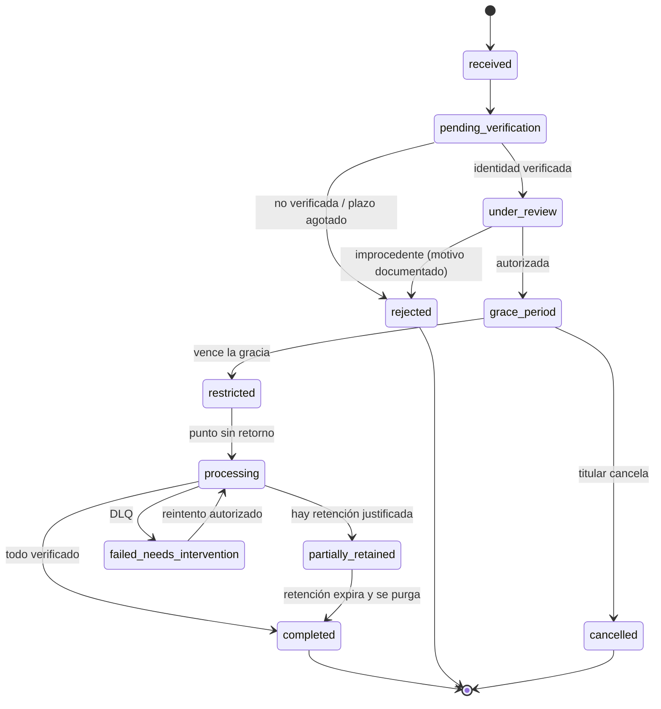

# ENSAMBRIA — Privacy & Data Lifecycle Management (PDLM)

**Documento de arquitectura y gobierno · Versión 2.0 (diseño aprobado; revisión legal por tratamiento pendiente) · 11 de noviembre de 2026**

| Campo | Valor |
|---|---|
| Propietario técnico | Arquitectura de CORE |
| Propietario de cumplimiento | Kevins Yesid Vega Marmolejo, designado por declaración del propietario como responsable DPO/Legal el 2026-11-11; credenciales no verificadas independientemente |
| Revisores obligatorios | Seguridad, SRE/Plataforma, backends CORE · BUSINESS · PLATFORM · PUBLIC |
| Estado | Diseño técnico/documental aprobado formalmente por el propietario el 2026-11-11. La revisión de fuentes, aplicabilidad legal por tratamiento, borradores y trazabilidad de implementación continúan pendientes; esta aprobación no certifica cumplimiento. La revisión profesional concreta se documenta por separado y no se presume. |
| Alcance | Plataforma global, multi-tenant, multi-región, multi-jurisdicción |
| Destinatarios | Ingeniería, seguridad, legal, operaciones y agentes de implementación |

> **Aviso.** Este documento define arquitectura y requisitos técnicos. No es asesoría jurídica ni aprobación legal. La investigación, redacción e integración técnica de documentos y controles puede avanzar antes de la revisión profesional. Cada pregunta jurídica crítica se registra por tratamiento y jurisdicción; únicamente el alcance que requiera esa validación previa permanece deshabilitado. Los valores numéricos operativos (tamaños de lote, concurrencia, SLOs) son hipótesis iniciales que deben calibrarse con pruebas de carga.

**Convención de lenguaje.** DEBE y NO DEBE indican requisitos obligatorios. DEBERÍA indica una recomendación fuerte que solo se omite con una excepción documentada. PUEDE indica una opción.

La Fase 0 de este plan PDLM es una línea de trabajo del documento, no sustituye ni adelanta la Fase 0 del roadmap ENSAMBRIA. La Fase 0 de ENSAMBRIA es documental: aprueba requisitos, responsables, decisiones y contratos; no crea runtime, migraciones ni esquemas activos. La ejecución de cada etapa PDLM debe trazarse a la fase/subfase ENSAMBRIA que introduce el comportamiento correspondiente. Para ENSAMBRIA, UUID v7 es el identificador canónico predeterminado para entidades distribuidas y se preserva entre backends; CORE mantiene separadas la identidad global y la membresía tenant-scoped. Los IDs no son credenciales ni sustituyen autorización. La recomendación UUID v7 para `request_id` es consistente con este estándar; toda decisión de generación nativa PostgreSQL depende de verificar la versión desplegada.

La investigación y registro de obligaciones legales, roles de tratamiento y requisitos por jurisdicción se coordina con [ENSAMBRIA_Privacy_Legal_Compliance.md](ENSAMBRIA_Privacy_Legal_Compliance.md). PDLM establece los controles de ciclo de vida; no reemplaza la revisión profesional. La falta de esa revisión no impide documentar o preparar su implementación, pero tampoco autoriza a marcar como validados requisitos, plazos o mercados ni a habilitar el alcance que dependa de una validación previa.

---

## 1. Propósito y alcance

PDLM es la capacidad transversal de ENSAMBRIA para ejercer y gobernar, de forma verificable, los derechos de las personas y las obligaciones de las organizaciones sobre los datos:

1. Acceso y consulta.
2. Rectificación y actualización.
3. Supresión / eliminación.
4. Portabilidad / exportación.
5. Oposición y revocación del consentimiento.
6. Baja de cuenta personal y baja de organización (tenant).
7. Retención, bloqueo legal (*legal hold*) y expiración de datos.
8. Evidencia auditable de todo lo anterior.

**Dentro de alcance:** CORE (identidad, tenants, autorización), BUSINESS (CRM, reservas, membresías, inventario, pedidos), PLATFORM (suscripciones SaaS, facturación), PUBLIC (perfiles, directorios, reseñas), almacenamiento de objetos, cachés, índices de búsqueda, analítica, logs, backups, colas/streams y subprocesadores externos.

**Fuera de alcance de este documento:** gestión de consentimiento y cookies en clientes web/móviles, política de privacidad de cara al público, y respuesta a requerimientos de autoridades judiciales (se coordinan con PDLM pero tienen su propio procedimiento legal).

---

## 2. Principios rectores

1. **Privacidad por diseño y por defecto.** Los datos personales se clasifican, se aíslan y se minimizan desde el modelo de datos, no con parches posteriores.
2. **Una autoridad central, ejecución distribuida.** CORE coordina y es la fuente de verdad de la solicitud. Cada backend propietario ejecuta y certifica su parte. Nadie borra tablas ajenas.
3. **Nunca síncrono ni masivo desde HTTP.** Toda eliminación o exportación es asíncrona, por lotes, idempotente, reanudable y con límites de consumo.
4. **Seguridad destructiva con frenos.** Lo irreversible exige verificación reforzada, período de gracia, notificaciones y un punto sin retorno explícito.
5. **Demostrable, no declarativo.** Un sistema solo "eliminó" algo si puede producir evidencia verificable sin conservar los datos eliminados.
6. **Jurisdicción como dato, no como código.** Plazos, excepciones y requisitos de verificación viven en un registro de políticas versionado, no dispersos en el código.
7. **El borrado criptográfico es ciudadano de primera clase.** El diseño de claves y la pseudonimización permiten supresión efectiva incluso en réplicas y backups.
8. **Aislamiento entre tenants y entre regiones** como propiedad del sistema, verificada continuamente.
9. **Operación segura a escala.** Una solicitud de eliminación o exportación NO DEBE degradar reservas, pagos ni a otros tenants.
10. **Evolutivo.** Un nuevo módulo, vertical o región se integra implementando contratos, sin rediseñar el mecanismo.

---

## 3. Marco normativo y estrategia multijurisdicción

### 3.1 Estrategia

ENSAMBRIA DEBE diseñarse para operar bajo múltiples regímenes simultáneamente. La estrategia es:

- **Línea base común exigente** (nivel RGPD) para toda la plataforma, de modo que abrir un nuevo mercado no obligue a rediseñar.
- **Registro de políticas por jurisdicción** (sección 3.3) que ajusta plazos, excepciones de retención, requisitos de verificación y notificaciones.
- **Regla del plazo más estricto:** cuando una solicitud toca más de una jurisdicción aplicable, el reloj de cumplimiento es el menor de los plazos aplicables, salvo decisión legal documentada.
- **Determinación de jurisdicción aplicable** por: residencia del titular, ubicación del tenant, región de almacenamiento de los datos y mercados en los que opera el tenant. Esta determinación DEBE registrarse en la solicitud.

### 3.2 Regímenes de referencia

Los plazos son **referenciales y DEBEN verificarse contra el texto oficial vigente** antes de configurarse en producción.

| Jurisdicción | Norma | Plazo de respuesta (referencial) | Notas relevantes para PDLM |
|---|---|---|---|
| UE / EEE | RGPD (arts. 12, 15–21, 25, 28, 30, 32–35, cap. V) | 1 mes, prorrogable 2 meses más en casos complejos | Notificación de brechas a la autoridad en 72 h. Transferencias internacionales con garantías adecuadas. Registro de actividades de tratamiento. |
| Reino Unido | UK GDPR + Data Protection Act 2018 | 1 mes, prorrogable | Régimen propio de transferencias. |
| California (EE. UU.) | CCPA / CPRA | 45 días, prorrogable 45 más | Derecho a eliminar, conocer, corregir. El proveedor de servicios debe propagar la eliminación a sus subproveedores. Otros estados de EE. UU. tienen leyes propias. |
| Colombia | Ley 1581 de 2012 y reglamentación (Decreto 1074 de 2015) | Consultas: 10 días hábiles + hasta 5. Reclamos: 15 días hábiles + hasta 8 | Autoridad: SIC. Registro Nacional de Bases de Datos. La supresión no procede si hay deber legal o contractual de conservar. |
| México | Ley Federal de Protección de Datos Personales en Posesión de los Particulares (vigente desde el 21 de marzo de 2025) | 20 días hábiles para comunicar la decisión + 15 días hábiles para hacerla efectiva (art. 31, verificar) | La autoridad pasó a ser la Secretaría Anticorrupción y Buen Gobierno. Derechos ARCO. Verificar reglamento de la nueva ley. |
| Brasil | LGPD (Ley 13.709/2018) | Confirmación inmediata en formato simplificado, o declaración completa en hasta 15 días | Autoridad: ANPD. Derechos del art. 18. |
| Chile | Ley 21.719 (publicada el 13-dic-2024) | Por validar con asesoría local | Crea la Agencia de Protección de Datos Personales. **Vigencia legal: 1-dic-2026**, salvo que prospere el proyecto de ley ingresado a fines de agosto de 2026 que la posterga al 1-dic-2027. Al 10-nov-2026 ese proyecto seguía en tramitación. **Diseñar para 2026 y tratar cualquier prórroga como beneficio, no como supuesto.** |
| Argentina | Ley 25.326 y decretos | Plazos cortos (días) para acceso y supresión; verificar | Autoridad: AAIP. |
| Otros (evaluar antes de abrir mercado) | Perú (Ley 29.733), Uruguay (Ley 18.331), Canadá (PIPEDA y leyes provinciales como Quebec), Australia (Privacy Act), Singapur (PDPA), India (DPDP Act 2023), China (PIPL), entre otros | Por validar | Algunos imponen localización de datos o restricciones de transferencia que afectan la arquitectura regional (sección 19). |

### 3.3 Registro de políticas por jurisdicción (policy-as-data)

Cada política es un registro versionado e inmutable (nuevas versiones, nunca ediciones in situ):

```yaml
policy_id: co-ley1581-v3
jurisdiction: CO
effective_from: 2025-01-01
rights:
  access:      { sla: { value: 10, unit: business_days }, extension: { value: 5, unit: business_days, requires_notice: true } }
  erasure:     { sla: { value: 15, unit: business_days }, extension: { value: 8, unit: business_days, requires_notice: true } }
  export:      { sla: { value: 10, unit: business_days } }
identity_verification: { min_assurance: "AAL2", proof_of_representation: required_for_third_parties }
retention_exceptions: [ tax_invoicing, accounting_books, contractual_claims, security_logs ]
authority_notifications: { breach: { authority: SIC, deadline_ref: "validar" } }
language_of_response: [es]
reviewed_by: legal@ENSAMBRIA
reviewed_at: 2026-11-01
```

El motor de PDLM DEBE: calcular el `deadline_at` con calendarios de días hábiles por país, soportar pausas legítimas del reloj (por ejemplo, a la espera de verificación de identidad) solo cuando la política lo permita, y alertar escalonadamente antes del vencimiento.

---

## 4. Roles de tratamiento: responsable y encargado

ENSAMBRIA actúa en dos roles distintos y el sistema DEBE modelarlos explícitamente, porque determinan **quién decide** una eliminación:

| Datos | Rol de ENSAMBRIA | Quién decide | Consecuencia técnica |
|---|---|---|---|
| Cuenta de usuario de la plataforma, facturación de la suscripción SaaS, telemetría propia | Responsable (*controller*) | ENSAMBRIA | ENSAMBRIA atiende la solicitud directamente. |
| Datos de clientes finales, reservas, membresías, CRM y pedidos del tenant | Encargado (*processor*) del tenant | El tenant (responsable) | Si un cliente final solicita supresión a ENSAMBRIA, la solicitud se **reenvía al tenant** y se ejecuta solo con su instrucción, dentro del plazo pactado en el contrato de encargo (DPA). |
| Perfiles públicos, directorios y reseñas | Puede ser corresponsable | Definir por caso con Legal | Requiere acuerdo explícito y flujos diferenciados. |

Requisitos:

- Cada dato clasificado DEBE tener un atributo `controller_role` (sección 7).
- El sistema DEBE soportar el flujo **DSAR forwarding**: recepción, reenvío al tenant en un plazo contractual corto (propuesta inicial: 48 h), seguimiento y cierre.
- El DPA con cada tenant DEBE incluir: instrucciones de tratamiento, subencargados autorizados, plazos de asistencia, devolución o supresión al terminar el servicio y derecho de auditoría.

---

## 5. Titulares y tipos de solicitud

### 5.1 Tipos de titular

| Titular | Ejemplo | Particularidad |
|---|---|---|
| Usuario con cuenta | Empleado, administrador, cliente registrado | Puede pertenecer a varios tenants. |
| Cliente final sin cuenta | Cliente que reservó como invitado | Identificación por correo, teléfono o ID del tenant. Mayor riesgo de suplantación. |
| Representante legal del tenant | Propietario de la organización | Requiere prueba de facultad. |
| Visitante / lead | Persona en formulario o directorio público | Datos en PUBLIC y analítica. |
| Menor de edad | Cliente menor de un salón | Requiere representante legal y reglas especiales. |
| Tercero representante | Abogado o apoderado | Requiere poder verificable. |

### 5.2 Tipos de solicitud

| Solicitud | Alcance | Coordinador | Ejecutores |
|---|---|---|---|
| Eliminación de cuenta personal | Identidad, perfil, sesiones y datos personales eliminables del usuario | CORE | CORE + dominios donde aparezca el usuario |
| Baja de tenant | Organización, sucursales, usuarios, datos operativos y módulos contratados | CORE | CORE + BUSINESS + PLATFORM + PUBLIC + terceros |
| Exportación (acceso / portabilidad) | Datos personales o empresariales autorizados | CORE | Cada backend propietario |
| Rectificación | Corrección de datos inexactos | CORE | Dominios propietarios |
| Oposición / revocación | Cese de tratamientos específicos | CORE | Dominios y analítica |
| Restricción / bloqueo | Suspender tratamiento sin borrar | CORE | Dominios |
| Retención forzada (*legal hold*) | Congelar datos por obligación legal | Legal vía CORE | Todos |

---

## 6. Arquitectura

### 6.1 Vista general

```text
                          SOLICITANTE
        Usuario · Cliente final · Admin tenant · Representante
                               │
                               ▼
            ┌───────────────────────────────────────┐
            │   API de Privacidad (borde)           │
            │   AuthN reforzada · Rate limit · WAF  │
            └───────────────────┬───────────────────┘
                                ▼
 ┌──────────────────────────────────────────────────────────┐
 │  PLANO DE CONTROL — CORE · Privacy & Data Lifecycle      │
 │  Solicitudes · Políticas por jurisdicción · Workflows    │
 │  Estados · Relojes de plazo · Legal holds · Auditoría    │
 └───────┬───────────────┬───────────────┬──────────────────┘
         │ contratos versionados · mTLS · identidad de servicio
   ┌─────▼────┐    ┌─────▼────┐    ┌─────▼────┐    ┌──────────────┐
   │ BUSINESS │    │ PLATFORM │    │  PUBLIC  │    │ Satélites    │
   │ Agente   │    │ Agente   │    │ Agente   │    │ Search·Cache │
   │ de datos │    │ de datos │    │ de datos │    │ Analítica·Log│
   └─────┬────┘    └─────┬────┘    └─────┬────┘    └──────┬───────┘
         │               │               │                │
   ┌─────▼───────────────▼───────────────▼────────────────▼──────┐
   │  PLANO DE DATOS REGIONAL (celdas por región)                │
   │  PostgreSQL particionado · Object Storage · Streams         │
   │  PII Vault · KMS/HSM regional · Workers con límites         │
   └─────────────────────────────┬───────────────────────────────┘
                                 ▼
        Auditoría inmutable (WORM) · Evidencia · Suppression Ledger
```

### 6.2 Componentes

| Componente | Responsabilidad |
|---|---|
| **API de Privacidad** | Punto de entrada único. Autentica, aplica rate limiting, registra la solicitud con idempotency key y devuelve un identificador de seguimiento. NUNCA ejecuta trabajo pesado. |
| **Motor de workflows** | Orquestación durable de pasos con estado persistido, temporizadores, reintentos y reanudación tras caídas. PUEDE implementarse con un motor de workflows durable o con máquinas de estado propias sobre PostgreSQL y outbox, pero DEBE cumplir los requisitos de la sección 21. |
| **Registro de políticas** | Fuente de plazos, excepciones y requisitos por jurisdicción (sección 3.3). |
| **Agente de datos por dominio** | Servicio dentro de cada backend propietario que implementa los contratos PDLM sobre sus propios datos. Es el único autorizado a modificarlos. |
| **Workers de procesamiento** | Ejecutan lotes de borrado, anonimización y exportación, con admisión controlada (sección 21). |
| **PII Vault** | Almacén aislado de identificadores personales directos con tokenización (sección 8). |
| **Suppression Ledger** | Registro minimizado de supresiones para reaplicarlas tras restauraciones (sección 17). |
| **Almacén de evidencia** | Atestaciones firmadas de cada dominio, sin contener datos personales. |
| **Panel de operación** | Estado de solicitudes, plazos en riesgo, DLQ, métricas y aprobaciones manuales. |

### 6.3 Regla de ownership

- CORE NO DEBE leer ni escribir tablas de BUSINESS, PLATFORM o PUBLIC.
- Toda orden se emite mediante **contratos versionados** (Anexo B), autenticados y autorizados con identidad de servicio.
- Un dominio NO DEBE declarar cumplida una orden sin haber verificado sus propios resultados (sección 25.4).

---

## 7. Inventario y clasificación de datos

El sistema entero depende de saber **dónde está cada dato personal**. Sin esto, la eliminación es una ilusión.

### 7.1 Catálogo de datos como código

Cada backend DEBE mantener un catálogo versionado en su repositorio que anote cada tabla, columna, campo de evento, objeto de almacenamiento y entrada de caché o índice:

```yaml
dataset: business.bookings
owner_domain: BUSINESS
controller_role: processor          # controller | processor | joint
tenant_scoped: true
subject_key: customer_subject_id
fields:
  - name: customer_subject_id
    class: pseudonymous_id
  - name: notes
    class: personal_free_text       # riesgo alto: puede contener datos sensibles
  - name: amount
    class: financial_transactional
retention_policy: booking_records_v2
erasure_strategy: anonymize          # delete | anonymize | retain_restricted | vault_token_drop
exportable: true
downstream: [search.bookings_index, analytics.fact_bookings]
```

### 7.2 Niveles de clasificación

| Nivel | Ejemplos | Controles mínimos |
|---|---|---|
| C0 Público | Datos publicados por el tenant | Integridad |
| C1 Interno | Configuración, catálogos | Control de acceso |
| C2 Personal | Nombre, correo, teléfono, historial de reservas | Cifrado, minimización, auditoría de acceso |
| C3 Personal sensible o financiero | Datos de salud o biométricos si existieran, identificadores fiscales, datos de pago tokenizados | Cifrado a nivel de campo, acceso por necesidad, alertas |
| C4 Secretos | Credenciales, tokens, claves | Nunca en exportaciones, nunca en logs, almacén de secretos |

### 7.3 Controles obligatorios

- **Gate de CI:** una migración que añada una columna sin anotación en el catálogo DEBE fallar el pipeline.
- **Escáner periódico de PII** en logs, campos de texto libre, objetos y analítica para detectar datos no catalogados.
- **Registro de actividades de tratamiento** generado a partir del catálogo, para cumplir obligaciones de documentación (por ejemplo, art. 30 RGPD).
- Los campos de **texto libre** (notas, comentarios, mensajes) se tratan como potencialmente sensibles por defecto.

---

## 8. Pseudonimización y PII Vault

**Decisión de arquitectura recomendada (ADR-03):** los dominios NO almacenan identificadores personales directos. Almacenan un `subject_id` opaco; los datos directamente identificadores (nombre, correo, teléfono, documento, dirección) viven en el **PII Vault**.

Beneficios:

- La supresión de una persona es **eliminar o destruir su registro en el vault**: los registros de dominio quedan automáticamente anonimizados, sin recorrer millones de filas.
- Los backups, streams, analítica y logs contienen solo `subject_id`, no identificadores directos, lo que reduce drásticamente el problema de datos "fantasma".
- El acceso a identidad se centraliza, se audita y se protege con controles más fuertes.

Reglas:

- El vault es regional (sección 19), con claves propias en KMS/HSM y ciclo de backup más corto que los dominios.
- La re-identificación solo es posible mediante el vault, con autorización y auditoría.
- Cuando existan obligaciones de conservación (por ejemplo, facturación), el dato fiscal necesario se conserva en el dominio correspondiente bajo `retain_restricted`, separado del resto.
- Contrapartida: añade un salto de lectura y un punto crítico de disponibilidad. El vault DEBE diseñarse con alta disponibilidad, caché segura de lectura y pruebas de carga propias.

---

## 9. Modelo de datos del subsistema (CORE)

Los nombres son conceptuales y DEBEN ajustarse a las convenciones del modelo real.

```text
privacy/
├── data_subject_requests        # solicitud canónica (todas las clases)
├── request_verifications        # evidencia y nivel de verificación de identidad
├── request_authorizations       # aprobaciones (four-eyes), representaciones
├── request_deadlines            # reloj, pausas, extensiones, alertas
├── processing_workflows         # instancia del workflow por solicitud
├── processing_steps             # paso por dominio, estado, cursor, intentos
├── domain_attestations          # certificaciones de cada dominio (hash, contadores)
├── retention_policies           # políticas versionadas por categoría
├── legal_holds                  # bloqueos con alcance, motivo, titular y vigencia
├── jurisdiction_policies        # registro de políticas (sección 3.3)
├── subprocessor_registry        # terceros, DPA, API de borrado, región
├── subprocessor_requests        # órdenes a terceros y confirmaciones
├── suppression_ledger           # supresiones minimizadas para reaplicar tras restore
├── processing_audit             # auditoría encadenada e inmutable
└── outbox_events                # outbox transaccional
```

Campos mínimos de una solicitud:

```text
request_id                 UUID (v7 recomendado, ordenable por tiempo)
idempotency_key            único por solicitante y tipo
request_type               erasure | export | rectification | objection | restriction | tenant_closure
subject_type               user | end_customer | tenant | representative
subject_id / tenant_id     referencias opacas
requested_by               identidad autenticada
acting_on_behalf_of        si hay representación
channel                    app | web | email | autoridad | tenant_forward
jurisdictions[]            jurisdicciones aplicables determinadas
policy_ids[]               versiones de políticas aplicadas
verification_level         none | basic | strong | legal_representative
status                     ver sección 10
requested_at / received_at fecha de recepción para el reloj legal
deadline_at                calculado por el motor de políticas
extension_applied          bool + motivo + notificación al titular
point_of_no_return_at      cuándo se cruzó el punto sin retorno
completed_at
outcome                    completed | partially_retained | rejected | cancelled
outcome_reason_code        catálogo cerrado (nunca texto con datos personales)
correlation_id / trace_id
region_of_record
```

`suppression_ledger` guarda únicamente: `subject_id` (o su hash con sal por región), `tenant_id`, `scope`, `erased_at` y `request_id`. NO guarda nombre, correo ni ningún identificador directo.

---

## 10. Máquina de estados y relojes de plazo

### 10.1 Estados



| Estado | Significado |
|---|---|
| `received` | Registrada con idempotency key. Reloj legal iniciado. |
| `pending_verification` | Esperando verificación de identidad o representación. El reloj puede pausarse solo si la política lo permite. |
| `under_review` | Evaluación de dependencias, retenciones, holds y excepciones. |
| `grace_period` | Autorizada y anunciada. El titular puede cancelar. Accesos reducidos según política. |
| `restricted` | Accesos y operaciones restringidos. Sin nuevos negocios. |
| `processing` | Ejecución distribuida. Punto sin retorno cruzado. |
| `partially_retained` | Eliminado lo procedente. Conservación restringida con fecha de expiración. |
| `failed_needs_intervention` | Pasos en DLQ que requieren operador. El reloj sigue corriendo. |
| `completed` | Todos los dominios y terceros atestiguaron y la verificación pasó. |
| `rejected` | Improcedente, con motivo codificado y comunicación al titular. |
| `cancelled` | Cancelada antes del punto sin retorno. |

### 10.2 Reglas

- Las transiciones DEBEN ser atómicas con su evento de outbox y su registro de auditoría.
- Solo se permiten transiciones del diagrama. Cualquier otra se rechaza y alerta.
- **Punto sin retorno (PNR):** momento exacto a partir del cual se ejecutan operaciones irreversibles. Antes del PNR, la cancelación es posible. Después, no. El PNR DEBE ser un evento explícito, registrado y verificable por cuatro ojos en bajas de tenant.
- **Reloj de plazos:** alertas a 50 %, 75 % y 90 % del plazo; escalamiento automático a Legal y a operación. Una solicitud en riesgo de vencer DEBE tener prioridad en la cola.
- **Extensiones** solo cuando la política lo permita y notificando al titular con motivo.

---

## 11. Verificación de identidad, autorización y anti-abuso

### 11.1 Niveles de aseguramiento

| Acción | Autenticación mínima |
|---|---|
| Exportar datos personales propios | Sesión reciente con MFA |
| Eliminar cuenta personal | Reautenticación reforzada + confirmación por canal verificado |
| Solicitud de cliente final sin cuenta | Verificación por canal registrado + comparación de datos conocidos. Nunca confirmar la existencia de datos a un solicitante no verificado |
| Baja de tenant | Propietario verificado con MFA + prueba de facultad + aprobación de segundo propietario o administrador legal + confirmación diferida |
| Solicitud de un tercero | Poder o autorización verificable y validación legal |

### 11.2 Controles anti-abuso y anti-fraude

- **Notificación a todos los propietarios** del tenant ante cualquier solicitud de baja o exportación masiva, por canales independientes de la sesión actual.
- **Cooling-off** (período de gracia) obligatorio antes del PNR. Duración definida por política; propuesta inicial de 14 a 30 días para tenants, y menor para cuentas personales.
- **Cancelación sencilla** durante la gracia, desde cualquier propietario.
- **Rate limiting** por identidad, IP, tenant y tipo de solicitud. Detección de patrones de abuso (solicitudes masivas, enumeración de sujetos).
- **Respuestas indistinguibles** ante solicitantes no verificados para evitar que el canal revele si una persona existe.
- **Separación de funciones:** quien aprueba no es quien ejecuta. El personal de soporte NO PUEDE iniciar ni aprobar bajas por sí solo. Cualquier acción humana sobre una solicitud DEBE requerir permisos específicos, motivo y registro.
- **Break-glass** para casos excepcionales con aprobación dual, vigencia corta y alerta inmediata a seguridad.

---

## 12. Eliminación de cuenta individual

Escenario: un usuario solicita eliminar su cuenta.

1. Solicitud autenticada con reautenticación reforzada; registro con idempotency key.
2. Determinación del tipo de relaciones: propietario, administrador, empleado o cliente, en **uno o varios tenants**.
3. **Evaluación de bloqueos:** ¿es el último propietario de algún tenant? ¿tiene reservas futuras, comisiones o pagos pendientes? ¿hay disputas o legal holds? Si es el último propietario, se exige transferir la titularidad o iniciar la baja del tenant. La cuenta NO se elimina dejando un tenant huérfano.
4. Período de gracia con acceso restringido y notificación.
5. Tras el PNR: revocación de sesiones, refresh tokens, claves de API, dispositivos y credenciales en todos los canales.
6. Ejecución por dominio: eliminar, anonimizar o conservar restringidamente según el catálogo y las políticas de retención.
7. Eliminación o destrucción de las entradas del vault. Los registros de dominio quedan desvinculados.
8. Limpieza de satélites: índices de búsqueda, cachés, analítica, colas y terceros (sección 16).
9. **Verificación:** el usuario no puede autenticarse, recuperar su cuenta ni ser encontrado en búsquedas; los dominios atestiguan resultados.
10. Comunicación de cierre al titular, con resumen de qué se eliminó, qué se anonimizó y qué se conserva y por cuánto tiempo.

Principio de integridad: eliminar a un empleado NO elimina la organización, las reservas de otros clientes ni los registros financieros del negocio. Si un registro histórico debe conservarse, se desvincula la identidad personal cuando sea legalmente procedente, preservando la integridad del registro.

---

## 13. Baja de tenant

### 13.1 Fases

| Fase | Contenido | Responsable |
|---|---|---|
| A. Validación de autoridad | Representación legal, cuatro ojos, verificación fuerte | CORE + Legal |
| B. Evaluación de dependencias | Pagos y liquidaciones pendientes, disputas y contracargos, facturas a conservar, suscripción SaaS, reservas futuras, membresías, franquicias y sucursales dependientes, integraciones con terceros, legal holds | CORE + dominios |
| C. Cierre comercial | Cancelación de suscripción y facturación final, notificación a clientes finales si el contrato lo exige, retiro de publicaciones públicas | PLATFORM + PUBLIC |
| D. Ventana de exportación | El tenant puede descargar sus datos antes de la eliminación | Dominios |
| E. Período de gracia | Acceso restringido, cancelación posible | CORE |
| F. Punto sin retorno | Evento explícito aprobado por cuatro ojos | CORE |
| G. Eliminación / anonimización | Por dominio con la estrategia adecuada al tamaño (sección 14) | Dominios |
| H. Verificación y evidencia | Atestaciones, reconciliación con terceros, informe final | CORE |
| I. Conservación restringida | Lo que la ley exige conservar, aislado, con expiración | Dominios |

### 13.2 Jerarquías y franquicias

- Un tenant con sucursales o franquicias DEBE modelar qué entidades dependen de cuál. La baja de una sucursal no implica la baja de la matriz ni viceversa.
- Si una franquicia es controlada por un tenant distinto, la baja de la matriz NO DEBE borrar datos de la franquicia sin instrucción de su propio responsable.

---

## 14. Estrategias de borrado a escala

Un único mecanismo (`DELETE` por lotes) no sirve para todos los tamaños. ENSAMBRIA DEBE definir **niveles de tenant** y una estrategia por nivel.

### 14.1 Niveles

| Nivel | Perfil | Estrategia de aislamiento | Estrategia de borrado |
|---|---|---|---|
| Estándar | Mayoría de tenants | Esquema compartido, tablas particionadas por `tenant_id` (hash) | Borrado por lotes + borrado criptográfico de claves del tenant |
| Grande | Cientos de miles a millones de filas | Particiones dedicadas (LIST) o subparticionamiento | `DETACH`/`DROP PARTITION` tras verificación + crypto-shredding |
| Enterprise / regulado | Contrato específico, residencia o claves propias | Esquema o base de datos dedicada, claves propias (BYOK opcional) | Eliminación de la base o esquema dedicado + destrucción de claves |

Reglas de particionamiento:

- El particionamiento por tenant DEBE decidirse en el diseño del esquema. Reconvertir tablas enormes después es costoso y riesgoso.
- Hay que equilibrar el número de particiones (demasiadas degradan el planificador). Preferir particionamiento hash con un número controlado y promover a tenants grandes a particiones dedicadas.
- Todas las claves foráneas, índices y consultas DEBEN incluir `tenant_id`.

### 14.2 Borrado criptográfico (crypto-shredding)

Jerarquía de claves recomendada:

```text
Raíz regional (HSM/KMS)
 └── KEK por tenant
      └── DEK por dataset / dominio / período
           └── Cifrado de datos y objetos
```

- Al finalizar la baja de un tenant, la destrucción programada de su KEK vuelve ilegibles datos residuales en réplicas, backups, snapshots y objetos, **sin tocar los backups**.
- Destrucción de claves con período de retención de seguridad (periodo de recuperación corto y definido), doble control y auditoría.
- La rotación de claves y la custodia DEBEN estar documentadas. Perder una clave por error es una pérdida de datos irreversible: se necesita un procedimiento de custodia y verificación previo a la destrucción.
- Para personas individuales, el equivalente es la destrucción del registro en el PII Vault (sección 8).

### 14.3 Borrado por lotes

Para datos que no se eliminan por partición ni por clave:

- Lotes pequeños y **configurables por dominio**. Valor inicial a calibrar (por ejemplo, cientos de filas), nunca uno global.
- *Keyset pagination*. Prohibido `OFFSET` grande.
- Transacciones cortas por lote, con checkpoints persistidos y operaciones idempotentes.
- Índices parciales y sobre `tenant_id` y claves de procesamiento.
- Atención a efectos secundarios: *bloat*, presión sobre autovacuum, volumen de WAL, lag de réplicas de lectura y de DR. Los workers DEBEN medir y reaccionar (sección 21.3).
- Ventanas de baja carga y prioridad inferior a reservas y pagos.

### 14.4 Anonimización

- Estrategia por campo: supresión, generalización, hash con sal por región (cuando no permita re-identificación razonable), tokenización irreversible.
- DEBE ser realmente irreversible para el contexto. Un hash sin sal de un correo NO es anonimización.
- Evaluar riesgo de re-identificación por combinación de campos (fecha + sucursal + servicio + importe). Los datos agregados para analítica DEBEN revisarse con criterios de *k-anonimato* u otros equivalentes cuando se publiquen o compartan.

---

## 15. Exportación y portabilidad

### 15.1 Flujo

1. **Solicitud y autorización** con el nivel de aseguramiento de la sección 11.
2. **Definición del alcance:** datos personales del titular, o datos empresariales del tenant. Nunca datos de otros tenants.
3. **Snapshot lógico consistente:** definición de "versión" mediante marca de tiempo o LSN, de modo que el paquete sea coherente y reproducible. Para dominios con cambios continuos, se documenta la semántica de consistencia (por dominio) y se informa en el paquete.
4. **Extracción por lotes** con cursores e índices, límites de consumo y prioridad baja.
5. **Construcción del paquete** en formatos estructurados y de uso común (JSON, CSV y adjuntos), con esquema documentado, diccionario de datos y manifiesto con *checksums*.
6. **Almacenamiento privado cifrado** en object storage regional, con clave por paquete.
7. **Entrega segura:** URL firmada de corta vigencia, de un solo uso o con descargas limitadas, tras reautenticación. Registro de quién descargó y cuándo.
8. **Expiración y eliminación** del paquete al vencer su disponibilidad.

### 15.2 Protecciones

- Nunca URL pública permanente.
- Nunca incluir credenciales, hashes de contraseñas, tokens, claves, secretos, ni datos C4.
- Los datos de terceros incluidos en el alcance (otros clientes mencionados en notas) DEBEN revisarse. Si no hay fundamento válido para incluirlos, se omiten o se redactan.
- Control de tamaño, duración, concurrencia por tenant y global. Cuota de exportaciones por período.
- Cifrado en reposo y en tránsito. La contraseña o clave del paquete (si se usa) se entrega por canal separado.
- Prevención de fugas: marcas de trazabilidad por paquete, detección de descargas anómalas y alertas.
- Para organizaciones grandes, la extracción PUEDE usar réplica de lectura o infraestructura de exportación aislada. La decisión se toma con mediciones reales, no por defecto.
- Los paquetes no se almacenan más allá de su vigencia, y su eliminación es verificable.

---

## 16. Sistemas derivados y terceros

Un borrado que solo cubre PostgreSQL deja datos vivos. PDLM DEBE cubrir todos los almacenes derivados.

| Sistema | Riesgo | Tratamiento |
|---|---|---|
| Cachés (Redis, CDN) | Datos servidos tras la eliminación | Invalidación por `subject_id` y `tenant_id`; TTLs cortos para PII; claves de caché sin PII en el nombre |
| Índices de búsqueda | Persistencia de documentos con PII | Eventos de supresión consumidos por el indexador; reindexación verificable |
| Streams y colas (por ejemplo, Kafka) | Retención larga con PII | Eventos con `subject_id`, no con PII directa; compactación con *tombstones*; cifrado por tenant; retención acotada |
| Analítica y data lake | Copias derivadas sin control | Solo datos pseudonimizados; propagación de supresiones; particionamiento y expiración por tenant |
| Logs y trazas | PII en mensajes | Prohibido registrar PII directa; redacción automática; retención acotada; escáner periódico |
| Almacenamiento de objetos | Archivos adjuntos, imágenes | Prefijos por tenant y claves por tenant; ciclo de vida; borrado verificado; versionado controlado |
| Modelos / *features* de ML | Memorización de datos personales | Datos de entrenamiento minimizados y anonimizados; registro de linaje; política de reentrenamiento |
| Herramientas de soporte y CRM interno | Copias manuales | Integración con PDLM o procedimiento controlado |
| Subencargados (pasarelas de pago, correo, SMS, analítica, mensajería, almacenamiento) | Datos fuera del control directo | Registro de subencargados; orden de supresión vía API; confirmación; evidencia; cláusulas contractuales |

Requisitos:

- Todo satélite DEBE aparecer en el catálogo (`downstream`) y suscribirse a eventos de supresión.
- Cada subencargado DEBE tener documentado: finalidad, categoría de datos, región, mecanismo de supresión, plazo y contacto. Los que no ofrezcan supresión verificable DEBEN evaluarse con riesgo explícito.
- Las órdenes a terceros usan el mismo patrón de idempotencia y reintentos, y quedan en `subprocessor_requests` con confirmación.

---

## 17. Backups, recuperación ante desastres y restauración

Los backups NO se modifican fila por fila. La solución combina cuatro mecanismos:

1. **Retención acotada y publicada.** Los backups operativos expiran en un plazo definido y comunicado (propuesta inicial a validar con Legal). Los datos eliminados dejan de existir en backups cuando expira la retención.
2. **Datos poco identificables en backups.** Gracias al PII Vault, los backups de dominio contienen `subject_id`, no identificadores directos. El vault tiene su propio ciclo de backup más corto.
3. **Borrado criptográfico.** La destrucción de claves por tenant (sección 14.2) deja ilegibles sus datos en cualquier copia.
4. **Suppression Ledger.** Registro mínimo e inmutable de supresiones que se reaplica tras cualquier restauración.

Procedimiento de restauración (obligatorio):

- Restaurar en un **entorno en cuarentena**, sin tráfico de usuarios.
- Reaplicar el Suppression Ledger completo (supresiones posteriores al punto de restauración).
- Reaplicar legal holds y políticas de retención vigentes.
- Validar con consultas de verificación que no hay sujetos suprimidos accesibles.
- Solo entonces conmutar tráfico.
- Registrar el procedimiento como evidencia.

Reglas adicionales:

- Los **legal holds** PUEDEN extender la retención de backups para el alcance afectado, con registro explícito.
- Los DR drills (ejercicios de restauración) DEBEN incluir el reaplicado de supresiones y se ejecutan periódicamente.
- Los backups DEBEN cifrarse con claves distintas a las de producción y con control de acceso separado.

---

## 18. Retención y legal holds

### 18.1 Política de retención

Cada categoría de datos DEBE tener una política con: base legal o contractual, período, disparador (por ejemplo, fin de relación, fecha de factura), acción al vencer (eliminar o anonimizar), jurisdicciones y propietario. Las políticas son versionadas y revisadas por Legal.

### 18.2 Ejemplo ilustrativo (a validar por jurisdicción)

| Categoría | Estrategia ante solicitud de supresión | Retención |
|---|---|---|
| Perfil y credenciales | Eliminar | Inmediata tras PNR |
| Historial de reservas | Anonimizar (preservar integridad operativa y estadística) | Según política del tenant |
| Facturas y registros contables | Conservar restringido | Plazo fiscal y contable aplicable |
| Pagos y contracargos | Conservar restringido | Plazos de disputa y regulatorios |
| Logs de seguridad | Conservar restringido, minimizados | Plazo de seguridad definido |
| Datos publicados (PUBLIC) | Retirar y eliminar | Inmediata |
| Analítica | Anonimizada o eliminada | Según política |
| Evidencia de la solicitud | Conservar mínima | Período de defensa legal |

Los plazos concretos DEBEN fijarlos Legal y Finanzas por jurisdicción. El sistema solo los ejecuta.

### 18.3 Legal holds

- Un hold congela datos específicos (alcance por sujeto, tenant, categoría, período) ante litigios, investigaciones o requerimientos.
- Los holds prevalecen sobre solicitudes de supresión dentro de su alcance. La solicitud se procesa en lo que no esté afectado y pasa a `partially_retained`, con comunicación apropiada al titular.
- Un hold requiere autor, motivo codificado, vigencia y revisión periódica. Solo Legal puede crearlo o levantarlo, con auditoría.
- Cuando el hold termina, se evalúa y ejecuta automáticamente la supresión pendiente.

---

## 19. Residencia de datos y transferencias internacionales

### 19.1 Arquitectura regional

- La plataforma se organiza en **celdas regionales** (por ejemplo, UE, Norteamérica, Latinoamérica), cada una con su plano de datos, KMS/HSM, PII Vault, object storage y workers.
- Cada tenant tiene una **región de origen** (`region_of_record`) registrada y, salvo contrato específico, sus datos personales no salen de ella.
- El plano de control global NO DEBE almacenar PII regulada fuera de su región. Almacena identificadores opacos, estados y metadatos. Si necesita PII, la consulta al vault regional con autorización.
- Las solicitudes se enrutan a la región correspondiente. La eliminación se ejecuta en cada región donde existan datos del sujeto, y el estado global se agrega sin copiar datos personales.

### 19.2 Transferencias

- Los flujos transfronterizos (soporte, analítica, subencargados) DEBEN estar mapeados y justificados, con el mecanismo jurídico adecuado por ruta (por ejemplo, cláusulas contractuales tipo, decisiones de adecuación o marcos de transferencia aplicables). Legal valida cada ruta.
- El acceso remoto desde otra región (por ejemplo, soporte) se considera transferencia y DEBE controlarse (acceso justo a tiempo, enmascaramiento, registro).
- Los países con **localización obligatoria** de datos requerirán una celda dedicada antes de abrir mercado.

### 19.3 Idioma y comunicación

- Las comunicaciones al titular DEBEN emitirse en el idioma del titular o del mercado, con plantillas revisadas por Legal.
- Los motivos de rechazo o retención se expresan con códigos de catálogo cerrado traducidos, sin texto libre que filtre datos.

---

## 20. Seguridad

### 20.1 Modelo de amenazas (resumen)

| Amenaza | Impacto | Controles |
|---|---|---|
| Cuenta de propietario comprometida solicita baja o exportación | Pérdida o fuga masiva | MFA, reautenticación, notificación a todos los propietarios, gracia, cuatro ojos, rate limiting |
| Empleado interno malicioso o error humano | Eliminación indebida o fuga | Separación de funciones, mínimos privilegios, break-glass, auditoría inmutable, alertas |
| Cross-tenant (A afecta datos de B) | Pérdida de confidencialidad o integridad | Filtro de `tenant_id` obligatorio en cada capa, particionamiento, RLS (Row-Level Security) donde aplique, pruebas automáticas de aislamiento |
| Servicio interno suplantado | Órdenes falsas de eliminación | mTLS, identidad de servicio, firmas de mensajes, permisos mínimos por contrato, listas de emisores permitidos |
| Manipulación de mensajes / repetición | Doble ejecución o ejecución espuria | Idempotency keys, nonces, firmas con expiración, validación de estado antes de ejecutar |
| Fuga de paquete de exportación | Exposición de datos | Cifrado, URL firmada breve, un solo uso, marcas de trazabilidad, detección de anomalías |
| Enumeración de titulares | Revelación de datos | Respuestas indistinguibles, rate limiting, CAPTCHA adaptativo |
| Supply chain (dependencias, imágenes) | Compromiso del worker | SBOM, escaneo, firmas, entornos aislados, versiones fijadas |
| Denegación de servicio mediante solicitudes de privacidad | Degradación de operación | Cuotas, colas con prioridad, admisión controlada, límites por tenant |
| Restauración que revive datos | Incumplimiento | Suppression Ledger y procedimiento de cuarentena |
| Pérdida de claves por error | Pérdida de datos irreversible | Custodia, doble control, retención de seguridad previa a la destrucción |
| Fuga por logs o auditoría | Exposición secundaria | Prohibir PII en logs, redacción, auditoría minimizada |

### 20.2 Controles técnicos obligatorios

- **Autenticación entre servicios** con identidad de carga de trabajo (por ejemplo, mTLS con certificados de corta vida) y autorización por contrato. Un worker solo accede a los datasets de su dominio.
- **Mínimos privilegios y credenciales efímeras.** Roles de base de datos separados para workers de PDLM, con límites de conexiones y permisos de solo las operaciones necesarias.
- **Cifrado** en tránsito (TLS moderno) y en reposo (con claves por tenant donde la sección 14 lo exige). Cifrado a nivel de campo para C3.
- **Gestión de secretos** en almacén dedicado. Rotación automática. Prohibido en repositorios y logs.
- **Auditoría inmutable:** `processing_audit` en almacenamiento WORM o con encadenamiento de hashes (*hash chain*), firmada y replicada. Contiene eventos, actores, decisiones y resultados, **sin PII directa**.
- **Verificación de integridad de órdenes:** toda orden lleva `request_id`, `idempotency_key`, `schema_version`, firma y expiración. El agente valida el estado actual de la solicitud en CORE antes de ejecutar acciones irreversibles.
- **Protección de acciones destructivas:** cualquier operación irreversible requiere PNR registrado y consulta de legal holds en el momento de ejecución (no solo al inicio).
- **Monitoreo y alertas** para: solicitudes masivas, descargas anómalas, accesos al vault, intentos de transición inválida, órdenes duplicadas y cambios en políticas.
- **Pruebas de seguridad:** modelado de amenazas por cambio relevante, pruebas de penetración periódicas, ejercicios de *red team* sobre flujos de baja y exportación, y revisión de código obligatoria para el módulo.

### 20.3 Marcos de referencia

El programa DEBERÍA alinearse con ISO/IEC 27001 (seguridad de la información), ISO/IEC 27701 (gestión de privacidad), SOC 2 (confianza de servicios) y, según mercado y clientes, requisitos sectoriales. Las evidencias de PDLM (atestaciones, auditoría, pruebas de restauración) deben generarse de forma que alimenten estas auditorías.

---

## 21. Fiabilidad y escalabilidad

### 21.1 Orquestación durable

- Cada solicitud es un **workflow persistente**: estado, pasos, temporizadores, reintentos y cursores sobreviven a reinicios y despliegues.
- **Patrón saga con avance hacia adelante:** como la eliminación es irreversible, no se diseñan compensaciones de borrado. Se diseñan *puntos seguros* previos al PNR y verificaciones de precondiciones. Después del PNR, la política es continuar y reintentar hasta completar, escalando a operador si falla.
- Cada paso tiene: *timeout*, límite de reintentos, política de backoff exponencial con *jitter*, y destino a DLQ con alerta.
- **Outbox transaccional** para emitir órdenes y eventos de manera atómica con los cambios de estado. Los consumidores son idempotentes.
- **Detección de pasos huérfanos:** si un dominio no responde en el plazo del paso, se emite alerta y se aplican políticas de reintento o intervención.

### 21.2 Idempotencia y concurrencia entre solicitudes

- Idempotencia por `request_id` y por `(subject, scope, operation)`.
- Reglas de conflicto entre solicitudes simultáneas: por ejemplo, una exportación en curso y una eliminación sobre el mismo sujeto; una baja de tenant mientras se procesa la eliminación de un usuario de ese tenant; una restricción activa. El motor aplica una matriz de compatibilidad definida y serializa las incompatibles.
- Las operaciones con legal holds se evalúan en cada paso.

### 21.3 Protección de la base de datos y admisión controlada

Los workers NO DEBEN decidir su ritmo por sí solos. Un **controlador de admisión** ajusta la concurrencia en función de señales:

- Latencia p95/p99 de operaciones críticas (reservas, pagos).
- Utilización de conexiones y de CPU/IO de PostgreSQL.
- Lag de réplicas y de DR.
- Tasa de generación de WAL y presión de autovacuum.
- Tamaño de colas críticas.

Política recomendada: incremento aditivo y reducción multiplicativa (AIMD), con pausas automáticas cuando se superen umbrales, límites duros por backend, por base de datos y global, y un **interruptor manual** (kill switch) auditado.

Límites mínimos:

- Pool de conexiones separado para PDLM, con tope estricto.
- Timeouts de sentencia y de bloqueo cortos. Los workers NO DEBEN esperar locks prolongados sobre tablas operativas.
- Cola de baja prioridad independiente de reservas y pagos. Una solicitud con plazo en riesgo puede subir de prioridad, nunca por encima de operaciones transaccionales críticas.
- Equidad entre tenants: cuotas de capacidad por tenant para que una baja o exportación grande no consuma el cupo de otros.

### 21.4 Objetivos de nivel de servicio (hipótesis iniciales)

| Indicador | Objetivo inicial (a calibrar) |
|---|---|
| Registro de solicitud (API) | Disponibilidad ≥ 99,9 %, p95 < 500 ms |
| Cumplimiento de plazos legales | 100 % dentro del plazo aplicable (con alertas escalonadas) |
| Impacto de PDLM en transacciones críticas | Sin degradación medible de p99 de reservas y pagos fuera de la tolerancia acordada |
| Eliminación completa (cuenta personal) | Dentro del plazo operativo definido, muy inferior al legal |
| Pérdida de pasos | 0. Todo paso acaba en `completed` o en DLQ con alerta |
| Evidencia disponible | 100 % de solicitudes cerradas con atestación |

### 21.5 Escalabilidad horizontal

- Workers sin estado, escalables horizontalmente, con particionamiento del trabajo por `tenant_id` o rangos para evitar contención.
- Colas por dominio y por región, con *backpressure*.
- El plano de control escala por región. El estado global de una solicitud multi-región se agrega con eventos, sin copiar datos personales.
- Pruebas de capacidad con tenants sintéticos de órdenes de magnitud superiores al mayor tenant esperado.

---

## 22. Observabilidad y auditoría

### 22.1 Métricas

- Solicitudes por tipo, estado, jurisdicción y región. Tiempo en cada estado. Porcentaje de plazo consumido.
- Por dominio: filas procesadas, lotes, duración, errores, reintentos, tamaño de DLQ.
- Salud de la base de datos durante el procesamiento: latencia, conexiones, WAL, lag.
- Exportaciones: tamaño, duración, descargas, anomalías.
- Terceros: tiempo de confirmación y fallos.

### 22.2 Registros y trazas

- Trazabilidad con `trace_id` y `correlation_id` extremo a extremo.
- Logs estructurados sin PII. Los identificadores se expresan con `subject_id` o hashes regionales.

### 22.3 Auditoría y evidencia

- Cada transición y cada acción humana queda en `processing_audit`.
- Cada dominio emite una **atestación firmada** por solicitud con: alcance, contadores (eliminadas, anonimizadas, conservadas con motivo y fecha de expiración), hash del resultado y versión de política. Sin datos personales.
- Informe final por solicitud, disponible para el titular (resumen), para Legal y para auditoría (detallado).
- Retención de la evidencia por el período de defensa legal definido, con minimización.

---

## 23. Incidentes y brechas de seguridad

- Procedimiento de respuesta a incidentes con roles, severidades y comunicación. Integra al DPO desde el inicio.
- Evaluación de si el incidente afecta datos personales, cuántos titulares, en qué jurisdicciones y a qué tenants.
- **Notificación a autoridades y titulares** dentro de los plazos aplicables por jurisdicción (por ejemplo, 72 horas para la autoridad bajo RGPD). Los plazos de cada autoridad viven en el registro de políticas y DEBEN validarse con Legal.
- Como encargado, ENSAMBRIA notifica al tenant responsable sin demora indebida, con plazo contractual definido.
- Un incidente que afecte a PDLM (por ejemplo, eliminación errónea, exportación filtrada) activa un plan específico: congelar workers, preservar evidencia, evaluar restauración con Suppression Ledger y comunicar.
- Posincidente: análisis de causa raíz sin culpables, acciones correctivas rastreadas y revisión de controles.

---

## 24. Casos límite

| Caso | Tratamiento |
|---|---|
| Usuario en varios tenants | La eliminación de la cuenta personal no elimina su participación laboral en los tenants de forma automática. Cada tenant decide sobre los datos que controla. La identidad se desvincula y los registros se anonimizan según política. |
| Último propietario elimina su cuenta | Se bloquea la eliminación hasta transferir titularidad o iniciar la baja del tenant. |
| Reservas futuras | Se gestionan antes del PNR (cancelación, transferencia, notificación a clientes). |
| Pagos pendientes, liquidaciones o contracargos | Retención restringida hasta resolución. Eliminación parcial del resto. |
| Legal hold activo | Tratamiento parcial y comunicación apropiada. |
| Solicitud de un menor | Requiere representante legal. Reglas específicas por jurisdicción. |
| Cliente final sin cuenta | Verificación por canal registrado. Reenvío al tenant responsable. |
| Identidad duplicada o cuentas fusionadas | Resolución de identidad previa. Una solicitud DEBE cubrir todos los vínculos conocidos del sujeto. |
| Solicitudes simultáneas (exportar + eliminar) | Matriz de compatibilidad: primero exportar, luego eliminar, o decisión explícita del titular. |
| Reactivación durante la gracia | Cancelación de la solicitud y restitución de accesos. Registro auditable. |
| Solicitud tras el PNR | No cancelable. Se informa el estado. |
| Datos en texto libre con terceros | Tratamiento conservador: redacción o anonimización de menciones. |
| Datos en backups o archivo legal | Retención acotada, borrado criptográfico y Suppression Ledger. |
| Tenant en otra región o con datos en varias | Ejecución por región con agregación de estado. |
| Disputa sobre el derecho a solicitar | Estado `under_review` con intervención de Legal. |
| Fallo definitivo de un tercero | Escalamiento, registro del riesgo y comunicación según contrato. |

---

## 25. Pruebas y verificación

### 25.1 Pirámide de pruebas

1. **Unitarias** de la máquina de estados, políticas, cálculo de plazos y calendarios de días hábiles por país.
2. **Contrato:** pruebas de contrato entre CORE y cada agente de datos (compatibilidad de versiones).
3. **Integración:** flujos completos con todos los dominios y terceros simulados.
4. **Aislamiento:** pruebas automáticas que intentan acceder o borrar datos de otro tenant o región.
5. **Carga y estrés:** tenants sintéticos grandes, exportaciones y bajas concurrentes junto a tráfico transaccional real simulado.
6. **Caos:** caída de workers a mitad de lote, particiones de red, lag de réplicas, falla de terceros, expiración de claves.
7. **Restauración:** ejercicios periódicos de DR con reaplicado de supresiones.
8. **Seguridad:** pentesting, abuso de solicitudes, enumeración, suplantación de servicios.

### 25.2 Datos sintéticos

- Generador de tenants y sujetos sintéticos con **datos canario** (valores únicos rastreables) distribuidos en todos los almacenes, incluidos satélites y terceros simulados.
- Nunca se usan datos reales de producción en pruebas de carga.

### 25.3 Escáner de verificación de supresión

- Proceso automatizado que, tras una baja de prueba (y en muestreos reales con resultados minimizados), busca los canarios y referencias del sujeto en todos los almacenes catalogados y reporta cualquier residuo.
- Cualquier residuo no justificado por una retención registrada es un defecto bloqueante.

### 25.4 Verificación por dominio

Un dominio solo puede reportar `completed` si ejecuta su propia verificación posterior: consultas de residuos, reconciliación de contadores previos y posteriores, comprobación de particiones o claves destruidas y revisión de satélites. La atestación incluye el resultado.

### 25.5 Criterios de aceptación (ver también Anexo A)

- Una exportación de un tenant grande no degrada reservas ni pagos de otros tenants más allá de la tolerancia definida.
- Una eliminación interrumpida se reanuda sin duplicar efectos.
- Una solicitud repetida no crea procesos duplicados.
- Una restauración de backup respeta las supresiones aplicables.
- No se elimina información con obligación de conservación vigente.
- Todos los dominios y terceros reportan resultado verificado.
- Existe evidencia auditable de solicitud, ejecución y resultado.
- No existe ningún endpoint que permita eliminación masiva síncrona.
- Los plazos se cumplen en el 100 % de las solicitudes de prueba y alertan escalonadamente.
- El escáner de supresión no detecta residuos no justificados.

---

## 26. Gobernanza y operación

### 26.1 Roles

| Rol | Responsabilidad |
|---|---|
| DPO / Responsable de privacidad | Supervisión del programa, interlocución con autoridades, revisión de DPIA |
| Legal por jurisdicción | Validación de plazos, excepciones, contratos y comunicaciones |
| Arquitectura CORE | Diseño y evolución de PDLM |
| Propietarios de dominio | Catálogo, agentes de datos, atestaciones |
| Seguridad | Modelo de amenazas, controles, pruebas, respuesta a incidentes |
| SRE / Plataforma | Capacidad, límites, observabilidad, DR |
| Soporte y Operaciones | Gestión de solicitudes con permisos limitados |
| Finanzas | Políticas de retención fiscal y contable |

### 26.2 Matriz RACI (resumen)

| Actividad | DPO | Legal | Arq. CORE | Dominios | Seguridad | SRE |
|---|---|---|---|---|---|---|
| Registro de políticas por jurisdicción | A | R | C | I | C | I |
| Catálogo de datos | A | C | C | R | C | I |
| Agentes de datos y atestaciones | I | I | A | R | C | C |
| Límites de carga y admisión | I | I | A | C | C | R |
| Gestión de legal holds | C | A/R | I | I | I | I |
| Respuesta a brechas | A | R | C | C | R | R |
| Pruebas de restauración | I | I | C | C | C | A/R |

R: ejecuta · A: responsable final · C: consultado · I: informado.

### 26.3 Procesos recurrentes

- **DPIA / evaluación de impacto** para nuevos tratamientos o cambios relevantes.
- **Revisión trimestral** de políticas de retención y de jurisdicción, y monitoreo regulatorio continuo (por ejemplo, cambios de vigencia como los de Chile).
- **Revisión de subencargados** al incorporar o cambiar proveedores.
- **Capacitación** obligatoria para equipos con acceso a datos y para soporte.
- **Auditorías** internas y externas con paquetes de evidencia generados automáticamente.
- **ADR** (registros de decisiones de arquitectura) para toda decisión relevante.

---

## 27. Plan de implementación por fases (programa a gran escala)

Este programa NO se plantea como un MVP reducido. Se estructura para construir primero las **decisiones difíciles de revertir** y luego las capacidades funcionales, con criterios de salida verificables.

### Fase 0 — Fundaciones y decisiones irreversibles

- Revisión y aprobación formal de este documento y designación de responsables técnicos, de privacidad/cumplimiento y revisores de CORE, BUSINESS, PLATFORM y PUBLIC. La responsabilidad DPO/Legal debe quedar asignada antes de cerrar esta fase.
- Inventario inicial, versionado y trazable de datos personales y sensibles, propósitos, categorías, titulares, backend/módulo propietario, flujos, destinatarios/subencargados, ubicaciones y sistemas derivados (incluidos eventos, cachés, búsqueda, analítica, logs y backups).
- Identificación de las jurisdicciones iniciales e investigación de fuentes oficiales, roles (responsable/encargado), bases y avisos aplicables, derechos, plazos y transferencias. Los plazos y obligaciones del documento no se consideran validados por su sola inclusión; la revisión profesional se registra como estado posterior.
- Mantener el registro de obligaciones y bloqueos de privacidad/cumplimiento por jurisdicción y tratamiento conforme a [ENSAMBRIA_Privacy_Legal_Compliance.md](ENSAMBRIA_Privacy_Legal_Compliance.md), con fuentes, propietario, estado de investigación, revisión profesional pendiente, control y evidencia requerida. La falta de revisión profesional no detiene la investigación o el diseño.
- Decisiones y ADRs necesarios antes de la primera implementación PDLM: autoridad central con ejecución por backend propietario; aplicación del UUID v7 canónico, autoridad generadora por entidad y preservación de IDs; uso de `subject_id` opaco sin PII y separación entre identidad y membresía; minimización y prohibición de PII en eventos/telemetría; residencia y transferencia; retención, borrado, backups y legal hold; controles de identidad, autorización, tenant isolation e idempotencia. PII Vault, particionamiento, jerarquía de claves/KMS/HSM, crypto-shredding, celdas regionales y opciones de workflow siguen siendo propuestas hasta que sus ADR se aprueben explícitamente.
- Contratos PDLM v1 (Anexo B) y modelo lógico del subsistema como diseño, con ownership por backend y estados, errores, seguridad, auditoría, reintentos, cancelación, idempotencia y evidencia definidos.
- Propuesta inicial de políticas de retención y conservación, DPA tipo, registro de subencargados y comunicaciones. No presentar propuestas como aprobadas; asignar dueño, registrar preguntas pendientes y mantener bloqueado solo el tratamiento cuya retención, contrato o proveedor requiera una decisión previa.
- Modelo de amenazas inicial y matriz de trazabilidad requisito → dato/dominio → control → caso de prueba/aceptación → responsable → evidencia.
- Definición del formato versionable del catálogo y de las reglas del gate de CI. El inventario puede entregarse como artefacto estático; el gate se activa junto con los primeros esquemas/migraciones en la fase de implementación correspondiente. No se declaran catálogo ejecutable, esquema ni controles runtime activos en Fase 0.
- Registro de los ámbitos fuera de este documento —consentimiento/cookies, aviso público de privacidad y requerimientos de autoridades— con procedimiento, responsable e integración con PDLM; estar fuera de alcance aquí no los exime de diseño ni aprobación.

**Salida:** revisión técnica/documental del PDLM por los responsables asignados; inventario y matriz iniciales; investigación y borradores versionados por jurisdicción; contratos y ADRs requeridos para la primera implementación aprobados según su dueño; riesgos y decisiones pendientes con propietario, etapa de resolución y alcance dependiente explícito. La revisión profesional de textos y obligaciones se conserva como estado posterior y no es requisito general para completar la preparación documental o la integración técnica. Ningún requisito se presenta como legalmente aprobado sin evidencia; los tratamientos que requieran una validación previa concreta permanecen deshabilitados. No se requiere ni permite como criterio de esta fase un esquema activo, migración, servicio o runtime. La aceptación de Fase 0 ENSAMBRIA no equivale a declarar implementada, legalmente aprobada o certificada PDLM.

En cada fase/subfase ENSAMBRIA que trate datos personales, se actualiza esta trazabilidad antes o junto con el diseño, se implementan los controles del alcance y se ejecutan pruebas aplicables de privacidad, seguridad y aislamiento con evidencia real. Ninguna fase posterior puede heredar como aprobado un ADR, requisito legal, gate o control que siga marcado como propuesta o pendiente.

### Fase 1 — Identidad y plano de control

- Solicitudes, estados, relojes de plazo, motor de políticas y auditoría inmutable.
- Verificación de identidad, notificaciones, gracia y cancelación.
- Eliminación de cuenta personal de extremo a extremo para CORE, con revocación global de sesiones y vault.
- Panel de operación y alertas de plazos.

**Salida:** eliminación de cuenta personal certificada con escáner de supresión y atestaciones.

### Fase 2 — Dominios y exportación

- Agentes de datos en BUSINESS, PLATFORM y PUBLIC.
- Exportación asíncrona con snapshot, paquete cifrado y entrega segura.
- Propagación a satélites (búsqueda, caché, analítica, streams, logs).
- Admisión controlada y límites de carga.

**Salida:** exportaciones y eliminaciones de usuarios con múltiples dominios, sin degradación en pruebas de carga.

### Fase 3 — Baja de tenant y escala

- Flujo completo de baja de tenant con cuatro ojos, PNR y crypto-shredding.
- Estrategia por niveles (particiones dedicadas, esquemas dedicados).
- Integración con subencargados y verificación.
- Legal holds y conservación restringida.

**Salida:** baja de tenant sintético de gran tamaño con evidencia completa y sin impacto en tenants vecinos.

### Fase 4 — Internacionalización y resiliencia

- Celdas regionales adicionales y enrutamiento de solicitudes.
- Políticas por jurisdicción nuevas y localización de comunicaciones.
- Restauración con Suppression Ledger, DR drills y caos.
- Alineación ISO 27001/27701 y SOC 2 con las evidencias de PDLM.

**Salida:** ejercicios de restauración y de caos superados; checklist legal por mercado aprobado.

### Fase 5 — Madurez continua

- Optimización con datos reales, automatización de evidencias, revisión regulatoria continua, métricas de madurez y simplificación operativa.

---

## 28. Decisiones de arquitectura (ADR) que requieren aprobación

| ID | Decisión | Recomendación | Estado |
|---|---|---|---|
| ADR-01 | Autoridad central + ejecución distribuida por dominio | Aprobar | Propuesta |
| ADR-02 | Particionamiento por tenant y niveles de tenant | Aprobar antes de definir el esquema definitivo | Propuesta |
| ADR-03 | PII Vault con tokenización (`subject_id`) | Aprobar | Propuesta |
| ADR-04 | Jerarquía de claves por tenant y crypto-shredding | Aprobar | Propuesta |
| ADR-05 | Celdas regionales y residencia de datos | Aprobar | Propuesta |
| ADR-06 | Motor de workflows durable (comprar/adoptar vs. construir sobre PostgreSQL + outbox) | Evaluar con prueba de concepto | Abierta |
| ADR-07 | Controlador de admisión AIMD para workers | Aprobar | Propuesta |
| ADR-08 | Registro de políticas por jurisdicción como datos | Aprobar | Propuesta |
| ADR-09 | Auditoría inmutable (WORM / hash chain) | Aprobar | Propuesta |
| ADR-10 | Suppression Ledger y restauración en cuarentena | Aprobar | Propuesta |
| ADR-11 | Punto sin retorno con cuatro ojos en bajas de tenant | Aprobar | Propuesta |
| ADR-12 | Eventos sin PII y estrategia de streams (compactación, tombstones) | Aprobar | Propuesta |

---

## 29. Riesgos, supuestos y preguntas abiertas

**Riesgos principales**

1. Datos personales en lugares no catalogados (texto libre, logs, terceros). Mitigación: escáner, gate de CI, revisiones.
2. Complejidad del PII Vault y su disponibilidad. Mitigación: diseño de alta disponibilidad y pruebas específicas.
3. Cambios regulatorios frecuentes (por ejemplo, Chile y México). Mitigación: registro de políticas versionado y monitoreo legal.
4. Pérdida de claves o destrucción prematura. Mitigación: doble control y períodos de retención de seguridad.
5. Sobreingeniería. Mitigación: entregar por fases con criterios de salida, priorizando decisiones irreversibles.
6. Dependencia de terceros sin API de supresión. Mitigación: evaluación contractual y alternativas.

**Preguntas abiertas para Legal y Negocio**

1. ¿En qué países se abrirá mercado primero y en qué orden (afecta celdas y políticas iniciales)?
2. ¿Cuál es el rol exacto de ENSAMBRIA en PUBLIC (perfiles, directorios, reseñas): responsable, encargado o corresponsable?
3. ¿Qué plazos de conservación fiscal y contable aplican por jurisdicción y tipo de dato?
4. ¿Cuál es la duración deseada del período de gracia para cuentas y tenants?
5. ¿Qué retención máxima de backups se acepta y se comunica?
6. ¿Se ofrecerá BYOK o instalaciones dedicadas a clientes enterprise?
7. ¿Habrá datos de menores o datos sensibles (salud, biométricos) en algún vertical?
8. ¿Qué subencargados se utilizarán y cuáles no ofrecen supresión verificable?
9. ¿Qué certificaciones (ISO 27001/27701, SOC 2) se persiguen y en qué calendario?
10. ¿Cuál es la postura ante la prórroga de la Ley 21.719 de Chile: preparar para el 1-dic-2026 o esperar la resolución legislativa?

---

## Anexo A — Catálogo de requisitos no negociables

| ID | Requisito |
|---|---|
| R-01 | Ninguna eliminación o exportación se ejecuta de forma síncrona ni masiva desde una petición HTTP. |
| R-02 | Toda solicitud tiene `request_id`, idempotency key, estado persistente y auditoría de cada transición. |
| R-03 | Cada dominio es el único que modifica sus datos y atestigua sus resultados. |
| R-04 | El plazo legal aplicable se calcula por política y se controla con alertas escalonadas. |
| R-05 | Todo dato personal está catalogado con clase, propietario, estrategia de borrado y downstream. Una columna sin anotación rompe el pipeline. |
| R-06 | Los dominios no almacenan identificadores directos fuera del PII Vault. |
| R-07 | Cada tenant tiene su propia jerarquía de claves y se soporta crypto-shredding. |
| R-08 | El borrado en bases grandes usa particiones o claves cuando aplique y lotes con keyset pagination en el resto. |
| R-09 | Los workers operan con admisión controlada, pools limitados, timeouts cortos y kill switch auditado. |
| R-10 | Las bajas de tenant requieren verificación fuerte, cuatro ojos, notificación a propietarios, período de gracia y PNR registrado. |
| R-11 | Los legal holds se consultan en el momento de ejecución de cada paso irreversible. |
| R-12 | Las exportaciones usan almacenamiento privado cifrado, URL firmada de corta vigencia y registro de acceso. |
| R-13 | Ninguna exportación incluye secretos ni datos de otros tenants. |
| R-14 | Los satélites (cachés, búsqueda, analítica, streams, logs) y los terceros participan en la supresión y confirman. |
| R-15 | Los eventos y logs no contienen PII directa. |
| R-16 | Los backups expiran de forma acotada y toda restauración se hace en cuarentena con reaplicado del Suppression Ledger. |
| R-17 | La región de origen del tenant se respeta. El plano de control global no almacena PII regulada. |
| R-18 | La comunicación entre servicios usa identidad de servicio, mTLS, firma, expiración y permisos mínimos. |
| R-19 | La auditoría es inmutable, encadenada y sin PII directa. |
| R-20 | Una solicitud solo se cierra como `completed` con atestaciones verificadas de todos los dominios y terceros. |
| R-21 | El escáner de supresión no detecta residuos injustificados en pruebas ni en muestreos. |
| R-22 | Los límites de carga se validan con pruebas de estrés y caos, incluyendo coexistencia con tráfico transaccional. |
| R-23 | Los plazos, excepciones y comunicaciones por jurisdicción están versionados y validados por Legal. |
| R-24 | Cada subencargado está registrado, con DPA, región y mecanismo de supresión. |
| R-25 | Existe un procedimiento probado de respuesta a incidentes y notificación a autoridades. |
| R-26 | No existe ningún endpoint de eliminación masiva síncrona. |

---

## Anexo B — Contratos internos (esquema orientativo)

Cada backend propietario implementa estos contratos. Versionado semántico; cambios incompatibles requieren nueva versión mayor y período de convivencia.

```protobuf
service DataLifecycleAgent {
  rpc SubmitDataExport      (DataOrder)        returns (OrderAck);
  rpc GetDataExportStatus   (OrderRef)         returns (OrderStatus);
  rpc SubmitDataErasure     (DataOrder)        returns (OrderAck);
  rpc GetDataErasureStatus  (OrderRef)         returns (OrderStatus);
  rpc SubmitRectification   (DataOrder)        returns (OrderAck);
  rpc ApplyRestriction      (DataOrder)        returns (OrderAck);
  rpc CancelDataRequest     (OrderRef)         returns (CancelResult);   // solo antes del PNR
  rpc VerifyDataErasure     (OrderRef)         returns (Attestation);
}

message DataOrder {
  string request_id        = 1;
  string idempotency_key   = 2;
  string schema_version    = 3;
  string correlation_id    = 4;
  SubjectRef subject       = 5;   // subject_id y/o tenant_id, nunca PII directa
  Scope scope              = 6;   // dominios, datasets, rango temporal
  string policy_ids        = 7;   // versiones de política aplicadas
  repeated Hold holds      = 8;   // holds vigentes en el alcance
  string region            = 9;
  Timestamp deadline_at    = 10;
  Timestamp not_after      = 11;  // expiración de la orden
  bytes signature          = 12;
}

message OrderStatus {
  string request_id = 1;
  State  state      = 2;          // accepted | running | paused | completed | failed
  Progress progress = 3;          // contadores y cursor (sin PII)
  repeated Retained retained = 4; // categoría, base, retención, hold_id
  string failure_code = 5;
}

message Attestation {
  string request_id   = 1;
  string domain       = 2;
  Counters counters   = 3;        // deleted, anonymized, retained, residual_found
  repeated Retained retained = 4;
  string evidence_hash = 5;
  string policy_version = 6;
  Timestamp verified_at = 7;
  bytes signature     = 8;
}
```

Reglas de contrato: respuestas idempotentes para el mismo `idempotency_key`; rechazo de órdenes expiradas o con firma inválida; el agente consulta el estado actual de la solicitud en CORE antes de acciones irreversibles; los códigos de error y de retención pertenecen a catálogos cerrados.

---

## Anexo C — Glosario

| Término | Definición |
|---|---|
| **DSAR** | Solicitud de un titular para ejercer derechos sobre sus datos. |
| **Responsable (controller)** | Quien decide finalidades y medios del tratamiento. |
| **Encargado (processor)** | Quien trata datos por cuenta del responsable. |
| **Subencargado** | Tercero contratado por el encargado. |
| **PNR** | Punto sin retorno: momento desde el cual las operaciones son irreversibles. |
| **PII Vault** | Almacén aislado de identificadores personales directos. |
| **Crypto-shredding** | Eliminación efectiva de datos mediante la destrucción de sus claves de cifrado. |
| **Suppression Ledger** | Registro minimizado de supresiones para reaplicar tras restauraciones. |
| **Legal hold** | Bloqueo de eliminación por obligación o proceso legal. |
| **Anonimización** | Proceso irreversible que impide razonablemente identificar al titular. |
| **Pseudonimización** | Sustitución de identificadores por referencias, reversible solo con información adicional separada. |
| **Idempotencia** | Propiedad de repetir una operación sin producir efectos adicionales. |
| **Outbox transaccional** | Patrón que emite eventos de forma atómica con el cambio de estado. |
| **DLQ** | Cola de mensajes muertos para fallos que requieren intervención. |
| **AIMD** | Incremento aditivo y reducción multiplicativa, estrategia de control de carga. |
| **WORM** | Almacenamiento de escritura única y lectura múltiple, inmutable. |
| **DPA** | Contrato de encargo de tratamiento de datos. |
| **DPIA** | Evaluación de impacto en protección de datos. |
| **BYOK** | Cliente aporta y controla sus propias claves de cifrado. |

---

## Anexo D — Recomendación final

Convertir PDLM en una capacidad de plataforma de primer nivel, con CORE como plano de control, dominios como ejecutores certificados y celdas regionales como unidad de aislamiento. Las decisiones que no se pueden revertir fácilmente (particionamiento por tenant, jerarquía de claves, PII Vault, residencia regional, formato de identificadores y eventos sin PII) DEBEN aprobarse en la Fase 0, antes de que existan datos reales. Todo lo demás puede evolucionar por fases, siempre que cada fase cierre con evidencia verificable.

Antes de abrir cada mercado, Legal DEBE validar los plazos, las excepciones de retención y las comunicaciones de su jurisdicción, y el registro de políticas DEBE actualizarse con su versión aprobada.
